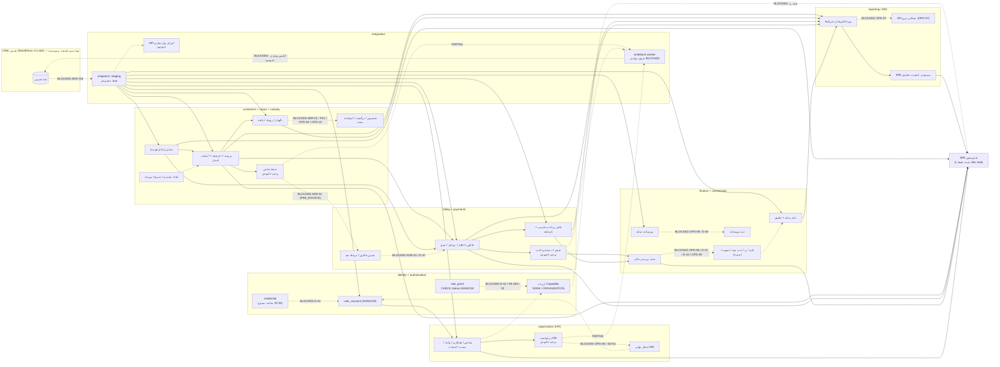

# RM-P08 — ممیزی یکپارچگی عملکردی و آمادگی عملیاتی CRM

| مورد | مقدار |
|---|---|
| نسخهٔ ممیزی‌شده | `main` @ `0b0220aee6fc273f753fd16361c6e9b22a79c060` (ادغام PR #95؛ PR #89 تا #95 ادغام‌شده) |
| تاریخ | 2026-11-23 |
| حالت | **فقط خواندنی.** هیچ کد برنامه، API، طرح دیتابیس، مهاجرت، نقش، Grant، Capability، پرچم، قرارداد یا وضعیت تصمیمی تغییر نکرد. هیچ Merge یا Deploy انجام نشد. تنها تغییر مخزن همین فایل است. |
| ممیزی قبلی مبنا | R7 (`docs/audit/r7-consolidated-audit.md` @ `e2c4b76`) و Slice 15 (`docs/cutover/*`). یافته‌های آن‌ها فقط پس از بازبینی روی کد فعلی تکرار شده‌اند. |
| وضعیت تولید | **GROUP B CLOSED — PRODUCTION NO-GO** |

## راهنمای برچسب شواهد

هر یافته یکی از این برچسب‌ها را دارد:

| برچسب | معنی |
|---|---|
| **[کد]** | از کد Go/TypeScript روی همین SHA خوانده شد. |
| **[OAS]** | از `api/openapi/openapi.yaml` خوانده شد. |
| **[DB]** | از مهاجرت‌های SQL (قیود CHECK، جدول‌ها، مجوزها) خوانده شد. |
| **[واحد]** | تست واحد Go یا Vitest که در این ممیزی اجرا و سبز شد. |
| **[PG]** | تست یکپارچگی روی PostgreSQL موقت با دادهٔ مصنوعی که در این ممیزی اجرا و سبز شد. |
| **[مرورگر]** | تست واقعی مرورگر (Chromium ← SPA ← API ← PostgreSQL) با دادهٔ مصنوعی. |
| **[سازمانی]** | سند تأیید سازمانی (رکورد تصویب). **در این مخزن هیچ رکورد تصویبی وجود ندارد.** |
| **[طراحی]** | فقط مستند طراحی یا قرارداد پیشنهادی؛ اثبات اجرا نیست. |

سه سطح بلوغ جدا از هم سنجیده شده‌اند:
- **پیاده‌سازی‌شده:** کد و مسیر وجود دارد.
- **تست‌شده:** با دادهٔ مصنوعی و هویت آزمایشی (dev stub) سبز است.
- **تأییدشده برای استفادهٔ واقعی:** با حساب واقعی، Grant فعال و دادهٔ واقعی پذیرفته شده است. **هیچ قابلیتی به این سطح نرسیده است.**

---

## ۱. خلاصهٔ مدیریتی

1. **CRM امروز یک «سایهٔ خواندنی» از CRM قدیمی است، نه سامانهٔ عملیاتی.** تقریباً همهٔ حوزه‌ها (HR، مشتری، پرونده، نگهداری، فاکتور، پرداخت، دفتر سایهٔ مالی، پورسانت، بیاوین، گزارش و MIS) داده را از بستهٔ واردسازی مصنوعی می‌خوانند و نمایش می‌دهند. RM-P01 تا RM-P07 این نمایش را به میزهای کار نقش‌محور (مشتری/پرونده/فاکتور ۳۶۰، خط زمانی، HR، MIS، مالی) تبدیل کرده‌اند، اما **هیچ عملیات تجاری جدیدی اضافه نکرده‌اند**. [کد] [OAS]
2. **هیچ کاربر واقعی نمی‌تواند هیچ داده‌ای ببیند یا هیچ کاری انجام دهد.** سه قفل مستقل وجود دارد:
   - قید دیتابیس `role_grant_shadow_only CHECK (status = 'SHADOW')` اجازهٔ هیچ Grant فعالی نمی‌دهد (`internal/identity/migrations/sql/00001_identity.sql:195`). [DB]
   - از ۹ نقش هدف فقط نقش HR شش Capability خواندنی دارد؛ هشت نقش دیگر تهی‌اند (`internal/identity/api/api.go` تابع `Roles`، متغیر `roles`). [کد]
   - هیچ اعتبارنامهٔ ورودی ساخته نمی‌شود: جدول `identity.credential` برای نقش برنامه فقط SELECT دارد و قاعدهٔ lint `r1-credential-write` هر نوشتنی را رد می‌کند (`00012_identity_authentication.sql:4-15`، `internal/architecture/lint.go:845`). [DB] [کد]
   تمام نمایش مثبت داده فقط با `authorization.DevSubjects` (`internal/authorization/guard.go:27-80`) ثابت شده که در تولید ممنوع است.
3. **ورود دادهٔ واقعی ممنوع است.** مرحلهٔ staging هر بستهٔ غیرمصنوعی را رد می‌کند (`internal/integration/legacy/staging/staging.go:119`، `BlockedNonSyntheticMessage`؛ ADR #18، D-23). هیچ استخراج‌گر MySQL/WordPress وجود ندارد. [کد]
4. **چهار خانوادهٔ فرمان کنترل‌شده** (ثبت نتیجهٔ تماس، مراحل درخواست HR، ارسال فیش و دستهٔ پرداخت، کار اجرایی خدمت) پیاده‌سازی و تست شده‌اند، اما همه پشت پرچم خاموش‌اند و **بازنویسی به CRM قدیمی در تولید همیشه BLOCKED است** (`cmd/crm-worker/compose.go:248-262`). بنابراین فعال‌کردن آن‌ها CRM جدید را از منبع حقیقت جدا می‌کند. [کد]
5. **هستهٔ درآمدی وجود ندارد:** ایجاد مشتری/سرنخ/پرونده، تخصیص و برگشت پرونده، صدور پیش‌فاکتور و فاکتور، تأیید/رد مالی، ثبت سند، تسویه، استرداد و پرداخت پورسانت هیچ مسیر API ندارند. ارزیاب‌های مربوط (`cases/claimgate`، `billing/issuance`، `custody/release`، `finance/posting`، `finance/refund`) طبق قاعدهٔ lint `r4-evaluator-wiring` فقط از تست‌ها قابل‌فراخوانی‌اند (`internal/architecture/lint.go:343`). [کد]
6. **حاکمیت:** از ۶۱ تصمیم ردیابی‌شده **صفر** تأیید شده است (۲۶ READY_FOR_REVIEW، ۳۰ EVIDENCE_MISSING، ۵ DRAFT؛ `docs/governance/r6-decision-tracker.json`). پوشهٔ `docs/governance/approvals/` وجود ندارد. دروازهٔ Group B بسته است (`docs/governance/rm-e04c-group-b-gate.json`: هر دو شناسهٔ M2 خالی). [سازمانی: ناموجود]
7. **نتیجهٔ تست‌ها در این ممیزی:** همهٔ تست‌های قابل اجرا سبز شدند (جزئیات در §۷). سبز بودن تست یعنی منطق هدف روی دادهٔ مصنوعی درست است؛ **پذیرش عملیاتی نیست**.

**حکم:** هیچ جریان End-to-End از شش جریان A تا F در CRM جدید قابل اجرای عملیاتی نیست. جریان‌های A، C و F در حد خواندن و بررسی کامل‌ترند؛ جریان‌های B، D و E در نقطهٔ «نوشتن اولیه» متوقف می‌شوند.

---

## ۲. نقشهٔ معماری فعلی

### ۲.۱ ماژول‌ها (هر ماژول مالک schema خود است)

| ماژول | مسیر کد | نقش در جریان | نوشتن تولیدی |
|---|---|---|---|
| identity | `internal/identity` | کاربر، اعتبارنامه، نشست، Grant (سایه) | نشست ورود/خروج؛ ساخت اعتبارنامه ممنوع |
| organization | `internal/organization` | شخص، همکاری، واحد، سمت، سطح، انتساب گزارش‌دهی، درخواست HR | فقط مراحل درخواست HR (پرچم) |
| authorization | `internal/authorization` | ارزیابی Capability، دسترسی مؤثر | ندارد |
| customers | `internal/customers` | مشتری سایه، نقاط تماس پوشیده، پروندهٔ ادغام | ندارد (فقط واردسازی) |
| cases | `internal/cases` | پروندهٔ فروش، تاریخچه، انتساب اعتبار | فقط نتیجهٔ تماس (پرچم) |
| custody | `internal/custody` | نگهدار فعلی، رویدادهای نگهداری، یافته‌ها | ندارد |
| billing | `internal/billing` | فاکتور، اقلام، مراحل، جمع‌ها | ندارد |
| payments | `internal/payments` | تلاش پرداخت قدیمی، فیش، دستهٔ پرداخت هدف | بارگذاری و دستهٔ پرداخت (پرچم) |
| finance | `internal/finance` | صف بررسی، دفتر سایه، ارزیاب‌ها | ندارد |
| commission | `internal/commission` | محاسبهٔ سایه، تطبیق | ندارد |
| reporting | `internal/reporting` | پروجکشن‌ها، متریک‌ها، MIS | فقط اجرای پروجکشن (`cmd/crm-reporting`) |
| biawin / fulfillment / catalog | `internal/biawin`، `internal/fulfillment`، `internal/catalog` | اشتراک، فعال‌سازی سایه، کار اجرایی | کار اجرایی (پرچم) |
| integration | `internal/integration` | واردسازی قدیمی، بازنویسی، درگاه، عملیات ارائه‌دهنده | صف بازنویسی؛ تحویل در تولید BLOCKED |
| platform | `internal/platform` | سرور API، پرچم، outbox/inbox، idempotency، object store | — |

### ۲.۲ سطح API

`api/openapi/openapi.yaml`: **۱۰۳ مسیر، ۱۰۵ عملیات = ۹۲ GET + ۱۳ POST، صفر PUT/PATCH/DELETE.** [OAS]

تمام ۱۳ POST:

| POST | خانواده |
|---|---|
| `/auth/login`، `/auth/logout`، `/auth/logout-all` | نشست (R1) |
| `/cases/{case_id}/contact-outcomes` | نتیجهٔ تماس |
| `/hr/requests`، `/hr/requests/{request_id}/decisions` | درخواست HR |
| `/payments/uploads`، `/payments/invoices/{invoice_id}/batches` | ارسال پرداخت |
| `/fulfillment/work-cases/{case_id}/assignment`، `/operational-actions`، `/evidence-records`، `/outcome` | کار اجرایی |
| `/integration/provider-operations/{operation_id}/resolution` | تطبیق عملیات ارائه‌دهنده |

هیچ POST برای مشتری، پرونده، تخصیص، فاکتور، تصمیم مالی، سند، استرداد یا پورسانت وجود ندارد.

### ۲.۳ رابط کاربری

`web/src/app/routes.tsx` حدود ۶۰ مسیر دارد، از جمله میزهای کار RM-P: `/customers/:id`، `/sales/cases/:id`، `/billing/invoices/:id`، `/hr/*` (۹ بخش)، `/mis/*` (۷ بخش)، `/finance/*` (۸ بخش). پنل فروشنده فقط پیش‌نمایش آزمایشی `/dev/seller` با fixture مصنوعی است (`docs/implementation/rm-e04k-seller-read-boundary.md`). [کد]

---

## ۳. بررسی شش جریان End-to-End

### جریان A — منابع انسانی تا دسترسی کاربر

| گام | وضعیت | شاهد |
|---|---|---|
| ثبت شخص و همکاری | **READ_ONLY** (فقط واردسازی از قدیمی؛ ایجاد شخص/همکاری ناموجود) | `GET /organization/persons`، `/persons/{id}` [OAS]؛ `cmd/crm-legacy-import import-organization` [کد]؛ `rm_p04_hr_workspace_test.go` [PG] |
| انتساب به واحد، سمت، سطح | READ_ONLY | `/organization/org-units`، `/positions`، `/levels`، `/assignments` [OAS]؛ `/hr/structure`، `/hr/positions`، `/hr/assignments` [کد] |
| تعیین مدیر (خط گزارش‌دهی) | READ_ONLY؛ یافته‌های سلسله‌مراتب نمایش داده می‌شوند | `/organization/hierarchy-findings`؛ `/hr/exceptions` |
| اتصال حساب کاربری به شخص | READ_ONLY؛ حساب مشترک به‌صورت تعارض `SHARED_USER` نمایش داده می‌شود، هرگز ادغام نمی‌شود | `GET /organization/persons?user_id=` (RM-P04) [OAS] [PG] |
| نقش | **PARTIAL**: نقش‌ها فقط از پروفایل قدیمی نگاشت می‌شوند و همیشه `SHADOW` هستند | `role_grant_basis CHECK (basis = 'LEGACY_PROFILE_ROLE')`، `role_grant_shadow_only` [DB] |
| Grant و Capability | **BLOCKED_DECISION**: Grant فعال از نظر دیتابیس غیرممکن است؛ ۸ نقش از ۹ نقش هیچ Capability ندارند | `00001_identity.sql:194-195` [DB]؛ `internal/identity/api/api.go` (`roles`) [کد]؛ D-42، R5-SEC-01 |
| ورود کاربر | **PARTIAL**: مسیر ورود، نشست سمت سرور و CSRF پیاده‌سازی شده‌اند؛ هیچ اعتبارنامه‌ای قابل ساخت نیست | `/auth/login` [OAS]؛ `internal/identity/session/session.go:192` [کد]؛ `00012_identity_authentication.sql:4-15` [DB]؛ D-34 |
| مشاهدهٔ اطلاعات مجاز | **BLOCKED_DECISION**: کاربر احرازشده «هویت دارد، اختیار ندارد»؛ همهٔ خواندن‌ها رد می‌شوند | `internal/authorization/session.go:19-27`؛ مثبت فقط با dev stub |
| تغییر یا خاتمهٔ همکاری | **PARTIAL**: درخواست انتقال/خاتمه و تأیید مرحله‌ای پیاده‌سازی شده است؛ اعمال نهایی BLOCKED است | `POST /hr/requests`، `/decisions` [OAS]؛ `hrrequest.go:62` (`HR_APPLY_IMPLEMENTATION_BLOCKED`) [کد]؛ OPD-05، SD-04 |

**پیوندهای واقعی:** شخص ↔ همکاری ↔ حساب کاربری (از دادهٔ واردشده، با تعارض‌های صریح) [PG].
**پیوندهای صرفاً نمایشی:** نقش → Capability → دسترسی؛ در اجرا فقط از مسیر dev stub دیده می‌شوند.
**فقدان پیوند هویتی و تأییدیه:**
- خاتمهٔ همکاری هیچ اثری روی اعتبارنامه یا نشست ندارد. اعتبار نشست فقط وضعیت اعتبارنامه و حضور حساب را بررسی می‌کند (`session.go:290-292`)، نه `employment_status`. امروز چون اعتبارنامه‌ای وجود ندارد خطری ایجاد نمی‌کند، اما پیش از فعال‌سازی ورود باید حل شود (BN-10).
- تأمین حساب (provisioning) و سیاست رمز اولیه (D-34) تصمیم‌گیری نشده‌اند.
- «جایگاه سازمانی» عمداً هیچ اختیاری نمی‌دهد: `OrgContext` پذیرفته می‌شود ولی هرگز منبع اختیار نیست (`authorization.go:38-49`؛ `scope_test.go`). [کد] [واحد]

**طبقهٔ نهایی جریان A:** PARTIAL (خواندن کامل؛ اختیار و ورود BLOCKED_DECISION).

### جریان B — ورود پرونده تا تخصیص MIS

| گام | وضعیت | شاهد |
|---|---|---|
| منبع پرونده و واردسازی | **PARTIAL**: فقط بستهٔ مصنوعی؛ دادهٔ واقعی رد می‌شود | `staging.go:119` [کد]؛ `crm-legacy-import load` |
| تعیین شناسهٔ پرونده | IMPLEMENTED_TESTED: `case_id` بومی UUID؛ کلید قدیمی فقط provenance است | `GET /cases?source_key=`، `?case_id=` (RM-P05/P06) [PG] |
| شناسایی منبع | IMPLEMENTED_TESTED: سامانه، spec، کلید، دستهٔ اول/آخر | `CaseSummary.source`؛ `rm_p06_mis_evidence_test.go` [PG] |
| تشخیص حضور | IMPLEMENTED_TESTED: `PRESENT` / `ABSENT_IN_LATEST`؛ فقط واردسازی COMPLETE غیبت را ثبت می‌کند؛ حذف نمی‌کند | `rm_p05_mis_workspace_test.go` [PG] |
| نمایش موجودی MIS | READ_ONLY | `/mis/cases`، `/mis/exceptions` (۲۰ صف) [کد] [مرورگر] |
| نگهدار فعلی | READ_ONLY؛ هفت حالت parity (MATCH، HISTORY_GAP، …، NOT_RECOVERABLE) | `GET /custody/assignments`، `/custody/cases/{id}` [OAS] [PG] |
| تاریخچهٔ انتساب | READ_ONLY؛ رویدادهای append-only | همان |
| تخصیص به نیروی فروش | **NOT_IMPLEMENTED / BLOCKED_DECISION** | هیچ مسیری وجود ندارد [OAS]؛ OPD-10، SD-01 |
| برگشت یا آزادسازی | **BLOCKED_DECISION**: ارزیاب `custody/release` بدون مسیر است و تا باز بودن ADR-01، F01 و OPD-03 هرگز SUCCESS نمی‌دهد | `internal/custody/release` [کد]؛ lint `r4-evaluator-wiring` |
| صلاحیت استفادهٔ مجدد | **NOT_IMPLEMENTED**: هیچ حالت eligibility یا reservation در مدل نیست؛ `ABSENT_IN_LATEST` هرگز «آزاد» نمی‌شود | RM-P05 §Operations [طراحی]؛ تست Go و UI [PG] [واحد] |

**نقطهٔ توقف:** تخصیص. **علت:** تصمیم سازمانی تصویب‌نشده (OPD-10، ADR-01، F01، OPD-03) و فقدان پیاده‌سازی. هیچ عملیاتی در این ممیزی اجرا نشد.

### جریان C — MIS تا فروش

| گام | وضعیت | شاهد |
|---|---|---|
| ارتباط پرونده با فروشنده | READ_ONLY (نگهدار مشتق‌شده؛ نگهدار حل‌نشده = `holder_link=UNRESOLVED`) | `custody/assignments?holder_link=` [PG] |
| سرپرست و مدیر فروش | READ_ONLY از سلسله‌مراتب HR؛ برای دسترسی استفاده نمی‌شود | `authorization.go:38-49` |
| نگهداری پرونده | READ_ONLY | §B |
| فعالیت فروشنده | **NOT_IMPLEMENTED** برای فروشندهٔ واقعی؛ پنل فروشنده فقط پیش‌نمایش مصنوعی | `/dev/seller`؛ `rm-e04k-seller-read-boundary.md` |
| ثبت نتیجهٔ تماس | IMPLEMENTED_TESTED (NO_ANSWER، CALLBACK، NOT_PURCHASED؛ فقط سرنخ نگهداری‌شدهٔ خود)؛ DUPLICATE و PRE_INVOICE همیشه BLOCKED | `POST /cases/{id}/contact-outcomes`؛ `internal/cases/command/contact_outcome.go:162-168` [کد]؛ `TestBrowserFullStack` [مرورگر] |
| تغییر وضعیت پرونده | **NOT_IMPLEMENTED** (نتیجهٔ تماس اثری روی فاکتور، نگهداری یا مالی ندارد) | توضیح Capability `cases.contact_outcome.record` در `api.go` |
| انتساب تاریخی اعتبار فروش | IMPLEMENTED_TESTED (خواندنی): ORIGINAL_OWNER، ORIGINAL_SELLER و CREDIT_OWNER هنگام واردسازی منجمد می‌شوند و از سلسله‌مراتب امروز بازمحاسبه نمی‌شوند | `GET /cases/{id}/attribution` [OAS] [PG] |
| حفظ شواهد پس از جابه‌جایی نیرو | IMPLEMENTED_TESTED در خواندن (تاریخچهٔ append-only؛ سلسله‌مراتب فعلی انتساب تاریخی را بازنویسی نمی‌کند)؛ جابه‌جایی نیرو خودش اجرا نمی‌شود | INV-004 (`GATE-0-PRODUCT-INVARIANTS.md`)؛ RM-P03 |

**نتیجه:** جریان C فقط **تاریخچهٔ قدیمی** را نشان می‌دهد. تنها گام اجرایی (نتیجهٔ تماس) برای هیچ نقش واقعی قابل دسترسی نیست، چون نقش seller هیچ Capability ندارد و دروازهٔ Group B بسته است. حتی اگر باز شود، بازنویسی به CRM قدیمی BLOCKED است.

### جریان D — فروش تا مشتری و فاکتور

| گام | وضعیت | شاهد |
|---|---|---|
| شناسایی مشتری | READ_ONLY: حل هویت از شواهد قدیمی؛ تلفن هرگز به‌تنهایی RESOLVED نمی‌شود؛ تعارض‌ها به صف ادغام می‌روند | `/customers`، `/customer-identity/*` [OAS]؛ `customers_e2e_test.go` [PG] |
| ایجاد یا ویرایش مشتری | **NOT_IMPLEMENTED** | هیچ POST [OAS]؛ D-30، OPD-01 |
| ارتباط پرونده و مشتری | READ_ONLY با `customer_link_state` (RESOLVED/CONFLICT/UNKNOWN/NOT_RECOVERABLE) | `GET /cases?customer_id=`؛ RM-P01 `customer_case_invoice_e2e_test.go` [PG] |
| صدور یا ورود فاکتور | ورود: READ_ONLY. صدور: **BLOCKED_DECISION** (ADR-01) | `crm-legacy-import import-billing`؛ `billing/issuance` فقط در تست |
| اقلام فاکتور | READ_ONLY | `/invoices/{id}/items` |
| مراحل پرداخت | READ_ONLY؛ مرحلهٔ بعد BLOCKED (D-32) | `/invoices/{id}/stages` |
| مبلغ و واحد پول | IMPLEMENTED_TESTED: IRT و IRR جدا؛ هرگز تبدیل نمی‌شوند؛ کلاس جمع MATCH/MISMATCH/UNKNOWN/INCOMPLETE/CONFLICT | `/invoices/{id}/totals`؛ `internal/billing/http/http.go:299-355` |
| پیوند فاکتور به پرونده و فروشنده | READ_ONLY با حالت پیوند؛ تلفن هرگز مبنای پیوند نیست | RM-P01 |
| سوابق تغییرات | **PARTIAL**: فقط فیلدهای زمانی رکورد (`issued_at_raw`، `updated_at_raw`)؛ تاریخچهٔ تغییر اقلام/مراحل در منبع وجود ندارد | RM-P03 §Known gaps |

**قدیمی در برابر جدید:** همهٔ مشتری‌ها، فاکتورها، اقلام و مراحل فقط از CRM قدیمی وارد می‌شوند. هیچ عملیات جدیدی روی مشتری یا فاکتور پشتیبانی نمی‌شود.

### جریان E — فاکتور تا مالی

| گام | وضعیت | شاهد |
|---|---|---|
| ثبت پرداخت (دستهٔ دستی) | IMPLEMENTED_TESTED، پشت پرچم `payments.manual`؛ بدون Capability نقش واقعی | `POST /payments/invoices/{id}/batches`؛ `payments_writes_e2e_test.go` [PG]؛ `TestBrowserPaymentsFullStack` [مرورگر] |
| تلاش‌های پرداخت (قدیمی) | READ_ONLY + تاریخچهٔ append-only + پرچم regression | `/payments/attempts*`؛ RM-P03/P07 [PG] |
| بارگذاری و نگهداری فیش | IMPLEMENTED_TESTED: قرنطینه → READY / NOT_RECOVERABLE؛ ماندگاری تولیدی object store تأیید نشده (D-44) | `POST /payments/uploads`؛ `payments_upload_lifecycle_e2e_test.go` [PG] |
| آماده‌شدن شواهد | IMPLEMENTED_TESTED در سرویس | `evidence_state` (RM-P07) [PG] |
| صف بررسی مالی | READ_ONLY | `GET /finance/review/attempts` [OAS] [PG] [مرورگر] |
| کنترل تفکیک وظایف | IMPLEMENTED_TESTED در ارزیاب: ارسال‌کننده هرگز بررسی‌کننده نیست؛ بررسی‌کنندهٔ نامعلوم = سازنده (fail closed)؛ چند حساب یک انسان = همان فرد | `internal/finance/review/review.go:72`، `contract.go:136-152` [واحد] |
| تأیید یا رد مالی | **BLOCKED_DECISION** — هیچ مسیری وجود ندارد | OPD-08، D-41، D-43، OPD-09 |
| تسویه | **NOT_IMPLEMENTED** | — |
| استرداد و برگشت | **BLOCKED_DECISION**: ماشین حالت استرداد فقط در تست | `internal/finance/refund`؛ OPD-04 |
| ثبت حسابداری | **BLOCKED_DECISION**: قرارداد posting مستقل از سیاست، فقط در تست؛ دفتر سایه خواندنی | `internal/finance/posting`؛ `/finance/ledger` |
| وضعیت نهایی فاکتور | **UNKNOWN**: چرخهٔ عمر فاکتور در هدف تعریف نشده است (TAD #20 deferred؛ F02 NOT_EVALUATED) | `internal/reporting/domain/domain.go` (`invoices.open_preinvoices`) |

**نقطهٔ توقف:** تصمیم مالی، بلافاصله پس از صف بررسی.
**علت:** تصمیم سازمانی تصویب‌نشده (OPD-08، D-41، D-43، OPD-09، OPD-04، OPD-06).
**مانع مستقل:** نوع فرمان `payments.manual_payment` در فهرست تحویل بازنویسی worker نیست (`compose.go:37`). پس حتی با آداپتور آزمایشی، پرداخت ثبت‌شده در CRM جدید به CRM قدیمی نمی‌رسد.

### جریان F — گزارش‌گیری و نظارت

| گزارش | دانهٔ داده | دامنه | منبع | کامل‌بودن | شاهد |
|---|---|---|---|---|---|
| گزارش مشتری (حل هویت) | مشتری / پروندهٔ ادغام | کل سازمان | customers | فقط دادهٔ واردشده؛ نامعلوم = UNKNOWN | `/customer-identity/resolution-report` |
| گزارش فروش (پوشش، parity نگهداری) | پرونده / پروجکشن نگهداری / یافته | کل سازمان؛ فقط PRESENT | cases، custody | شمارنده‌ها افراز نیستند و جمع نمی‌شوند؛ «هویت نگهدار حل‌نشده» قرارداد ندارد | `/sales/coverage-report`، `/sales/custody-parity`؛ RM-P05 |
| گزارش MIS | پروجکشن | کل سازمان | reporting | اجرای پروجکشن ≠ اجرای واردسازی؛ API اجرای واردسازی ناموجود | `/mis/*`؛ RM-P06 |
| گزارش فاکتور | واحد فاکتور × کلاس | کل سازمان؛ PRESENT | billing | بدون جمع مبلغ؛ شمارش به تفکیک واحد و کلاس | `reports/invoices`؛ `domain.go` |
| گزارش پرداخت | تلاش پرداخت | کل سازمان | payments | جمع فقط برای مبالغ REPRESENTABLE و به تفکیک واحد؛ UNREPRESENTABLE و ABSENT جدا شمرده می‌شوند | `internal/reporting/query/service.go:140-165` |
| گزارش مالی (دفتر سایه) | سند / خط | کل سازمان | finance shadow | «نه منبع حقیقت»؛ تطبیق با دفتر قدیمی | `/finance/*`؛ `views.go:85,457` |
| گزارش عملکرد نیروها (نرخ تکمیل/تبدیل) | گروه پرونده | — | — | **NOT_FINAL** (OPD-07)؛ ارزیابی نمی‌شود | `domain.go` (`cases.completion_rate`، `cases.conversion_rate`) |
| پورسانت | محاسبه/اعتبار | کل سازمان؛ `commission/me` = خود | commission shadow | داده‌ی ناقص → BLOCKED، هرگز صفر | `/commission/*` |

**فیلتر سطح دسترسی:** ارزیاب فقط دو دامنه می‌شناسد: `NONE` و `ORGANIZATION` (`authorization.go:72-78`). هیچ گزارش «خود» یا «زیرمجموعه» وجود ندارد، به‌جز `commission/me/earnings`. بنابراین گزارش‌های سرپرست، ارشد و مدیر فروش امکان‌پذیر نیستند (BN-09). [کد]

**اتکاپذیری معنایی مبالغ:**
- **قابل اتکا (ساختاری):** جمع‌ها هرگز بین IRT و IRR انجام نمی‌شوند. سرریز (Overflow) صریح است. مبالغ غیرقابل‌نمایش جمع را INCOMPLETE می‌کنند.
- **محدودیت معنایی:** `payments.accepted_attempt_amount` جمع تلاش‌هایی است که در قدیمی «ACCEPTED» نگاشت شده‌اند و **وصول تأییدشدهٔ مالی نیست** (برچسب متریک همین را می‌گوید؛ D-25).
- **مشاهدهٔ جزئی (UNKNOWN، نه نقص اثبات‌شده):** شمارش بدهکار دفتر سایه از `coalesce(sum(...) FILTER (WHERE side='DEBIT'), 0)` استفاده می‌کند (`internal/finance/query/views.go:457`). اگر گروهی فقط خط بستانکار داشته باشد، «۰» بدهکار نشان داده می‌شود. چون گروه‌ها از روی خطوط موجود ساخته می‌شوند، این «۰» واقعاً «بدون بدهکار» است، نه «ناموجود». ولی برای انطباق با قاعدهٔ «نامعلوم ≠ صفر» در AGENTS.md باید در بازبینی بعدی تأیید شود. الگوی مشابه: `internal/commission/query/query.go:489`.
- وضعیت‌های تجمیعی فاکتور (پرداخت‌شده/باز) **قابل اتکا نیستند**، چون وضعیت فعلی متعارف فاکتور تعریف نشده است (F02).

---

## ۴. ماتریس جامع قابلیت‌ها

ستون «تأیید واقعی» برای همهٔ ردیف‌ها «ندارد» است، چون هیچ حساب واقعی، Grant فعال یا رکورد تصویبی وجود ندارد. ستون «E2E» یعنی تست مرورگر روی دادهٔ مصنوعی.

| قابلیت | ماژول مالک | Backend | API | Frontend | تست E2E | تأیید واقعی | وضعیت نهایی | مانع |
|---|---|---|---|---|---|---|---|---|
| ورود/خروج و نشست | identity | دارد | `/auth/*`، `/session` | دارد | `TestBrowserFullStack` (رد) | ندارد | PARTIAL | D-34؛ ساخت اعتبارنامه ممنوع |
| تأمین حساب و رمز اولیه | identity | ندارد | ندارد | ندارد | — | ندارد | BLOCKED_DECISION | D-34 |
| Grant فعال و Capability نقش | identity/authorization | ارزیاب دارد | `/authorization/effective-access` | `/hr/access` | dev stub | ندارد | BLOCKED_DECISION | D-42، R5-SEC-01، Group B؛ CHECK دیتابیس |
| دامنهٔ خود/زیرمجموعه برای خواندن | authorization | ندارد | ندارد | ندارد | — | ندارد | NOT_IMPLEMENTED | D-42، D-32؛ قرارداد `/me` تصویب‌نشده |
| فهرست و پروندهٔ نیرو | organization | دارد | `/organization/persons*` | `/hr`، `/hr/people/:id` | `TestBrowserHRReadOverlay` | ندارد | READ_ONLY | — |
| ساختار، سمت، سطح، انتساب | organization | دارد | `/organization/*` | `/hr/structure`، `/positions`، `/assignments` | همان | ندارد | READ_ONLY | — |
| ایجاد شخص/همکاری/جذب | organization | ندارد | ندارد | ندارد | — | ندارد | NOT_IMPLEMENTED | HR spec؛ بدون تصویب |
| درخواست انتقال/خاتمه و تأیید مرحله‌ای | organization | دارد | `/hr/requests*` (POST) | `/hr/requests*` | `TestBrowserHRFullStack` | ندارد | IMPLEMENTED_TESTED | پرچم خاموش؛ بازنویسی BLOCKED |
| اعمال نهایی HR | organization | BLOCKED | ندارد | نمایش «مسدود» | — | ندارد | BLOCKED_DECISION | OPD-05، SD-04 |
| حل هویت مشتری | customers | دارد | `/customers*`، `/customer-identity/*` | `/customers*` | `TestBrowserCustomer360ReadOverlay` | ندارد | READ_ONLY | — |
| ایجاد/ویرایش/ادغام مشتری | customers | ندارد | ندارد | ندارد | — | ندارد | BLOCKED_DECISION | D-30، OPD-01، D-29/D-31 |
| موجودی پرونده و منبع | cases | دارد | `/cases*` | `/mis/cases`، `/sales/cases*` | `TestBrowserMISWorkspaceReadOverlay`، `TestBrowserMISEvidenceReadOverlay` | ندارد | READ_ONLY | — |
| ایجاد سرنخ/پرونده | cases | ندارد | ندارد | ندارد | — | ندارد | NOT_IMPLEMENTED | بدون قرارداد |
| نگهدار فعلی و تاریخچهٔ نگهداری | custody | دارد | `/custody/*` | `/mis/custody*` | همان | ندارد | READ_ONLY | — |
| تخصیص پرونده | custody | ندارد | ندارد | ذکر «ناموجود» | — | ندارد | BLOCKED_DECISION | OPD-10، SD-01 |
| برگشت/آزادسازی/بازتخصیص/استفادهٔ مجدد | custody | فقط ارزیاب در تست | ندارد | ذکر «ناموجود» | — | ندارد | BLOCKED_DECISION | ADR-01، F01، OPD-03 |
| ثبت نتیجهٔ تماس | cases | دارد | POST contact-outcomes | پنل نوشتن | `TestBrowserFullStack` | ندارد | IMPLEMENTED_TESTED | Group B؛ پرچم؛ بازنویسی BLOCKED |
| پیش‌فاکتور از نتیجهٔ تماس | cases/billing | همیشه BLOCKED | (همان POST) | — | تست واحد BLOCKED | ندارد | BLOCKED_DECISION | ADR-01 |
| انتساب تاریخی اعتبار | cases | دارد | `/cases/{id}/attribution` | Case 360 | `TestBrowserActivityTimelineReadOverlay` | ندارد | READ_ONLY | — |
| خط زمانی یکپارچه | (UI) | خواندن‌های موجود | — | دارد | همان | ندارد | READ_ONLY | ساعت قدیمی بدون منطقهٔ زمانی |
| فاکتور، اقلام، مراحل، جمع‌ها | billing | دارد | `/invoices*` | `/billing/invoices*` | `TestBrowserInvoiceWorkspaceReadOverlay` | ندارد | READ_ONLY | — |
| صدور فاکتور | billing | فقط ارزیاب در تست | ندارد | ندارد | — | ندارد | BLOCKED_DECISION | ADR-01، F01 |
| مرحلهٔ بعد پرداخت | billing | ندارد | ندارد | ندارد | — | ندارد | BLOCKED_DECISION | D-32 |
| تلاش پرداخت قدیمی و تاریخچه | payments | دارد | `/payments/attempts*` | `/billing/attempts` | `TestBrowserFinanceWorkspaceReadOverlay` | ندارد | READ_ONLY | — |
| بارگذاری فیش | payments | دارد | POST uploads | دارد | `TestBrowserPaymentsFullStack` | ندارد | IMPLEMENTED_TESTED | پرچم؛ D-44 |
| ارسال دستهٔ پرداخت | payments | دارد | POST batches | دارد | همان | ندارد | IMPLEMENTED_TESTED | پرچم؛ OPD-10؛ نوع فرمان خارج از تحویل بازنویسی |
| نهایی‌سازی فیش (worker) | payments | سرویس دارد | — | `/payments/evidence` | تست PG | ندارد | PARTIAL | استقرار worker و ذخیره‌ساز تولیدی |
| صف بررسی مالی | finance | دارد | `/finance/review/*` | `/finance/review*` | همان | ندارد | READ_ONLY | — |
| تأیید/رد مالی | finance | ارزیاب (همیشه BLOCKED) | ندارد | ذکر «ناموجود» | — | ندارد | BLOCKED_DECISION | OPD-08، D-41، D-43، OPD-09 |
| ثبت سند و تسویه | finance | فقط قرارداد در تست | ندارد | ندارد | — | ندارد | BLOCKED_DECISION | D-41، OPD-09 |
| استرداد/برگشت | finance | فقط ماشین حالت در تست | ندارد | ندارد | — | ندارد | BLOCKED_DECISION | OPD-04، INV-015 |
| دفتر سایه و تطبیق | finance | دارد | `/finance/shadow-runs`، `/ledger`، `/balances`، `/reconciliation` | `/finance/*` | `TestBrowserReportingBiawinFullStack` (بخشی) | ندارد | READ_ONLY | منبع حقیقت نیست |
| پورسانت سایه و `me` | commission | دارد | `/commission/*` | `/commission*` | — (تست PG) | ندارد | READ_ONLY | OPD-09، D-36 |
| ثبت/پرداخت پورسانت | commission | ندارد | ندارد | ندارد | — | ندارد | BLOCKED_DECISION | OPD-08، OPD-09 |
| گزارش‌ها و متریک‌ها | reporting | دارد | `/reports/*`، `/reporting/metrics*` | `/reports/:report` | `TestBrowserReportingBiawinFullStack` | ندارد | READ_ONLY | — |
| KPI عملکرد (تکمیل/تبدیل) | reporting | قرارداد BLOCKED | (متریک NOT_FINAL) | — | — | ندارد | BLOCKED_DECISION | OPD-07 |
| MIS (نمای کلی، کیفیت، تطبیق) | reporting | دارد | `/mis/*` | `/mis*` | `TestBrowserReportingBiawinReadOverlay` | ندارد | READ_ONLY | — |
| API اجرای واردسازی/دسته | integration | جدول staging دارد | ندارد | «در دسترس نیست» | — | ندارد | NOT_IMPLEMENTED | قرارداد خواندن تصویب‌نشده |
| کار اجرایی خدمت | fulfillment | دارد | 4 POST + GET | `/operations/work*` | `TestBrowserFulfillmentFullStack` | ندارد | IMPLEMENTED_TESTED | پرچم؛ کاتالوگ خالی |
| فعال‌سازی بیاوین | biawin | SHADOW | `/biawin/activation-decisions` | `/operations/activations` | تست PG | ندارد | BLOCKED_DECISION | D-35a–e (CHECK دیتابیس) |
| بازنویسی به CRM قدیمی | integration | worker دارد | `/writeback/*` (خواندنی) | `/writeback` | تست PG | ندارد | BLOCKED_DECISION | آداپتور تولیدی ناموجود؛ قرارداد سازگاری تصویب‌نشده |
| واردسازی دادهٔ واقعی | integration | فقط مصنوعی | — | — | — | ندارد | BLOCKED_DECISION | ADR #18، D-23 |
| شکایت/پس از فروش/تیکت | — | ندارد | ندارد | ندارد | — | ندارد | NOT_IMPLEMENTED | قرارداد محصول ناموجود |
| پنل فروشنده (واقعی) | cases/... | ندارد | `/me` تصویب‌نشده | فقط `/dev/seller` مصنوعی | `seller-preview.spec.ts` (مصنوعی) | ندارد | BLOCKED_DECISION | Group B (M2 record 1 و 2) |

**شمارش (۴۴ ردیف):** OPERATIONAL_VERIFIED = **۰**؛ IMPLEMENTED_TESTED = ۵؛ READ_ONLY = ۱۴؛ PARTIAL = ۲؛ BLOCKED_DECISION = ۱۸؛ NOT_IMPLEMENTED = ۵؛ UNKNOWN = ۰ (موارد UNKNOWN در جدول‌های جریان آمده‌اند: وضعیت نهایی فاکتور).

---

## ۵. ماتریس نقش‌ها و دسترسی‌ها

منبع: `internal/identity/api/api.go` (`roles`)، `internal/authorization/*`، قیود `identity.role_grant`.

| نقش | Capability از سرور (تولید) | صفحات در دسترس (تولید) | عملیات | تفکیک خود/زیرمجموعه/سازمان | اثر جایگاه سازمانی | خطر دید خارج از محدوده | Maker/Checker |
|---|---|---|---|---|---|---|---|
| seller | **هیچ** | هیچ (همه رد) | هیچ | نتیجهٔ تماس: فقط سرنخ نگهداری‌شدهٔ خود؛ دستهٔ پرداخت: فقط دسته‌های خود؛ خواندن پرونده: فقط ORGANIZATION | هیچ | UNKNOWN (دامنهٔ `/me` ساخته نشده؛ خواندن موجود سازمانی است) | ارسال‌کننده هرگز بررسی‌کننده نیست |
| supervisor | هیچ | هیچ | هیچ | زیرمجموعه پیاده‌سازی نشده | هیچ | UNKNOWN | — |
| senior_supervisor | هیچ | هیچ | هیچ | همان | هیچ | UNKNOWN | — |
| sales_manager | هیچ | هیچ | هیچ | همان | هیچ | UNKNOWN | — |
| sales_deputy | هیچ | هیچ | هیچ | همان | هیچ | UNKNOWN | — |
| mis | هیچ | هیچ | هیچ | فقط ORGANIZATION | هیچ | — | — |
| hr | ۶ خواندنی: `identity.user.read`، `org.person.read`، `org.employment.read`، `org.position.read`، `org.unit.read`، `org.assignment.read` | در نظریه `/hr/*`؛ **در عمل هیچ، چون Grant فعال غیرممکن است** | هیچ (ایجاد/بررسی درخواست HR در بستهٔ نقش نیست) | ORGANIZATION | هیچ | — | گام‌های درخواست: زنجیرهٔ بررسی بدون درخواست‌دهنده (DEF-HR-01) |
| finance | هیچ | هیچ | هیچ | ORGANIZATION | هیچ | — | ارزیاب: سازنده ≠ بررسی‌کننده، نامعلوم = سازنده |
| invoice_reviewer | هیچ | هیچ | هیچ | — | هیچ | — | — |
| ناشناس / احرازشده بدون Grant | هیچ | فقط صفحهٔ ورود | ورود/خروج | NONE | — | تست منفی: UNAUTHORIZED (VERIFIED) | — |
| dev stub `dev-user-001` (فقط dev/test) | ۳۷ Capability مستقیم + ۶ از نقش HR = همهٔ ۴۳ Capability (مصنوعی) | همه | همهٔ ۱۳ POST | ORGANIZATION | — | در تولید رد می‌شود (`authstub.ErrProductionLockout`) | — |

پاسخ به پرسش‌های بند ۴:

- **صفحات واقعی هر نقش:** در تولید، هیچ نقشی هیچ صفحهٔ داده‌ای ندارد. [DB] [کد]
- **Capability از سرور:** `GET /authorization/effective-access` همان ارزیابی سرور را برمی‌گرداند و برای هر کاربر واقعی همه را رد می‌کند. [کد] [مرورگر: آزمون‌های رد]
- **تفکیک خود، زیرمجموعه و سازمان:** فقط در سه فرمان سطر-محور وجود دارد: نتیجهٔ تماس (سرنخ خود)، دستهٔ پرداخت (ارسال‌کنندهٔ خود؛ `batch.go:242`) و کار اجرایی (سرپرست/مجری خدمت). همهٔ خواندن‌ها سازمانی‌اند. **دامنهٔ زیرمجموعه هیچ‌جا پیاده‌سازی نشده است.** [کد]
- **اعطای دسترسی از جایگاه سازمانی:** خیر. `OrgContext` عمداً منبع اختیار نیست (D-32، D-42). [کد] [واحد: `scope_test.go`]
- **دید خارج از محدوده:** امروز به‌دلیل رد کامل ممکن نیست. با باز شدن Grant و بدون دامنهٔ سطری، هر Capability خواندنی به **کل سازمان** دسترسی می‌دهد. این خطر بالقوهٔ اصلی پیش از فعال‌سازی است (BN-09).
- **Maker/Checker:** در ارزیاب مالی و زنجیرهٔ درخواست HR پیاده‌سازی و تست شده است. چون تصمیم مالی مسیری ندارد، در اجرا آزموده نمی‌شود. [واحد]
- هیچ Role، Grant یا Capability جدیدی در این ممیزی تعریف نشد.

---

## ۶. گلوگاه‌های واقعی

شدت: **بحرانی** = مانع هرگونه استفادهٔ عملیاتی؛ **بالا** = مانع یک فرآیند اصلی؛ **متوسط** = مانع کامل‌بودن یا اتکاپذیری.

| شناسه | شرح | ماژول‌ها | دستهٔ علت | علت ریشه‌ای (اثبات‌شده) | شدت | وابستگی | پیشنهاد اصلاح | آزمون پذیرش |
|---|---|---|---|---|---|---|---|---|
| BN-01 | هیچ Grant فعالی ممکن نیست؛ ۸ نقش از ۹ نقش بدون Capability | identity، authorization، همه | تصمیم سازمانی تصویب‌نشده + محدودیت امنیتی | `role_grant_shadow_only` [DB]؛ `roles` [کد]؛ D-42، R5-SEC-01 تأییدنشده | بحرانی | BN-02 | تصویب D-42 و R5-SEC-01 و ثبت دو رکورد M2 → مهاجرت و فرمان Grant ممیزی‌شده | کاربر واقعی با Grant تصویب‌شده فقط Capabilityهای تصویب‌شده را می‌گیرد؛ تست منفی برای بقیه |
| BN-02 | ساخت اعتبارنامه و تأمین حساب ممنوع است | identity | تصمیم سازمانی + فقدان پیاده‌سازی | `00012_identity_authentication.sql:4-15`؛ lint `r1-credential-write`؛ D-34 | بحرانی | — | تصویب D-34 → فرمان enrolment ممیزی‌شده با تفکیک وظایف | ثبت‌نام، ورود، بازنشانی و غیرفعال‌سازی با حساب واقعی روی staging |
| BN-03 | دادهٔ واقعی قابل واردسازی نیست؛ استخراج‌گری وجود ندارد | integration، همه | تصمیم سازمانی + فقدان پیاده‌سازی | `staging.go:119`؛ ADR #18، D-23؛ `spec/scope.go` | بحرانی | — | تصویب سیاست staging/ناشناس‌سازی → محیط امن → استخراج‌گر با allowlist | تطبیق snapshot واقعی با صفر اختلاف توضیح‌داده‌نشده (INV-036) |
| BN-04 | بازنویسی به CRM قدیمی در تولید همیشه BLOCKED است؛ پرداخت حتی در فهرست تحویل نیست | integration، payments، cases، organization | فقدان پیاده‌سازی + قرارداد معماری | `cmd/crm-worker/compose.go:37,248-262`؛ `compat.New` بدون تصویب شکست می‌خورد | بحرانی | BN-03 | تصویب قرارداد سازگاری → آداپتور تولیدی → تمرین روی کپی staging قدیمی؛ یا تصمیم «نویسندهٔ واحد» (P1-8) | Apply/Observe با parity، UNKNOWN → reconcile، بدون Apply کور |
| BN-05 | ایجاد مشتری، سرنخ و پرونده وجود ندارد | customers، cases | فقدان قرارداد معماری + تصمیم | هیچ POST [OAS]؛ D-30، OPD-01 | بالا | BN-01، BN-04 | قرارداد محصول ایجاد پرونده/سرنخ و قاعدهٔ هویت مشتری | ایجاد، رد تکراری با شواهد، عدم استفاده از تلفن به‌عنوان هویت |
| BN-06 | تخصیص، انتقال، برگشت، آزادسازی و استفادهٔ مجدد پیاده‌سازی نشده‌اند | custody، cases، billing | تصمیم سازمانی تصویب‌نشده | ADR-01 (READY_FOR_REVIEW)، F01 (EVIDENCE_MISSING)، OPD-03، OPD-10؛ `custody/release` فقط در تست | بحرانی (برای فروش) | BN-01 | تصویب ADR-01 و F01 → فرمان‌ها با هارنس رقابت ۱۵ سناریویی موجود | تست رقابت INV-009 (برگشت در برابر صدور فاکتور) روی PG؛ تاریخچه بازنویسی نمی‌شود |
| BN-07 | صدور پیش‌فاکتور و فاکتور BLOCKED | billing، cases | تصمیم سازمانی | `contact_outcome.go:166-167`؛ `billing/issuance` فقط در تست | بحرانی (برای درآمد) | BN-06 | همراه با ADR-01 | صدور idempotent، ادعای پرونده، تست رقابت |
| BN-08 | تأیید/رد مالی، ثبت سند، تسویه و استرداد وجود ندارند | finance، payments، billing | تصمیم سازمانی | OPD-08، D-43 (READY)، D-41، OPD-09، OPD-06 (EVIDENCE_MISSING)، OPD-04 | بحرانی (برای مالی) | BN-01، BN-04 | تکمیل بسته‌های P-FIN → فرمان تصمیم با Maker/Checker موجود | Maker ≠ Checker روی PG؛ عدم اثر مضاعف posting؛ Outcome Unknown قبل از retry |
| BN-09 | دامنهٔ سطری خود/زیرمجموعه برای خواندن وجود ندارد | authorization، همه | فقدان پیاده‌سازی + تصمیم | `authorization.go:72-78` (فقط NONE/ORGANIZATION)؛ قرارداد `/me` تصویب‌نشده؛ D-32 | بالا (امنیتی) | BN-01 | قرارداد دامنهٔ سطری (خود، زیرمجموعه براساس انتساب HR جاری با قاعدهٔ تصویب‌شده) | تست منفی: سرپرست پروندهٔ خارج از زیرمجموعه را نمی‌بیند؛ عدم نشت شمارش |
| BN-10 | اعمال نهایی HR وجود ندارد؛ خاتمهٔ همکاری اثری روی حساب/نشست ندارد | organization، identity، custody | تصمیم سازمانی + فقدان پیاده‌سازی | `hrrequest.go:62`؛ `session.go:290-292`؛ OPD-05، SD-04 | بالا | BN-02، BN-06 | تصویب OPD-05/SD-04 → اعمال نهایی، تحویل کار باز، ابطال نشست | خاتمه → نشست باطل؛ کار باز بدون مالک نمی‌ماند (INV-030) |
| BN-11 | KPIهای عملکرد نیرو تعریف نشده‌اند؛ گزارش‌ها فقط سازمانی‌اند | reporting | تصمیم سازمانی + فقدان پیاده‌سازی | `domain.go` (NOT_FINAL، OPD-07)؛ F02 NOT_EVALUATED | متوسط | BN-09 | تصویب OPD-07 و چرخهٔ عمر فاکتور | KPI با فرمول تصویب‌شده؛ داده‌ی ناقص → PARTIAL |
| BN-12 | API خواندن اجرای واردسازی و دسته وجود ندارد | integration، reporting | فقدان API | RM-P06 §Source evidence | متوسط | BN-03 | قرارداد خواندنی `integration.import_batch` | MIS وضعیت و کامل‌بودن دسته را از منبع نشان دهد |
| BN-13 | حل پروندهٔ منطقی و Next Actor وجود ندارند | cases، custody | تصمیم + قرارداد | MIS-G02، OPD-01 (EVIDENCE_MISSING) | متوسط | BN-03 | قرارداد resolver با حالت UNKNOWN/CONFLICT | چند ردیف منبع → یک پروندهٔ منطقی، بدون پیوند تلفنی |
| BN-14 | شکایت، پس از فروش و تیکت بین‌واحدی قرارداد محصول ندارند | — | فقدان قرارداد معماری | R7 §0؛ journey 12 Slice 15 | بالا (برای پس از فروش) | — | تدوین spec محصول | — |
| BN-15 | طراحی نقش‌های HR، MIS و مالی منجمد نیست | UI | تصمیم سازمانی | `prototype/hr/HR-DESIGN-SPEC.md:8`، `prototype/mis/MIS-DESIGN-SPEC.md:7`، `prototype/finance/FINANCE-DESIGN-SPEC.md:8` = «READY FOR REVIEW» | متوسط | — | بازبینی و انجماد طراحی | — |
| BN-16 | زیرساخت عملیاتی (استقرار، پشتیبان، مانیتورینگ، DR) فقط پیش‌نویس است | platform | فقدان تأیید واقعی | `docs/remediation/r3-*-DRAFT.md`؛ CI فقط تمرین staging | بالا | — | امضای چک‌لیست زیرساخت و تمرین بازیابی | بازیابی زمان‌دار با RPO/RTO تصویب‌شده |
| BN-17 | حاکمیت: ۶۱ تصمیم، صفر تأیید؛ پوشهٔ تأیید ناموجود | همه | تصمیم سازمانی | `r6-decision-tracker.json`؛ `docs/governance/approvals/` ناموجود | بحرانی | — | جلسات M1–M4 و ثبت رکورد تأیید | رکورد APPROVED_VERIFIED برای هر تصمیم P0 |
| BN-18 | تفاوت معنایی با CRM قدیمی: «ACCEPTED» قدیمی ≠ وصول تأییدشده؛ منطقهٔ زمانی ساعت قدیمی نامعلوم | payments، reporting، timeline | اختلاف معنایی با CRM قدیمی | `domain.go` (D-25)؛ RM-P03 §Clocks | متوسط | BN-08 | تصمیم D-25 و ثبت منطقهٔ زمانی منبع | — |

---

## ۷. نتیجهٔ تست‌های اجراشده

همهٔ تست‌ها روی **PostgreSQL 16.15 موقت محلی** (پورت ۵۵۴۳۲، خوشهٔ تازه، فقط دادهٔ مصنوعی) اجرا شدند و پس از ممیزی متوقف شد. CI از PostgreSQL 18 استفاده می‌کند. هیچ تستی به Production یا Staging وصل نشد.

| دسته | فرمان | نتیجه |
|---|---|---|
| Go: واحد + یکپارچگی PostgreSQL + lint معماری + قرارداد OpenAPI + حاکمیت | `CRM_TEST_REQUIRE_POSTGRES=1 go test -count=1 ./...` | **PASS**: ۱۰۰ بسته ok، ۰ FAIL؛ ۷۱۸ تابع تست سطح بالا PASS و ۱۰۳۴ زیرتست PASS؛ ۱۰ SKIP در اجرای اول (پایین ببینید) |
| تست‌های منفی مجوز | ضمن همان اجرا (`internal/authorization`، `internal/platform/apiserver`، `rm_p0*_test.go`، `cmd/crm-api`) | **PASS** |
| تست‌های حاکمیتی | `docs/governance/*_test.go` (Group B gate، شواهد RM-P07، provenance) | **PASS** |
| lint معماری | `internal/architecture` (شامل `r4-evaluator-wiring`، `r1-credential-write`) | **PASS** |
| Web typecheck | `tsc --noEmit` | **PASS** |
| Web ESLint | `eslint .` | **PASS** |
| Web unit (Vitest) | `vitest run` | **PASS**: ۳۰ فایل، ۴۰۴ تست |
| E2E typecheck | `tsc -p e2e/tsconfig.json` | **PASS** |
| OpenAPI lint | `redocly lint` | **PASS** (valid) |
| OpenAPI drift | bundle دوباره ≡ `openapi.bundled.yaml` | **PASS** (بدون drift) |
| SPA build | `npm run build` | **PASS** |
| مرورگر واقعی (۱۴ orchestrator از `e2e-ci.yml`) | `go test -tags e2e … ./internal/integration/legacy/shadow/` | **PASS**: ۱۴/۱۴ orchestrator؛ ۱۱۳ تست Playwright passed، ۰ failed/flaky (۳۲۹ ثانیه) |
| SKIPهای اجرای اول، دوباره اجراشده | `R5_REQUIRE_PROVENANCE=1 CRM_TEST_BACKUP=1` پس از `git fetch --unshallow` | **PASS**: ۴ تست provenance حاکمیتی (قبلاً به‌دلیل clone کم‌عمق SKIP) و ۵ تمرین پشتیبان/بازیابی R3 (pg_dump/pg_restore/age). `TestR75ExportIntegratedPackage` فقط بستهٔ مصنوعی را صادر می‌کند (`CRM_R75_EXPORT_DIR`) و اجرا نشد. |

**یادداشت محیطی:** Playwright پروژه (`@playwright/test` 1.56.1، Chromium revision 1194) با Chromium از پیش نصب‌شدهٔ محیط (revision 1243) از طریق یک پوشهٔ مرورگر موقت خارج از مخزن اجرا شد. هیچ فایل مخزن تغییر نکرد.

**توجه:** همهٔ تست‌های مرورگر مثبت روی dev stub یا لایهٔ overlay آزمایشی اجرا می‌شوند. تست‌های «FullStack» با مجوز تولیدی فقط **رد شدن** را ثابت می‌کنند (R7 §0).

**آنچه این تست‌ها ثابت نمی‌کنند:** رفتار با حساب واقعی، Grant واقعی، دادهٔ واقعی، شبکه یا زیرساخت تولید. **اجرای HR و Finance همچنان NOT LIVE VERIFIED است** (AGENTS.md §Runtime Verification).

**BLOCKED (قابل اجرا نیست):**
- پذیرش با حساب واقعی برای هر نقش: Grant و اعتبارنامه وجود ندارد.
- تطبیق دادهٔ واقعی: ADR #18.
- تمرین بازنویسی روی کپی CRM قدیمی: آداپتور و محیط وجود ندارد.
- تست بار و DR تولید: زیرساخت تأییدشده وجود ندارد.

---

## ۸. نقشهٔ اتصال ماژول‌ها (Mermaid)

راهنما: خط پررنگ `==>` = اتصال عملیاتی تأییدشده (**هیچ موردی وجود ندارد**)؛ `-->` = اتصال خواندنی پیاده‌سازی‌شده؛ `-.->` با برچسب PARTIAL = اتصال ناقص (فرمان کنترل‌شده بدون فعال‌سازی/بازنویسی)؛ `-.->` با برچسب BLOCKED = مسدود به تصمیم؛ `-.-x` = ناموجود.

**جمع‌بندی نقشه:**
- **داده کجا ایجاد می‌شود:** فقط در CRM قدیمی، و از آنجا فقط بستهٔ مصنوعی به staging می‌رسد.
- **داده در CRM جدید کجا ایجاد می‌شود:** نتیجهٔ تماس، درخواست HR، فیش و دستهٔ پرداخت، و کار اجرایی. همه پشت پرچم خاموش‌اند و هیچ‌کدام به CRM قدیمی بازنمی‌گردند.
- **داده کجا خوانده می‌شود:** همهٔ ماژول‌ها و SPA. در تولید همهٔ خواندن‌ها رد می‌شوند.
- **عملیات غیرقابل اجرا:** Grant، ساخت اعتبارنامه، اعمال HR، ایجاد پرونده/مشتری، تخصیص/برگشت، صدور فاکتور، تصمیم مالی، سند، استرداد، پورسانت، بازنویسی و ورود دادهٔ واقعی.

---

## ۹. فهرست اولویت P0 / P1 / P2

هیچ موردی صرفاً به‌خاطر ارزش تجاری بالا «آمادهٔ توسعه» اعلام نشده است. ستون «آمادگی قرارداد» تعیین‌کننده است. اندازه‌ها تقریبی‌اند (S ≈ یک PR، M ≈ ۲–۴ PR، L ≈ بیش از ۴ PR).

### P0 — مانع اصلی استفادهٔ عملیاتی

| # | قابلیت | ارزش عملیاتی | وابستگی | ریسک | آمادگی قرارداد | اندازه | تأثیر بر قابل‌استفاده شدن | آزمون پذیرش | پیش‌نیاز تصویب |
|---|---|---|---|---|---|---|---|---|---|
| P0-1 | Grant فعال ممیزی‌شده + بستهٔ Capability نقش‌ها (اول HR و seller) | بسیار بالا | P0-2 | بالا (امنیتی) | بسته‌های M2 READY_FOR_REVIEW؛ **تصویب‌نشده** | M | بدون آن هیچ صفحه‌ای کار نمی‌کند | تست مثبت/منفی با حساب واقعی روی staging | D-42، R5-SEC-01، رکوردهای M2-1 و M2-2 |
| P0-2 | ثبت اعتبارنامه و تأمین/غیرفعال‌سازی حساب | بسیار بالا | — | بالا | D-34 READY_FOR_REVIEW | M | ورود کاربر واقعی | ثبت‌نام، ورود، بازنشانی و ابطال | D-34 |
| P0-3 | واردسازی و تطبیق دادهٔ واقعی | بسیار بالا | محیط امن | بالا (حریم خصوصی) | ADR #18 READY_FOR_REVIEW | L | نمایش دادهٔ واقعی | تطبیق با صفر اختلاف توضیح‌داده‌نشده | ADR #18، D-23 |
| P0-4 | تصمیم «نویسندهٔ واحد» یا بازنویسی تولیدی | بسیار بالا | P0-3 | بسیار بالا | قرارداد سازگاری تصویب‌نشده | L | هر نوشتن در CRM جدید | parity و reconcile روی کپی قدیمی | P1-8، قرارداد compat |
| P0-5 | دامنهٔ سطری خود/زیرمجموعه | بالا | P0-1 | بالا (نشت داده) | `/me` پیشنهادی؛ D-32 EVIDENCE_MISSING | M | فعال‌سازی امن نقش‌های فروش | تست منفی خارج از دامنه | D-42، D-32 |
| P0-6 | زیرساخت تولید (استقرار، پشتیبان، مانیتورینگ، DR) | بالا | — | بالا | پیش‌نویس R3 | M | هر استقرار | تمرین بازیابی | تأیید عملیات |

### P1 — ضروری برای تکمیل فرآیندهای اصلی

| # | قابلیت | ارزش | وابستگی | ریسک | آمادگی قرارداد | اندازه | آزمون پذیرش | پیش‌نیاز تصویب |
|---|---|---|---|---|---|---|---|---|
| P1-1 | تخصیص/برگشت/آزادسازی پرونده | بالا | P0-1، P0-4 | بالا (رقابت INV-009) | ADR-01 READY؛ F01 EVIDENCE_MISSING | L | هارنس رقابت ۱۵ سناریویی روی PG | ADR-01، F01، OPD-03، OPD-10 |
| P1-2 | صدور پیش‌فاکتور/فاکتور و مرحلهٔ بعد | بالا | P1-1 | بالا (مالی) | ADR-01؛ D-32 EVIDENCE_MISSING | L | صدور idempotent + رقابت | ADR-01، D-32، D-28 |
| P1-3 | تصمیم مالی (تأیید/رد) با Maker/Checker | بالا | P0-1، P0-4 | بسیار بالا | OPD-08، D-43 READY؛ D-41 EVIDENCE_MISSING | M | Maker ≠ Checker، Outcome Unknown | OPD-08، D-43، D-41 |
| P1-4 | ثبت سند، تسویه، استرداد | بالا | P1-3 | بسیار بالا | OPD-09، OPD-06 EVIDENCE_MISSING؛ OPD-04 READY | L | عدم اثر مضاعف posting | OPD-09، OPD-06، OPD-04 |
| P1-5 | اعمال نهایی HR + تحویل کار + ابطال نشست | بالا | P0-2، P1-1 | بالا | OPD-05، SD-04 READY | M | INV-030 | OPD-05، SD-04 |
| P1-6 | ایجاد مشتری/سرنخ/پرونده | بالا | P0-4 | متوسط | D-30، OPD-01 بدون شواهد | L | عدم هویت تلفنی | D-30، OPD-01، D-29/D-31 |
| P1-7 | پیوند اعمال‌شدن پرداخت به بازنویسی (`payments.manual_payment`) | بالا | P0-4 | بالا | — | S | parity پرداخت | P0-4 |
| P1-8 | قرارداد محصول شکایت/پس از فروش/تیکت | متوسط | — | متوسط | ناموجود | M (فقط spec) | — | OPD-04 |

### P2 — بهبود تجربه و قابلیت‌های تکمیلی

| # | قابلیت | آمادگی | اندازه | پیش‌نیاز |
|---|---|---|---|---|
| P2-1 | API خواندن اجرای واردسازی/دسته برای MIS | فنی آماده، تصویب قرارداد لازم | S | — |
| P2-2 | KPI عملکرد نیرو و گزارش‌های سلسله‌مراتبی | وابسته به تصمیم | M | OPD-07، P0-5 |
| P2-3 | resolver پروندهٔ منطقی و Next Actor | وابسته به تصمیم | M | OPD-01، MIS-G02 |
| P2-4 | انجماد طراحی HR/MIS/Finance و هم‌ترازی UI | بازبینی طراحی | M | تأیید طراحی |
| P2-5 | تأیید معنای `coalesce(…,0)` در جمع بدهکار دفتر سایه و پورسانت | فنی | S | — |
| P2-6 | ثبت منطقهٔ زمانی ساعت قدیمی | تصمیم داده | S | مالک داده |
| P2-7 | ادامهٔ پنل فروشنده با دادهٔ واقعی | Group B | M | P0-1، P0-5 |

---

## ۱۰. پیشنهاد دقیق سه مرحلهٔ توسعهٔ بعدی

این پیشنهاد است و تا بازبینی مستقل و اجازهٔ صریح اجرا نمی‌شود.

### مرحلهٔ ۱ — «یک کاربر واقعی، یک صفحهٔ واقعی» (پایلوت خواندنی سایه)

- **تصمیم‌های لازم (مدیریت):** D-34، D-42، R5-SEC-01، ADR #18 و D-23 (جلسات M1/M2)، با ثبت رکورد تأیید در `docs/governance/approvals/` و پر کردن شناسه‌های M2 در دروازهٔ Group B.
- **توسعه (پس از تصویب):**
  1. مهاجرت ممیزی‌شده که `role_grant_shadow_only` را فقط برای مبنای تصویب‌شده باز کند، به‌همراه فرمان Grant با Maker/Checker.
  2. فرمان enrolment اعتبارنامه و اتصال غیرفعال‌سازی همکاری به ابطال نشست (BN-10، بخش هویتی).
  3. استخراج‌گر با allowlist و staging امن، سپس پر کردن دفتر تطبیق داده.
  4. دامنهٔ سطری «خود» برای seller (قرارداد `/me` پس از تصویب M2-2).
- **پذیرش:** حساب واقعی HR و یک seller در staging؛ دید مثبت فقط در دامنه؛ تست‌های منفی؛ تطبیق snapshot واقعی. اجرای HR از این نقطه «LIVE VERIFIED» می‌شود؛ Finance هنوز نه.

### مرحلهٔ ۲ — «نویسندهٔ واحد برای فرمان‌های غیرمالی»

- **تصمیم‌ها:** قرارداد بازنویسی یا انتقال نویسنده (P1-8)، OPD-10، ADR-01، F01، OPD-03، OPD-05 و SD-04.
- **توسعه:**
  1. آداپتور تولیدی بازنویسی برای نتیجهٔ تماس و درخواست HR با تمرین روی کپی قدیمی.
  2. فرمان‌های تخصیص، برگشت و آزادسازی بر پایهٔ هارنس رقابت موجود.
  3. اعمال نهایی HR و تحویل کار باز.
  4. دامنهٔ زیرمجموعه برای سرپرست و مدیر.
- **پذیرش:** parity بازنویسی صفر اختلاف؛ تست رقابت INV-009؛ کار بی‌مالک صفر؛ تاریخچه بدون بازنویسی.

### مرحلهٔ ۳ — «چرخهٔ درآمد و مالی»

- **تصمیم‌ها:** D-32، D-28، OPD-08، D-43، D-41، OPD-09، OPD-06، OPD-04 و D-25.
- **توسعه:**
  1. صدور فاکتور و مرحلهٔ بعد.
  2. تصمیم مالی با Maker/Checker موجود.
  3. posting بر پایهٔ قرارداد مستقل از سیاست موجود.
  4. استرداد.
  5. افزودن `payments.manual_payment` به بازنویسی.
  6. KPIهای OPD-07.
- **پذیرش:** حساب واقعی Finance (پایان NOT LIVE VERIFIED)؛ Maker ≠ Checker؛ عدم اثر مضاعف؛ Outcome Unknown قبل از retry تطبیق داده می‌شود؛ تطبیق دفتر با قدیمی.

---

## ۱۱. پاسخ نهایی: پنج مانع اصلی راه‌اندازی امروز در یک شرکت واقعی

**اگر همین امروز بخواهیم CRM را در یک شرکت واقعی راه‌اندازی کنیم، این پنج مانع جلوی ما قرار دارند:**

1. **هیچ کاربری نمی‌تواند وارد شود و هیچ اختیاری ندارد (BN-01، BN-02، BN-09).**
   - ساخت اعتبارنامه در دیتابیس و lint ممنوع است.
   - Grant فعال با قید CHECK غیرممکن است.
   - ۸ نقش از ۹ نقش هیچ Capability ندارند.
   - هر خواندن، اگر باز شود، کل سازمان را نشان می‌دهد؛ دامنهٔ خود/زیرمجموعه وجود ندارد.
   - **تصمیم‌های لازم:** D-34، D-42، R5-SEC-01، D-32 و رکوردهای M2-1/M2-2.
   - **توسعهٔ لازم:** فرمان enrolment و Grant ممیزی‌شده، دامنهٔ سطری، ابطال نشست با خاتمهٔ همکاری.
2. **دادهٔ واقعی وارد نمی‌شود (BN-03).**
   - staging هر بستهٔ غیرمصنوعی را رد می‌کند و استخراج‌گری وجود ندارد.
   - **تصمیم لازم:** ADR #18 و D-23 (سیاست staging، ناشناس‌سازی و allowlist).
   - **توسعهٔ لازم:** محیط امن، استخراج‌گر با allowlist، و تطبیق با صفر اختلاف توضیح‌داده‌نشده.
3. **CRM جدید نمی‌تواند نویسنده باشد (BN-04).**
   - تحویل بازنویسی در تولید همیشه BLOCKED است و پرداخت حتی در فهرست تحویل نیست.
   - فعال‌سازی هر فرمان، CRM جدید را از منبع حقیقت جدا می‌کند.
   - **تصمیم لازم:** «نویسندهٔ واحد» (P1-8) یا قرارداد سازگاری بازنویسی.
   - **توسعهٔ لازم:** آداپتور تولیدی، تمرین روی کپی قدیمی، و سازوکار غیرفعال‌سازی نویسندهٔ قدیمی.
4. **هستهٔ فروش و درآمد وجود ندارد (BN-05، BN-06، BN-07).**
   - ایجاد مشتری/سرنخ/پرونده، تخصیص، برگشت و صدور فاکتور مسیری ندارند.
   - **تصمیم‌های لازم:** ADR-01، F01، OPD-03، OPD-10، D-30، OPD-01، D-32 و D-28.
   - **توسعهٔ لازم:** فرمان‌ها بر پایهٔ هارنس رقابت و ارزیاب‌های موجود، با حفظ تاریخچه و شناسه‌های بومی.
5. **مالی فقط می‌بیند، تصمیم نمی‌گیرد (BN-08) و حاکمیت صفر تأیید دارد (BN-17).**
   - تأیید/رد، سند، تسویه، استرداد و پورسانت وجود ندارند.
   - از ۶۱ تصمیم هیچ‌کدام تأیید نشده‌اند.
   - **تصمیم‌های لازم:** OPD-08، D-43، D-41، OPD-09، OPD-06، OPD-04 و D-25، با ثبت رکورد تأیید.
   - **توسعهٔ لازم:** فرمان تصمیم با Maker/Checker موجود، posting، استرداد، و پذیرش با حساب واقعی Finance.

علاوه بر این پنج مانع، زیرساخت تولید (BN-16) هم باید امضا شود. این مانع مستقل از تصمیم‌های تجاری است.

**وضعیت نهایی: GROUP B CLOSED — PRODUCTION NO-GO.** CRM قدیمی (2.0.160) تنها منبع حقیقت و نویسنده باقی می‌ماند. این ممیزی هیچ چیزی را تأیید نمی‌کند.
