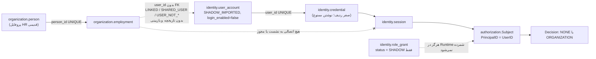
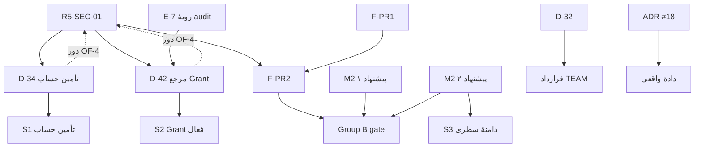

# RM-P09 — ممیزی هویت، دسترسی به داده و آمادگی امنیتی پایلوت

| مورد | مقدار |
|---|---|
| نسخهٔ ممیزی‌شده | `main` @ `36d170453162601d22e915404a9300688ba4ad96` (ادغام PR #96). تفاوت کد با مبنای RM-P08 (`0b0220a`) صفر است؛ تنها تفاوت، فایل گزارش RM-P08 است (`git diff --stat 0b0220a 36d1704`). |
| تاریخ | 2026-11-23 |
| حالت | **فقط خواندنی.** هیچ کاربر، Role، Grant، Capability، اعتبارنامه، رمز، نشست، Feature Flag، مهاجرت، کد یا دادهٔ واقعی ایجاد یا تغییر داده نشد. تنها تغییر مخزن همین فایل است. |
| مبنای بازاستفاده | RM-P08 (`docs/audits/rm-p08-functional-integration-audit.md`)، RM-E04A/G/H/I/O (`docs/security/*`، `docs/implementation/rm-e04o-*`)، `docs/remediation/m2-*`، رجیستری عملیات `internal/authorization/http/testdata/operation_scope_registry.yaml`. یافته‌های قبلی فقط پس از بازبینی روی همین SHA تکرار شده‌اند. |
| وضعیت تولید | **GROUP B CLOSED — PRODUCTION NO-GO** |

## راهنمای برچسب شواهد

| برچسب | معنی |
|---|---|
| **[کد]** | از کد Go/TypeScript روی همین SHA خوانده شد. |
| **[DB]** | از مهاجرت SQL (CHECK، FK، GRANT) خوانده شد. |
| **[OAS]** | از `api/openapi/openapi.bundled.yaml` خوانده شد. |
| **[رجیستری]** | از `operation_scope_registry.yaml` که تست `TestNT22*` آن را با handlerهای واقعی تطبیق می‌دهد. |
| **[واحد]** / **[PG]** | تست واحد / تست روی PostgreSQL موقت که **در همین ممیزی** اجرا و سبز شد. |
| **[پروب]** | تست موقت نوشته‌شده در worktree جداگانهٔ scratch (خارج از مخزن اصلی، Commit نشده) با دادهٔ مصنوعی. |
| **[طراحی]** | فقط سند طراحی/پیشنهاد؛ اثبات اجرا نیست. |
| **[سازمانی]** | رکورد تصویب. **در مخزن هیچ رکورد تصویبی وجود ندارد** (`docs/governance/approvals/` ناموجود). |

سطوح **SELF / TEAM / ALL** در این گزارش فقط **مدل ارزیابی پیشنهادی** هستند. هیچ‌کدام قرارداد اجرایی، Capability یا مجوز نیستند و بدون تصویب مالک پروژه نباید به قرارداد تبدیل شوند.

---

## ۱. خلاصهٔ مدیریتی

1. **هیچ انسان واقعی امروز نمی‌تواند وارد CRM شود.** سه قفل مستقل و فعال وجود دارد و هر سه در این ممیزی دوباره اثبات شدند:
   - نقش برنامه روی `identity.credential` فقط SELECT دارد؛ نوشتن اعتبارنامه رد می‌شود: `permission denied for table credential` (`00012_identity_authentication.sql:87`) [DB] [پروب PRB-S2].
   - Grant فعال در سطح دیتابیس غیرممکن است: `violates check constraint "role_grant_shadow_only"` (`00001_identity.sql:195`) [DB] [پروب PRB-S1].
   - در Staging، سرویس API هیچ DSN احراز هویت یا خواندن ندارد؛ پس ورود همیشه `BLOCKED / FEATURE_DISABLED` است (`deploy/staging/compose.yaml:100-107`، `internal/platform/apiserver/auth.go:42-47`) [کد].
2. **هویت انسانی معتبر مدل نشده است.** «شخص» (`organization.person`) یک ردیف پروفایل HR قدیمی است، نه انسان تأییدشده. پیوند حساب به شخص (`organization.employment.user_id`) کلید خارجی نیست، تاریخچه ندارد، بازبینی نمی‌شود، با هر واردسازی بازنویسی می‌شود و قابل لغو نیست (`00001_organization.sql:194-278`، `internal/organization/imports/imports.go:172-186`) [DB] [کد]. R5-SEC-01 تصویب نشده است.
3. **نشست هرگز به شخص یا همکاری نگاه نمی‌کند.** `Authenticate` فقط وضعیت اعتبارنامه و `presence` حساب را بررسی می‌کند (`internal/identity/session/session.go:289-292`). خاتمهٔ همکاری نشست را قطع نمی‌کند (BN-10 تأیید شد) [کد] [پروب PRB-S4].
4. **دامنهٔ سطری خواندن فقط «کل سازمان» است.** ارزیاب فقط دو دامنه دارد: `NONE` و `ORGANIZATION` (`internal/authorization/authorization.go:75-78`). از ۱۰۵ عملیات API، **۸۱ عملیات خواندنی** با `ScopeOrganization` و بدون فیلتر سطری‌اند [رجیستری]. فقط ۷ خواندن «خودی» (SELF) و ۲ خواندن با دامنهٔ خدمت (شبه TEAM) وجود دارد. **دامنهٔ TEAM مبتنی بر سلسله‌مراتب هیچ‌جا پیاده‌سازی نشده است.** این یک **نقص طراحی** برای نقش‌های فروش، سرپرستی و MIS محدود است (RM-P09-F06).
5. **کنترل‌های موجود محکم و تست‌شده‌اند:** سلسله‌مراتب هرگز مجوز نمی‌دهد. شناسهٔ کنندهٔ کار هرگز از بدنهٔ درخواست خوانده نمی‌شود. dev stub در تولید ساخته نمی‌شود. کوکی `__Host-` و CSRF وابسته به نشست وجود دارد. Grant در هر درخواست دوباره خوانده می‌شود. غیرفعال‌شدن اعتبارنامه درخواست بعدی را رد می‌کند. Capability پرونده مجوز مالی نمی‌دهد. [کد] [واحد] [PG] [پروب].
6. **حاکمیت:** هیچ‌یک از تصمیم‌های R5-SEC-01، D-34، D-42، D-32، D-45 و دو پیشنهاد M2 تصویب نشده‌اند. وابستگی R5-SEC-01 ↔ D-34/D-42 دوری است (OF-4، `docs/security/rm-e04h-person-identity-decision-package.md:75`) [سازمانی: ناموجود].
7. **آزمون‌ها:** کل مجموعهٔ Go روی PostgreSQL 16.15 موقت **PASS** شد (۱۰۰ بسته ok، ۰ FAIL). ۱۰۶ تست امنیتی سطح‌بالا و ۹۳۱ زیرتست PASS شدند. Vitest با ۴۰۴ تست PASS شد. ۹ پروب منفی هم PASS شدند. **هیچ آزمونی با حساب واقعی ممکن نبود (BLOCKED).**

**حکم نهایی (§۱۱):** **NO-GO** برای پایلوت خواندنی با کاربر واقعی در وضعیت امروز.

---

## ۲. معماری فعلی هویت

| لایه | مالک / مسیر | ذخیره‌سازی | وضعیت امروز | شاهد |
|---|---|---|---|---|
| شخص (Person) | organization — `internal/organization` | `organization.person` (یک ردیف به ازای هر پروفایل HR قدیمی؛ `UNIQUE (source_system, source_key)`) | فقط واردسازی؛ ایجاد/ویرایش ندارد | `00001_organization.sql:194-212` [DB] |
| همکاری (Employment) | organization | `organization.employment` (`person_id UNIQUE` → دقیقاً یک همکاری برای هر شخص؛ `employment_status` با ۸ مقدار) | فقط واردسازی؛ تاریخچهٔ همکاری ندارد | `00001_organization.sql:217-278` [DB] |
| پیوند حساب (Account Link) | organization (ستون، نه جدول) | `employment.user_id` (**بدون FK**) + `user_link_state ∈ {LINKED, USER_NOT_IMPORTED, USER_NOT_RECORDED, SHARED_USER}` | از اشارهٔ پروفایل قدیمی مشتق می‌شود؛ بازبینی، لغو و تاریخچه ندارد | `00001_organization.sql:215-216,229-231,263-264`؛ `imports.go:172-186` [DB] [کد] |
| حساب کاربری (User Account) | identity — `internal/identity` | `identity.user_account` (`account_state = 'SHADOW_IMPORTED'`، `login_enabled = false` با CHECK) | سایهٔ حساب قدیمی؛ نوع حساب (انسانی/خدمت) ندارد | `00001_identity.sql:146-170` [DB] |
| اعتبارنامه (Credential) | identity | `identity.credential` (`user_id UNIQUE`؛ Argon2id؛ `status ∈ {ACTIVE, DISABLED}`؛ نام ورود نباید شبیه تلفن باشد) | **صفر ردیف؛ نقش برنامه فقط SELECT** | `00012_identity_authentication.sql:22-40,87` [DB] |
| نشست (Session) | identity — `internal/identity/session/session.go` | `identity.session` (فقط digest توکن؛ idle ۳۰ دقیقه، مطلق ۱۲ ساعت) | پیاده‌سازی‌شده؛ پشت پرچم `identity.session_auth` (پیش‌فرض خاموش) | `session.go:56-58,160-264,274-322` [کد] |
| رویداد امنیتی | identity | `identity.auth_event` (append-only؛ بدون راز) | ورود/خروج/throttle/CSRF ثبت می‌شود | `00012:69-85`؛ `session.go:372-388` [DB] [کد] |
| Grant و نقش | identity | `identity.role_grant` (`basis = 'LEGACY_PROFILE_ROLE'`، `status = 'SHADOW'`) | فقط شاهد قدیمی؛ هرگز در اجرا شمرده نمی‌شود | `00001_identity.sql:175-200` [DB] |
| دسترسی مؤثر | authorization — `internal/authorization` | بدون جدول؛ ارزیاب کدی | Subject = `user_id` نشست + Grantهای ACTIVE (صفر) | `authorization/session.go:202-228`؛ `authorization.go:106-164` [کد] |
| هویت توسعه | `internal/platform/authstub` | بدون ذخیره؛ هدر `X-Dev-User` | فقط dev/test؛ در تولید `ErrProductionLockout` | `authstub.go:89-95`؛ `cmd/crm-api/writes.go:79-87` [کد] |

**زنجیرهٔ عملی امروز:**

---

## ۳. نقشهٔ اتصال شخص به حساب

### ۳.۱ ارزیابی هر حلقهٔ زنجیره

| حلقه | نحوهٔ ذخیره | کلید / قید | قابل بازبینی؟ | قابل لغو؟ | تاریخچه؟ | طبقه |
|---|---|---|---|---|---|---|
| HR Person | `organization.person` | `person_id` تولیدی برای هر پروفایل؛ دو پروفایل یک انسان = دو `person_id` (غیرقابل تشخیص) | خیر | خیر | فقط `refreshed_at` و `source_row_sha256` | LEGACY_IMPORTED (نه VERIFIED) |
| Person → Employment | `employment.person_id` | `UNIQUE` + FK | — | — | **خیر**: انتقال با Refresh بازنویسی می‌شود | LEGACY_IMPORTED |
| Employment → Account | `employment.user_id`، `user_link_state` | **بدون FK**؛ `user_id` یکتا نیست (حساب مشترک مجاز است) | خیر (بدون رکورد بازبینی) | خیر (بدون مفهوم unlink) | خیر | UNVERIFIED؛ `SHARED_USER` = CONFLICT |
| Account → Credential | `credential.user_id` | `UNIQUE` + FK | — | `status = DISABLED` (بدون نویسنده) | `created_at`، `updated_at`، `version` | NOT_PRESENT (صفر ردیف) |
| Credential → Session | `session.credential_id`، `session.user_id` | FK؛ `c.user_id = s.user_id` در هر احراز | — | logout، logout-all، غیرفعال‌سازی اعتبارنامه | `auth_event` | VERIFIED (کد و DB) |
| Session → Effective Access | `SessionSubjects.Subject` | `PrincipalID = UserID = session.user_id` | — | Grant در هر درخواست دوباره خوانده می‌شود | — | VERIFIED؛ امروز همه رد |

### ۳.۲ پاسخ به پرسش‌های بند ۱

| پرسش | پاسخ | شاهد |
|---|---|---|
| مرجع ثبت شخص کدام ماژول است؟ | `organization`. اما تنها منبع، واردسازی پروفایل HR قدیمی است و فرمان ایجاد شخص وجود ندارد. **مرجع معتبر هویت انسانی (Person Registry) وجود ندارد.** | `cmd/crm-legacy-import import-organization`؛ RM-P08 §۳ جریان A [کد] |
| آیا هر حساب به یک شخص واقعی و مشخص متصل می‌شود؟ | **خیر.** حساب فقط از طریق اشارهٔ پروفایل قدیمی و بدون بازبینی به «شخص» وصل می‌شود. حسابی که پروفایل ندارد به هیچ شخصی متصل نیست و هیچ کنترلی آن را رد نمی‌کند. | `imports.go:172-186`؛ RM-E04H §3.2 [کد] |
| رابطهٔ حساب و شخص در دیتابیس چگونه ذخیره می‌شود؟ | یک ستون nullable در `organization.employment` (`user_id` + `user_link_state`)، بدون FK بین schema ها (عمداً: «identity reference, not a foreign key»). | `00001_organization.sql:215-216,229-231` [DB] |
| آیا اتصال قابل بازبینی، لغو و ثبت در تاریخچه است؟ | **خیر.** جدول پیوند، رویداد پیوند، بازبین، لغو و تاریخچه وجود ندارد. قرارداد پیشنهادی آن (Option A) فقط سند است. | `docs/security/rm-e04i-option-a-implementation-contract.md` §4 [طراحی] |
| وضعیت حساب در زمان خاتمهٔ همکاری چه می‌شود؟ | **هیچ.** `employment_status = TERMINATED` هیچ اثری روی اعتبارنامه، نشست یا Grant ندارد. فقط `credential.status = DISABLED` یا `presence = ABSENT_IN_LATEST` درخواست بعدی را رد می‌کنند. اعمال نهایی HR هم BLOCKED است (`HR_APPLY_IMPLEMENTATION_BLOCKED`). | `session.go:289-292`؛ `internal/organization/hrrequest/hrrequest.go:62`؛ [پروب PRB-S4]؛ BN-10 |
| حساب بدون شخص، چند شخص یا پیوند متعارض چگونه کنترل می‌شود؟ | در **نمایش** کنترل می‌شود: `SHARED_USER` و `USER_NOT_*` با یافتهٔ سلسله‌مراتب نشان داده می‌شوند و هرگز ادغام نمی‌شوند. در **احراز هویت و مجوز** کنترل نمی‌شود: نشست و ارزیاب به این حالت‌ها نگاه نمی‌کنند. `EvidenceConflict` فقط برای خطای بارگذاری Grant فعال می‌شود. | `00001_organization.sql:385-406`؛ `authorization/session.go:216-219` [کد] |
| آیا حساب خدمت از حساب انسانی جدا شده است؟ | **در سطح کاربر برنامه: خیر.** `user_account` ستون نوع ندارد و همهٔ حساب‌ها سایهٔ حساب‌های قدیمی‌اند. **در سطح دیتابیس: بله.** هر ماژول نقش مالک جدا دارد (`crm_owner_<module>`) و worker با login دیتابیس کار می‌کند، نه با حساب کاربری. حساب خدمت برنامه‌ای (برای یکپارچگی) مدل نشده است: UNKNOWN. | `00001_identity.sql:146-170`؛ `internal/platform/owner`؛ `internal/platform/db/ownership_test.go` [DB] [کد] |
| هویت واقعی در کدام نقطه با شناسهٔ احرازشده تطبیق داده می‌شود؟ | **در هیچ نقطه.** شناسهٔ احرازشده `identity.user_account.user_id` است. در زنجیرهٔ ورود ← نشست ← Subject هیچ مرحله‌ای `person_id` یا همکاری را تطبیق نمی‌دهد. Principal فیلد شخص ندارد. ارزیاب‌های تفکیک وظایف مالی و استرداد با `IDENTITY_PERSON_LINK_UNMODELLED` fail-closed می‌شوند. | `websession.go:80-88`؛ `authorization.go:52-65`؛ `r5-person-identity-sod-DRAFT.md` [کد] [پروب PRB-S4] |

### ۳.۳ بررسی تصمیم‌های D-34، D-42 و R5-SEC-01

| تصمیم | پرسش | گزینه‌های ثبت‌شده | وضعیت | اثر کد امروز | شاهد |
|---|---|---|---|---|---|
| **R5-SEC-01** | مرجع معتبر هویت شخص و پیوند حساب به شخص | A: رجیستری شخص تأییدشده توسط HR با پیوند بازبینی‌شده و برگشت‌پذیر؛ B: IdP تحت مدیریت امنیت؛ C: تفکیک وظایف اعلامی؛ D: مسدود ماندن | `READY_FOR_REVIEW`؛ `approval_record` خالی؛ مالک اصلی **UNASSIGNED** | هیچ؛ SoD سطح شخص fail-closed | `r6-decision-tracker.json`؛ `rm-e04h-person-identity-decision-package.md` §2.2، §4 |
| **D-34** | سیاست رمز اولیه و تأمین حساب | رمز یک‌بارمصرف با تغییر اجباری / پیوند دعوت با انقضا / IdP خارجی (= R5-SEC-01 B) | `READY_FOR_REVIEW`؛ تعارض C-04 (پیش‌فرض امن) باز | هیچ نویسندهٔ اعتبارنامه‌ای وجود ندارد | `r5-decision-inventory.md:104`؛ `00012:4-15` |
| **D-42** | آیا HR می‌تواند Capability فروش را ویرایش کند؟ (مرجع اعطا/لغو) | فقط Identity/Security / HR درخواست، Security تأیید / HR در مجموعهٔ محدود | `READY_FOR_REVIEW`؛ پیش‌نیاز E-7 (رویهٔ تغییر Grant با audit) باز | `role_grant_shadow_only`؛ فرمان Grant/Revoke وجود ندارد | `r5-decision-inventory.md:105`؛ `00001_identity.sql:195` |

**گزینهٔ A در R5-SEC-01:** ترجیح اعلام‌شدهٔ مالک پروژه است و توصیهٔ مشروط مهندسی هم هست (`rm-e04h…` §4.3)، اما **تصویب‌شده نیست** و در این گزارش هم تصمیم تلقی نمی‌شود. قرارداد پیاده‌سازی آن (`rm-e04i-option-a-implementation-contract.md`) فقط PROPOSED است.

**ریسک ساختاری (G3، RT-3):** قفل مهاجرت `role_grant` در تست حاکمیتی فقط وضعیت `APPROVED_VERIFIED` تصمیم D-42 را بررسی می‌کند، نه R5-SEC-01 یا E-7 را (`rm-e04h…` §7.2). پیشنهاد PROPOSED این است که یک پیش‌شرط مشترک برای همهٔ مسیرهای بازکنندهٔ امنیتی تعریف شود. این پیشنهاد تصویب نشده است.

---

## ۴. ماتریس دسترسی سطری تمام ماژول‌ها

### ۴.۱ مدل فعلی RBAC

- **مسیر ارزیابی:** Route ← Module ← Action ← Row ← Field، به‌صورت کد و بدون زبان قاعده (`authorization.go:1-17`).
- **منبع اختیار:** فقط Grant با وضعیت ACTIVE که بستهٔ نقش آن Capability را دارد. **۸ نقش از ۹ نقش بستهٔ تهی دارند.** نقش HR شش Capability خواندنی دارد (`internal/identity/api/api.go:211-221`) [کد] [پروب PRB-A2].
- **دامنهٔ تصمیم:** `ScopeNone` یا `ScopeOrganization`. هر Allow همیشه ORGANIZATION است (`authorization.go:160-163`) [پروب PRB-A1].
- **قرارداد دامنهٔ پشتیبانی‌شده:** `CheckRead(..., supported...)` هر دامنهٔ اعلام‌نشده را با `ROW_SCOPE_DENIED` و پیش از هر کوئری رد می‌کند و هیچ دامنه‌ای را گسترش نمی‌دهد (`guard.go:175-221`؛ `TestNT07UnsupportedScopeRefused`) [واحد].
- **سلسله‌مراتب:** `OrgContext` پذیرفته می‌شود ولی هرگز منبع اختیار نیست (`authorization.go:39-49`؛ `TestHierarchyAndPositionNeverGrant`) [واحد] [پروب PRB-A3].
- **فیلد:** ماسک فیلد با Capabilityهای جانبی انجام می‌شود (مثلاً فیلدهای همکاری در `/organization/persons` فقط با `org.employment.read`؛ فیلتر با `user_id` هم همین Capability را لازم دارد؛ `internal/organization/http/http.go:107-125,179-181`) [کد].

### ۴.۲ ارزیابی امکان پیاده‌سازی SELF / TEAM / ALL (مدل پیشنهادی، تصویب‌نشده)

| ماژول | امروز | SELF: امکان‌پذیر؟ | TEAM: امکان‌پذیر؟ | ALL | نقص طراحی |
|---|---|---|---|---|---|
| HR / organization | همهٔ خواندن‌ها ALL. درخواست HR فقط برای مشارکت‌کننده (SELF) | بله؛ الگوی موجود با `hr_request_participant` | **خیر امروز.** انتساب گزارش‌دهی وجود دارد (`org_assignment`) و ایجاد درخواست HR از «فرزند جاری REPORTS_TO» استفاده می‌کند. اما ارزیاب دامنهٔ TEAM ندارد و تاریخچهٔ همکاری مؤثر-تاریخ وجود ندارد | فقط با Capability صریح HR | F06، F01 |
| MIS / گزارش | ALL؛ پارامتر `scope` فقط `ORGANIZATION` می‌پذیرد | بی‌معنا برای MIS | خیر: هیچ resolver دامنه‌ای برای گزارش وجود ندارد | بله | F07 |
| فروش (پرونده، نگهداری، پوشش) | ALL. فرمان نتیجهٔ تماس فقط برای نگهدار فعلی | **جزئی**: نگهدار فعلی (`custody`) قابل استفاده است، اما قرارداد `/me` و پیشنهاد ثبت ۲ در M2 تصویب نشده‌اند | خیر: سرپرست ← زیرمجموعه مدل نشده است (BN-09) | بله | F06 |
| مشتری | ALL؛ نقاط تماس پوشیده‌اند | خیر: «مالک مشتری» تعریف نشده است (D-30، OPD-01) | خیر | بله | F06 |
| پرونده (تاریخچه، انتساب) | ALL | جزئی (همانند فروش) | خیر | بله | — |
| فاکتور | ALL. ارسال پرداخت فقط برای فروشنده و صادرکنندهٔ فاکتور (SELF) | جزئی: `seller_user_id = issued_by_user_id = actor` در فرمان پرداخت وجود دارد؛ برای خواندن فاکتور اعمال نمی‌شود | خیر | بله | F06 |
| مالی (دفتر، صف بررسی، تطبیق) | ALL؛ بررسی‌کننده ≠ ارسال‌کننده در ارزیاب | بی‌معنا | بی‌معنا (نقش سازمانی) | بله، فقط با Capability مالی | SoD فقط در سطح حساب (F08) |
| پورسانت | ALL + `commission/me` (SELF با `user_id`) | بله (موجود) | خیر | بله | F08 |
| اجرای خدمت | دامنهٔ خدمت جاری (`ServicesInScope`) | بله | **بله (شبه TEAM):** رویدادهای GRANT/REVOKE دامنهٔ خدمت، فقط حالت جاری | — | — |

**جمع‌بندی:** پیاده‌سازی SELF با الگوی موجود (فیلتر handler پس از Capability؛ commission، payments، hrrequest، fulfillment) امکان‌پذیر است. **پیاده‌سازی TEAM با مدل فعلی امکان‌پذیر نیست.** دلیل‌ها:
(۱) ارزیاب دامنهٔ سوم ندارد؛
(۲) زیرمجموعه فقط از انتساب «جاری» قابل محاسبه است و همکاری تاریخچهٔ مؤثر-تاریخ ندارد؛
(۳) قاعدهٔ تجاری «سرپرست چه کسی را می‌بیند» تصمیم D-32/M2 است و نباید توسط مهندسی اختراع شود.
این مورد به‌عنوان **نقص طراحی RM-P09-F06** ثبت می‌شود.

### ۴.۳ پاسخ به پرسش‌های بند ۲

| پرسش | پاسخ | شاهد |
|---|---|---|
| کدام APIها فیلتر مالکیت معتبر دارند؟ | ۷ خواندن OWN: `commission/me/earnings` (holder = user_id)، `fulfillment/work-cases` و `/{id}` (دامنهٔ خدمت)، `hr/requests` و `/{id}` (مشارکت‌کننده)، `payments/invoices/{id}/submission` (فروشنده و صادرکننده)، `payments/batches/{id}` (ارسال‌کنندهٔ دسته). ۱۰ فرمان هم predicate سطری دارند. | [رجیستری]؛ `commission/http/http.go:422-446`؛ `fulfillment/http/work.go:120-197`؛ `hrrequest/read.go:44-45` |
| کدام APIها فقط Capability عمومی ماژول را بررسی می‌کنند؟ | **۸۱ عملیات `ORG_READ`** (همهٔ خواندن‌های HR، مشتری، پرونده، نگهداری، فاکتور، پرداخت، گزارش، MIS، مالی، بیاوین، پورسانت سازمانی، writeback). | [رجیستری]؛ جدول §۴.۴ |
| کدام گزارش‌ها احتمال نمایش اطلاعات خارج از محدوده دارند؟ | پس از باز شدن هر Grant: `/reports/*` (و ردیف تکی با شناسه)، `/mis/*`، `/reporting/metrics*`، `/sales/coverage-report`، `/sales/custody-parity`، `/billing/reconciliation-report`، `/customer-identity/resolution-report`، `/commission/overview`، `/finance/*`. همه کل سازمان را برمی‌گردانند. امروز به‌دلیل رد کامل، نشتی ممکن نیست. | `reporting/http/http.go:92-125`؛ پارامتر `scope` در [OAS] (`enum: [ORGANIZATION]`) |
| فیلترهای Frontend فقط نمایشی‌اند یا Backend هم اعمال می‌کند؟ | داده هرگز در Frontend فیلتر امنیتی نمی‌شود. ناوبری از `GET /authorization/effective-access` (ارزیابی سرور) می‌آید. فیلترهای صفحه به پارامتر کوئری سرور تبدیل می‌شوند که با AND **محدودتر** می‌کنند و هرگز گسترش نمی‌دهند. پارامتر ناشناخته (مثلاً تلفن) خطای ۴۰۰ می‌گیرد. هدر `X-Dev-User` فقط در build توسعه ارسال می‌شود. | `web/src/shared/api/client.ts:10`؛ `contract.test.ts:58`؛ `TestSlice4RejectsUnknownQueryAndInvalidIDs` [کد] [واحد] |
| امکان دسترسی مستقیم با شناسهٔ رکورد دیگر وجود دارد؟ | **بدون Capability: خیر.** پاسخ ۴۰۳ پیش از هر کوئری است (`NT-07`). **با Capability سازمانی: بله، عمداً**، چون دامنه ALL است. در خواندن‌های OWN، رکورد خارج از دامنه ۴۰۴ می‌گیرد و پیغام وجود رکورد را لو نمی‌دهد. استثنای کم‌خطر: `getFulfillmentWorkCase` پیش از بررسی دامنه کوئری می‌زند (`QUERY_BEFORE_IDENTITY`)، اما پاسخ یکسان ۴۰۴ است (F09). | `scope_nt07_test.go`؛ `fulfillment/http/work.go:176-195`؛ [رجیستری] |
| نشت در صفحه‌بندی، خروجی، شمارنده یا جستجو؟ | **خروجی فایل:** هیچ endpoint خروجی/CSV وجود ندارد ([OAS]: «no export»). **صفحه‌بندی:** cursor keyset با سقف ۲۰۰؛ چون دامنه ALL است، فراتر از دامنه نشتی ندارد. اما با افزودن TEAM باید دامنه پیش از cursor و شمارش اعمال شود. **شمارنده‌ها:** همه سازمانی‌اند. **جستجو:** فقط `q` روی نام نمایشی/کد کارمند (`/organization/persons`، `/identity/users`)؛ هیچ جستجوی تلفنی وجود ندارد. | [OAS]؛ `commission/http/http.go:446`؛ `m2-engineering-readiness.md` S3 |
| ارتباط تاریخی با تغییر سرپرست یا واحد باعث گسترش دسترسی می‌شود؟ | **خیر برای مجوز:** سلسله‌مراتب هرگز اختیار نمی‌دهد و انتساب اعتبار فروش منجمد است (INV-004). **دو نکته:** (الف) درخواست HR برای هر کنشگر تاریخی **برای همیشه** قابل مشاهده می‌ماند (`visible` شامل `hr_request_event.actor_user_id`)؛ این گسترش نیست، ولی پس از جابه‌جایی منقضی هم نمی‌شود (F10). (ب) دامنهٔ خدمت فقط حالت جاری را در نظر می‌گیرد (`DISTINCT ON … seq DESC`)؛ لغو فوراً اثر دارد. | `hrrequest/read.go:44-45`؛ `catalog/registry/registry.go:284-292`؛ `TestDEFHR01HierarchyChangesBeforeDecision` [PG] |

### ۴.۴ ماتریس Endpoint × Capability × Row Scope (هر ۱۰۵ عملیات)

منبع: `internal/authorization/http/testdata/operation_scope_registry.yaml`. تست‌های `TestNT22RegistryMatchesContract`، `TestNT22Inventory` و `TestNT07*` برچسب‌ها را با Capability واقعی درخواستی handler و رفتار واقعی آن مقایسه می‌کنند و در این ممیزی PASS شدند.

«ALL (سازمان)» یعنی پس از Allow هیچ فیلتر سطری اعمال نمی‌شود. **امروز هر سطر برای هر کاربر واقعی رد می‌شود**، چون Grant فعالی وجود ندارد. ستون آخر شامل Capability تکمیلی، Capabilityهای ماسک فیلد و رفتار در نبود `user_id` اثبات‌شده است.

| # | ماژول | عملیات | Capability | پرچم | دامنهٔ سطری فعلی | توضیح |
|---|---|---|---|---|---|---|
| 0a | platform | `GET /health/live` | `—` | `—` | — (عمومی) | بدون داده |
| 0b | platform | `GET /health/ready` | `—` | `—` | — (عمومی) | بدون داده |
| 1 | identity | `GET /session` | `—` | `—` | SELF (نشست) |  |
| 2 | identity | `POST /auth/login` | `—` | `identity.session_auth` | SELF (نشست) |  |
| 3 | identity | `POST /auth/logout` | `—` | `identity.session_auth` | SELF (نشست) |  |
| 4 | identity | `POST /auth/logout-all` | `—` | `identity.session_auth` | SELF (نشست) |  |
| 5 | identity | `GET /identity/users` | `identity.user.read` | `organization.hr_read_shadow` | ALL (سازمان) |  |
| 6 | identity | `GET /identity/users/{user_id}` | `identity.user.read` | `organization.hr_read_shadow` | ALL (سازمان) |  |
| 7 | identity | `GET /authorization/effective-access` | `—` | `—` | SELF (نشست) |  |
| 8 | HR/organization | `GET /organization/persons` | `org.person.read` | `organization.hr_read_shadow` | ALL (سازمان) | فیلد: org.assignment.read, org.employment.read, org.position.read, org.unit.read |
| 9 | HR/organization | `GET /organization/persons/{person_id}` | `org.person.read` | `organization.hr_read_shadow` | ALL (سازمان) | فیلد: org.assignment.read, org.employment.read, org.position.read, org.unit.read |
| 10 | HR/organization | `GET /organization/positions` | `org.position.read` | `organization.hr_read_shadow` | ALL (سازمان) |  |
| 11 | HR/organization | `GET /organization/levels` | `org.position.read` | `organization.hr_read_shadow` | ALL (سازمان) |  |
| 12 | HR/organization | `GET /organization/org-units` | `org.unit.read` | `organization.hr_read_shadow` | ALL (سازمان) |  |
| 13 | HR/organization | `GET /organization/assignments` | `org.assignment.read` | `organization.hr_read_shadow` | ALL (سازمان) |  |
| 14 | HR/organization | `GET /organization/hierarchy-findings` | `org.assignment.read` | `organization.hr_read_shadow` | ALL (سازمان) |  |
| 15 | HR/organization | `GET /hr/requests` | `org.hr_request.read` | `organization.hr_request_write` | SELF — `hr_request_participant` | بدون user_id: EMPTY_WITHOUT_QUERY |
| 16 | HR/organization | `POST /hr/requests` | `org.hr_request.create` | `organization.hr_request_write` | فرمان سطری — `hr_subject_descendant_of_actor` |  |
| 17 | HR/organization | `GET /hr/requests/{request_id}` | `org.hr_request.read` | `organization.hr_request_write` | SELF — `hr_request_participant` | بدون user_id: NOT_FOUND_WITHOUT_QUERY |
| 18 | HR/organization | `POST /hr/requests/{request_id}/decisions` | `org.hr_request.review` | `organization.hr_request_write` | فرمان سطری — `hr_request_next_reviewer` |  |
| 19 | مشتری | `GET /customers` | `customers.customer.read` | `customers.identity_shadow_read` | ALL (سازمان) |  |
| 20 | مشتری | `GET /customers/{customer_id}` | `customers.customer.read` | `customers.identity_shadow_read` | ALL (سازمان) | فیلد: customers.merge_case.read |
| 21 | مشتری | `GET /customers/{customer_id}/contact-points` | `customers.customer.read` | `customers.identity_shadow_read` | ALL (سازمان) |  |
| 22 | مشتری | `GET /customers/{customer_id}/evidence` | `customers.customer.read` | `customers.identity_shadow_read` | ALL (سازمان) |  |
| 23 | مشتری | `GET /customer-identity/merge-cases` | `customers.merge_case.read` | `customers.identity_shadow_read` | ALL (سازمان) |  |
| 24 | مشتری | `GET /customer-identity/merge-cases/{merge_case_id}` | `customers.merge_case.read` | `customers.identity_shadow_read` | ALL (سازمان) |  |
| 25 | مشتری | `GET /customer-identity/resolution-report` | `customers.identity_report.read` | `customers.identity_shadow_read` | ALL (سازمان) |  |
| 26 | پرونده/فروش | `GET /cases` | `cases.case.read` | `sales.read_shadow` | ALL (سازمان) |  |
| 27 | پرونده/فروش | `GET /cases/{case_id}` | `cases.case.read` | `sales.read_shadow` | ALL (سازمان) |  |
| 28 | پرونده/فروش | `GET /cases/{case_id}/history` | `cases.case.read` | `sales.read_shadow` | ALL (سازمان) |  |
| 29 | پرونده/فروش | `GET /cases/{case_id}/attribution` | `cases.case.read` | `sales.read_shadow` | ALL (سازمان) |  |
| 30 | پرونده/فروش | `GET /custody/assignments` | `custody.custody.read` | `sales.read_shadow` | ALL (سازمان) |  |
| 31 | پرونده/فروش | `GET /custody/cases/{case_id}` | `custody.custody.read` | `sales.read_shadow` | ALL (سازمان) |  |
| 32 | پرونده/فروش | `GET /sales/coverage-report` | `sales.report.read` | `sales.read_shadow` | ALL (سازمان) |  |
| 33 | پرونده/فروش | `GET /sales/custody-parity` | `sales.report.read` | `sales.read_shadow` | ALL (سازمان) |  |
| 34 | پرونده/فروش | `GET /cases/{case_id}/contact-outcomes` | `cases.case.read` | `sales.read_shadow` | ALL (سازمان) |  |
| 35 | پرونده/فروش | `POST /cases/{case_id}/contact-outcomes` | `cases.contact_outcome.record` | `cases.nonfinancial_write` | فرمان سطری — `case_current_holder` |  |
| 36 | فاکتور | `GET /invoices` | `billing.invoice.read` | `billing_payments.read_shadow` | ALL (سازمان) |  |
| 37 | فاکتور | `GET /invoices/{invoice_id}` | `billing.invoice.read` | `billing_payments.read_shadow` | ALL (سازمان) |  |
| 38 | فاکتور | `GET /invoices/{invoice_id}/items` | `billing.invoice.read` | `billing_payments.read_shadow` | ALL (سازمان) |  |
| 39 | فاکتور | `GET /invoices/{invoice_id}/stages` | `billing.invoice.read` | `billing_payments.read_shadow` | ALL (سازمان) |  |
| 40 | فاکتور | `GET /invoices/{invoice_id}/totals` | `billing.invoice.read` | `billing_payments.read_shadow` | ALL (سازمان) | +payments.attempt.read |
| 41 | فاکتور | `GET /invoices/{invoice_id}/payments` | `payments.attempt.read` | `billing_payments.read_shadow` | ALL (سازمان) |  |
| 42 | فاکتور | `GET /invoices/{invoice_id}/receipts` | `payments.attempt.read` | `billing_payments.read_shadow` | ALL (سازمان) |  |
| 43 | فاکتور | `GET /billing/reconciliation-report` | `billing.reconciliation.read` | `billing_payments.read_shadow` | ALL (سازمان) |  |
| 44 | پرداخت/مالی | `GET /payments/attempts` | `payments.attempt.read` | `billing_payments.read_shadow` | ALL (سازمان) |  |
| 45 | پرداخت/مالی | `GET /payments/attempts/{attempt_id}` | `payments.attempt.read` | `billing_payments.read_shadow` | ALL (سازمان) |  |
| 46 | پرداخت/مالی | `GET /payments/attempts/{attempt_id}/history` | `payments.attempt.read` | `billing_payments.read_shadow` | ALL (سازمان) |  |
| 47 | پرداخت/مالی | `GET /payments/receipts/{receipt_id}` | `payments.attempt.read` | `billing_payments.read_shadow` | ALL (سازمان) |  |
| 48 | پرداخت/مالی | `GET /invoice-review` | `reporting.invoice_review.read` | `reporting.read_shadow` | ALL (سازمان) |  |
| 49 | پرداخت/مالی | `GET /invoice-review/{invoice_id}` | `reporting.invoice_review.read` | `reporting.read_shadow` | ALL (سازمان) |  |
| 50 | پرداخت/مالی | `GET /finance/shadow-runs` | `finance.shadow.read` | `finance.shadow_ledger_read` | ALL (سازمان) |  |
| 51 | پرداخت/مالی | `GET /finance/shadow-runs/{run_id}` | `finance.shadow.read` | `finance.shadow_ledger_read` | ALL (سازمان) |  |
| 52 | پرداخت/مالی | `GET /finance/accounts` | `finance.shadow.read` | `finance.shadow_ledger_read` | ALL (سازمان) |  |
| 53 | پرداخت/مالی | `GET /finance/accounts/{account_id}` | `finance.shadow.read` | `finance.shadow_ledger_read` | ALL (سازمان) |  |
| 54 | پرداخت/مالی | `GET /finance/ledger` | `finance.ledger.read` | `finance.shadow_ledger_read` | ALL (سازمان) |  |
| 55 | پرداخت/مالی | `GET /finance/ledger/{entry_id}` | `finance.ledger.read` | `finance.shadow_ledger_read` | ALL (سازمان) |  |
| 56 | پرداخت/مالی | `GET /finance/balances` | `finance.shadow.read` | `finance.shadow_ledger_read` | ALL (سازمان) |  |
| 57 | پرداخت/مالی | `GET /finance/reconciliation` | `finance.reconciliation.read` | `finance.shadow_ledger_read` | ALL (سازمان) |  |
| 58 | پرداخت/مالی | `POST /payments/uploads` | `payments.upload.stage` | `payments.manual_write` | فرمان سطری — `upload_actor_user_id` |  |
| 59 | پرداخت/مالی | `GET /payments/invoices/{invoice_id}/submission` | `payments.submission.read` | `payments.manual_write` | SELF — `invoice_seller_and_issuer_user_id` | بدون user_id: NOT_FOUND_WITHOUT_QUERY |
| 60 | پرداخت/مالی | `POST /payments/invoices/{invoice_id}/batches` | `payments.batch.submit` | `payments.manual_write` | فرمان سطری — `invoice_seller_and_issuer_user_id` |  |
| 61 | پرداخت/مالی | `GET /payments/batches/{batch_id}` | `payments.submission.read` | `payments.manual_write` | SELF — `payment_batch_actor_user_id` | بدون user_id: NOT_FOUND_WITHOUT_QUERY |
| 62 | پرداخت/مالی | `GET /payments/evidence` | `payments.evidence.read` | `payments.manual_write` | ALL (سازمان) |  |
| 63 | پرداخت/مالی | `GET /finance/review/attempts` | `finance.review.read` | `finance.review_read` | ALL (سازمان) |  |
| 64 | پرداخت/مالی | `GET /finance/review/attempts/{attempt_id}` | `finance.review.read` | `finance.review_read` | ALL (سازمان) |  |
| 65 | گزارش/MIS | `GET /reporting/metrics` | `reporting.metrics.read` | `reporting.read_shadow` | ALL (سازمان) |  |
| 66 | گزارش/MIS | `GET /reporting/metrics/{metric_id}` | `reporting.metrics.read` | `reporting.read_shadow` | ALL (سازمان) |  |
| 67 | گزارش/MIS | `GET /reports/cases` | `reporting.metrics.read` | `reporting.read_shadow` | ALL (سازمان) |  |
| 68 | گزارش/MIS | `GET /reports/cases/{case_id}` | `reporting.metrics.read` | `reporting.read_shadow` | ALL (سازمان) |  |
| 69 | گزارش/MIS | `GET /reports/custody` | `reporting.metrics.read` | `reporting.read_shadow` | ALL (سازمان) |  |
| 70 | گزارش/MIS | `GET /reports/custody/{case_id}` | `reporting.metrics.read` | `reporting.read_shadow` | ALL (سازمان) |  |
| 71 | گزارش/MIS | `GET /reports/invoices` | `reporting.metrics.read` | `reporting.read_shadow` | ALL (سازمان) |  |
| 72 | گزارش/MIS | `GET /reports/invoices/{invoice_id}` | `reporting.metrics.read` | `reporting.read_shadow` | ALL (سازمان) |  |
| 73 | گزارش/MIS | `GET /reports/payments` | `reporting.metrics.read` | `reporting.read_shadow` | ALL (سازمان) |  |
| 74 | گزارش/MIS | `GET /reports/payments/{attempt_id}` | `reporting.metrics.read` | `reporting.read_shadow` | ALL (سازمان) |  |
| 75 | گزارش/MIS | `GET /mis/overview` | `reporting.mis.read` | `reporting.read_shadow` | ALL (سازمان) |  |
| 76 | گزارش/MIS | `GET /mis/source-quality` | `reporting.mis.read` | `reporting.read_shadow` | ALL (سازمان) |  |
| 77 | گزارش/MIS | `GET /mis/reconciliation` | `reporting.mis.read` | `reporting.read_shadow` | ALL (سازمان) |  |
| 78 | پورسانت | `GET /commission/overview` | `commission.shadow.read` | `commission.read_shadow` | ALL (سازمان) |  |
| 79 | پورسانت | `GET /commission/runs` | `commission.shadow.read` | `commission.read_shadow` | ALL (سازمان) |  |
| 80 | پورسانت | `GET /commission/calculations` | `commission.shadow.read` | `commission.read_shadow` | ALL (سازمان) |  |
| 81 | پورسانت | `GET /commission/findings` | `commission.shadow.read` | `commission.read_shadow` | ALL (سازمان) |  |
| 82 | پورسانت | `GET /commission/policies` | `commission.policy.read` | `commission.read_shadow` | ALL (سازمان) |  |
| 83 | پورسانت | `GET /commission/historical-runs` | `commission.shadow.read` | `commission.read_shadow` | ALL (سازمان) |  |
| 84 | پورسانت | `GET /commission/me/earnings` | `commission.own.read` | `commission.read_shadow` | SELF — `commission_holder_user_id` | بدون user_id: REFUSED_ROW_SCOPE_DENIED |
| 85 | بیاوین/اجرا | `GET /biawin/subscriptions` | `biawin.subscription.read` | `biawin_fulfillment.read_shadow` | ALL (سازمان) |  |
| 86 | بیاوین/اجرا | `GET /biawin/subscriptions/{subscription_id}` | `biawin.subscription.read` | `biawin_fulfillment.read_shadow` | ALL (سازمان) |  |
| 87 | بیاوین/اجرا | `GET /biawin/subscriptions/{subscription_id}/items` | `biawin.subscription.read` | `biawin_fulfillment.read_shadow` | ALL (سازمان) |  |
| 88 | بیاوین/اجرا | `GET /biawin/parity` | `biawin.parity.read` | `biawin_fulfillment.read_shadow` | ALL (سازمان) |  |
| 89 | بیاوین/اجرا | `GET /fulfillment/work-cases` | `fulfillment.work.read` | `fulfillment.work_read` | TEAM-مانند (دامنهٔ خدمت) — `fulfillment_service_scope` | بدون user_id: REFUSED_ROW_SCOPE_DENIED |
| 90 | بیاوین/اجرا | `GET /fulfillment/work-cases/{case_id}` | `fulfillment.work.read` | `fulfillment.work_read` | TEAM-مانند (دامنهٔ خدمت) — `fulfillment_service_scope` | بدون user_id: QUERY_BEFORE_IDENTITY |
| 91 | بیاوین/اجرا | `POST /fulfillment/work-cases/{case_id}/assignment` | `fulfillment.work.assign` | `fulfillment.work_write` | فرمان سطری — `fulfillment_supervisor_service_scope` |  |
| 92 | بیاوین/اجرا | `POST /fulfillment/work-cases/{case_id}/operational-actions` | `fulfillment.work.execute` | `fulfillment.work_write` | فرمان سطری — `fulfillment_assignee_executor_scope` |  |
| 93 | بیاوین/اجرا | `POST /fulfillment/work-cases/{case_id}/evidence-records` | `fulfillment.work.execute` | `fulfillment.work_write` | فرمان سطری — `fulfillment_assignee_executor_scope` |  |
| 94 | بیاوین/اجرا | `POST /fulfillment/work-cases/{case_id}/outcome` | `fulfillment.work.execute` | `fulfillment.work_write` | فرمان سطری — `fulfillment_assignee_executor_scope` |  |
| 95 | بیاوین/اجرا | `GET /biawin/activation-decisions` | `biawin.activation.read` | `fulfillment.work_read` | ALL (سازمان) |  |
| 96 | بیاوین/اجرا | `GET /fulfillment/cases` | `fulfillment.case.read` | `biawin_fulfillment.read_shadow` | ALL (سازمان) |  |
| 97 | بیاوین/اجرا | `GET /fulfillment/cases/{case_id}` | `fulfillment.case.read` | `biawin_fulfillment.read_shadow` | ALL (سازمان) |  |
| 98 | بیاوین/اجرا | `GET /fulfillment/cases/{case_id}/history` | `fulfillment.case.read` | `biawin_fulfillment.read_shadow` | ALL (سازمان) |  |
| 99 | یکپارچگی | `GET /integration/provider-operations` | `integration.provider_operation.read` | `fulfillment.work_read` | ALL (سازمان) |  |
| 100 | یکپارچگی | `POST /integration/provider-operations/{operation_id}/resolution` | `integration.provider_operation.reconcile` | `integration.provider_reconcile` | فرمان سطری — `no_row_predicate` |  |
| 101 | یکپارچگی | `GET /writeback/summary` | `integration.writeback.read` | `integration.writeback_read` | ALL (سازمان) |  |
| 102 | یکپارچگی | `GET /writeback/commands` | `integration.writeback.read` | `integration.writeback_read` | ALL (سازمان) |  |
| 103 | یکپارچگی | `GET /writeback/commands/{command_id}` | `integration.writeback.read` | `integration.writeback_read` | ALL (سازمان) |  |

**شمارش:** ORG_READ = ۷۹ + REVIEW_READ = ۲ (یعنی ۸۱ خواندن ALL)؛ OWN_READ = ۷؛ BUSINESS_COMMAND = ۱۰؛ SESSION = ۵؛ PUBLIC_HEALTH = ۲. هیچ عملیاتی دامنهٔ TEAM مبتنی بر سلسله‌مراتب ندارد.

---

## ۵. خطرات نشت داده

### ۵.۱ سناریوهای منفی (دادهٔ مصنوعی؛ هیچ دسترسی واقعی باز نشد)

| # | سناریو | امروز | اگر Grant با مدل فعلی باز شود | نتیجه / نقص طراحی | شاهد |
|---|---|---|---|---|---|
| N1 | فروشنده A به دادهٔ اختصاصی فروشنده B دسترسی نداشته باشد | **کنترل‌شده.** نقش seller هیچ Capability ندارد، پس همهٔ خواندن‌ها ۴۰۳ می‌گیرند. فرمان‌ها (نتیجهٔ تماس، دستهٔ پرداخت) جداسازی سطری دارند | **نقض می‌شود:** هر Capability خواندن پرونده/فاکتور، داده‌های B را هم نشان می‌دهد (ALL) | **نقص طراحی F06** تا پیاده‌سازی پیشنهاد ثبت ۲ M2 | [پروب PRB-A2]؛ `TestRME04OCrossSellerSeparation` [PG]؛ `TestNT07*` |
| N2 | سرپرست A دادهٔ تیم مستقل B را نبیند | کنترل‌شده (رد کامل) | **نقض می‌شود؛ TEAM وجود ندارد** | **نقص طراحی F06** (BN-09) | `authorization.go:75-78`؛ [پروب PRB-A1/A3] |
| N3 | تغییر واحد، دسترسی تاریخی نامحدود ایجاد نکند | کنترل‌شده: سلسله‌مراتب اختیار نمی‌دهد | کنترل‌شده برای مجوز. استثنای محدود: درخواست HR برای کنشگر سابق قابل مشاهده می‌ماند | ثبت به‌عنوان F10 (نیازمند تصمیم) | `TestHierarchyAndPositionNeverGrant` [واحد]؛ `hrrequest/read.go:44` |
| N4 | نقش فاقد مجوز با URL مستقیم به داده نرسد | **PASS:** ۴۰۳ پیش از کوئری؛ پرچم خاموش → BLOCKED؛ ناشناس → UNAUTHORIZED | PASS (کنترل Capability مستقل از دامنه است) | — | `TestNT07Anonymous`، `TestNT07DeniedStaysDenied`، `TestH_AnonymousNothingAllowed` [واحد] |
| N5 | دسترسی به پرونده خودکار مجوز مالی ندهد | **PASS:** Capabilityها مستقل‌اند. `getInvoiceTotals` هم `invoices.invoice.read` و هم `payments.attempt.read` لازم دارد | PASS | — | [پروب PRB-A4]؛ `billing/http/http.go:320-324` |
| N6 | خواندن گزارش از محدودیت ردیف‌های قابل مشاهده عبور نکند | کنترل‌شده (رد کامل) | **نقض می‌شود:** گزارش‌ها فقط ORGANIZATION دارند. کاربری با دامنهٔ محدود نمی‌تواند گزارش محدود بگیرد و با Capability گزارش کل سازمان را می‌بیند | **نقص طراحی F07** | `reporting/http/http.go:92-125`؛ [OAS] |
| N7 | شمارنده و خروجی فایل دادهٔ خارج از محدوده را افشا نکنند | خروجی فایل وجود ندارد. شمارنده‌ها رد می‌شوند | شمارنده‌ها سازمانی‌اند (همان F07) | F07؛ خروجی: N/A | [OAS] «no export» |

### ۵.۲ ثبت خطر

| شناسه | خطر | شدت | احتمال پس از فعال‌سازی | کنترل موجود | کنترل لازم |
|---|---|---|---|---|---|
| RM-P09-F01 | حساب به انسان تأییدشده وصل نیست؛ یک انسان می‌تواند چند حساب/پروفایل داشته باشد | بحرانی | بالا | نمایش `SHARED_USER`/`USER_NOT_*`؛ SoD مالی fail-closed | R5-SEC-01 (A یا B) + پیوند بازبینی‌شده، برگشت‌پذیر و append-only |
| RM-P09-F02 | نشست هیچ تطبیقی با شخص/همکاری ندارد | بحرانی | بالا | — | پیش‌شرط ورود: پیوند VERIFIED + همکاری فعال؛ در غیر این صورت `BLOCKED` |
| RM-P09-F03 | خاتمهٔ همکاری دسترسی را قطع نمی‌کند؛ نویسندهٔ `CREDENTIAL_DISABLED`، `ACCOUNT_NOT_PRESENT` و `SESSION_REVOKED` وجود ندارد | بالا | بالا | غیرفعال‌سازی اعتبارنامه در درخواست بعدی اثر دارد (`session_test.go`) | فرمان غیرفعال‌سازی + ابطال همهٔ نشست‌های کاربر + اتصال به OPD-05/SD-04 |
| RM-P09-F04 | `login_enabled=false` و `SHADOW_IMPORTED` در ورود بررسی نمی‌شوند؛ وجود ردیف اعتبارنامه تنها شرط است | متوسط | متوسط (فقط با درج دستی DBA) | نقش برنامه نمی‌تواند اعتبارنامه بنویسد | فرمان تأمین حساب با پیش‌شرط پیوند و ممنوعیت درج دستی؛ پایش درج خارج از فرمان |
| RM-P09-F05 | حساب خدمت برنامه‌ای مدل نشده است | متوسط | پایین امروز | نقش‌های DB جدا برای هر ماژول | قرارداد principal خدمت جدا از انسان |
| RM-P09-F06 | فقط دامنهٔ ALL؛ SELF جزئی؛ TEAM ناموجود | بحرانی (برای نقش‌های فروش) | قطعی | Capabilityها برای ۸ نقش تهی‌اند | قرارداد دامنه (M2 پیشنهاد ۲، D-32) + resolver سطری در کوئری |
| RM-P09-F07 | گزارش، MIS و شمارنده‌ها فقط سازمانی‌اند | بالا | قطعی برای هر دارندهٔ Capability گزارش | `scope` فقط ORGANIZATION | گزارش محدود یا محدودکردن Capability گزارش به نقش‌های سازمانی |
| RM-P09-F08 | خواندن OWN و SoD با `user_id` کار می‌کنند، نه با شخص؛ حساب مشترک دادهٔ چند انسان را ترکیب می‌کند | متوسط | متوسط | `SHARED_USER` در HR نمایش داده می‌شود | رد OWN و SoD برای حساب‌های CONFLICT (پس از R5-SEC-01) |
| RM-P09-F09 | `getFulfillmentWorkCase` پیش از بررسی دامنه کوئری می‌زند | پایین | پایین | پاسخ یکسان ۴۰۴ | بررسی دامنه پیش از Detail (تغییر کوچک کد پس از تأیید) |
| RM-P09-F10 | دید درخواست HR برای کنشگر سابق منقضی نمی‌شود | پایین/متوسط | متوسط | فقط مشارکت‌کنندگان | تصمیم HR دربارهٔ ماندگاری دید |
| RM-P09-F11 | Staging ورود واقعی را پیکربندی نکرده است | بالا (عملیاتی) | — | `CRM_ENV=production`؛ stub ممنوع | پیکربندی R1 و سطوح خواندن روی Staging ایزوله با دادهٔ مصنوعی |
| RM-P09-F12 | رد دسترسی (۴۰۳) و خواندن‌ها (به‌جز Invoice Review) در هیچ جدول ممیزی پایدار ثبت نمی‌شوند | متوسط | — | `auth_event` برای ورود/نشست؛ ممیزی Invoice Review با fail-closed | ممیزی خواندن حساس و رد دسترسی برای پایلوت (D-45، D-23) |

---

## ۶. وضعیت احراز هویت و نشست

| پرسش | پاسخ | شاهد |
|---|---|---|
| روش احراز هویت فعلی؟ | ورود با نام کاربری و رمز در برابر اعتبارنامهٔ Argon2id؛ نشست سمت سرور با توکن ۲۵۶ بیتی که فقط SHA-256 آن ذخیره می‌شود؛ کوکی `__Host-crm_session` (Secure، HttpOnly، SameSite=Strict)؛ CSRF = HMAC توکن. throttle با ۵ خطا در ۱۵ دقیقه و قفل advisory. بدون MFA، OTP، بازیابی یا ورود مشتری. | `session.go:1-24,157-264`؛ `websession.go:1-16,130-137` [کد] |
| آیا ورود واقعی در Staging پشتیبانی می‌شود؟ | **خیر.** سرویس `api` در Staging فقط `CRM_ENV=production`، آدرس و metrics دارد. `CRM_IDENTITY_AUTH_DATABASE_URL` و DSN سطوح خواندن تنظیم نشده‌اند، پس `unconfiguredAuth` پاسخ `BLOCKED/FEATURE_DISABLED` می‌دهد. حتی با پیکربندی هم اعتبارنامه‌ای وجود ندارد. | `deploy/staging/compose.yaml:100-107`؛ `apiserver/auth.go:42-66`؛ `cmd/crm-api/auth.go:85-92` |
| وابستگی‌های صدور Session؟ | (۱) `CRM_IDENTITY_AUTH_DATABASE_URL` + `CRM_FEATUREFLAGS_DATABASE_URL`؛ (۲) پرچم `identity.session_auth` روشن؛ (۳) ردیف `identity.credential` با `ACTIVE` (نیازمند D-34 و مهاجرت تصویب‌شده)؛ (۴) `user_account.presence = PRESENT`؛ (۵) `CRM_AUTH_ALLOWED_ORIGINS` با https در تولید؛ (۶) غیرفعال بودن `CRM_DEV_AUTH`. | `cmd/crm-api/auth.go:21-36,85-127`؛ `apiserver/auth.go:21-28,68-92` |
| آیا احراز هویت واقعی از Dev Stub جداست؟ | **بله.** این دو با هم ناسازگارند (`ErrAuthConflict`). stub در تولید ساخته نمی‌شود (`ErrProductionLockout`). محیط خالی یعنی production. `SessionSubjects` هرگز principal مربوط به stub یا Grant از نوع DEV را نمی‌پذیرد. | `apiserver/auth.go:26-28`؛ `authstub.go:42-53,89-95`؛ `authorization/session.go:195-228`؛ `TestHTTPNoDevBypassInProduction` [واحد]؛ [پروب PRB-A5] |
| Session چگونه منقضی یا لغو می‌شود؟ | idle لغزان ۳۰ دقیقه (حداکثر تا انقضای مطلق)، مطلق ۱۲ ساعت (ثابت)، `logout`، `logout-all`، جایگزینی هنگام ورود (دفاع fixation)، غیرفعال‌شدن اعتبارنامه یا غیاب حساب (در احراز بعدی)، و خاموش‌کردن پرچم (kill switch: هیچ نشستی پذیرفته نمی‌شود). **ابطال اداری نشست‌های کاربر دیگر وجود ندارد** (نوع `SESSION_REVOKED` نویسنده ندارد). | `session.go:274-357`؛ `00012:60,79-80`؛ `TestSessionLifecycle` [PG] |
| تغییر Role یا Grant چه اثری روی نشست فعال دارد؟ | Grantها در **هر درخواست** با `ActiveGrants` دوباره خوانده می‌شوند. پس اعطا یا لغو از درخواست بعدی اثر دارد و نشست cache مجوز ندارد. امروز هیچ تغییر Grantی ممکن نیست. | `authorization/session.go:207-228`؛ `identity/query/query.go:156-164` [کد] |
| آیا غیرفعال‌شدن حساب مانع درخواست‌های بعدی می‌شود؟ | **بله** برای `credential.status = DISABLED` و `presence = ABSENT_IN_LATEST`: شرط JOIN در احراز → کوکی پاک و درخواست ناشناس (۴۰۱/۴۰۳). **خیر** برای خاتمهٔ همکاری در HR (F03). | `session.go:289-292`؛ `session_test.go` (بلوک «A disabled credential … ends every active session») [PG] |
| آیا هویت حساب در سمت سرور اعتبارسنجی می‌شود؟ | **بله.** Principal فقط توسط middleware نشست و از دیتابیس ساخته می‌شود. هر درخواست digest توکن، انقضا، ابطال، وضعیت اعتبارنامه، تطابق `c.user_id = s.user_id` و حضور حساب را بررسی می‌کند. خطا هرگز به احراز موفق منجر نمی‌شود. | `apiserver/auth.go:94-124`؛ `session.go:274-322` |
| آیا جعل شناسهٔ کاربر از طریق درخواست ممکن است؟ | **خیر (در کد فعلی).** هیچ بدنهٔ POST فیلد کنشگر ندارد (فقط `subject_user_id` / `assignee_user_id` به‌عنوان موضوع، که با predicate سطری بررسی می‌شوند). `X-Dev-User` در تولید خوانده نمی‌شود. توکن بدشکل هرگز به دیتابیس نمی‌رسد. توکن انتخاب‌شده توسط کلاینت هرگز نشست نمی‌شود. پارامتر `user_id` در `/organization/persons` فقط فیلتر است، Capability جداگانه می‌خواهد و هویت نمی‌دهد. | [OAS] (بررسی همهٔ requestBodyها)؛ `websession.go:49-61`؛ `session.go:222-235`؛ `TestHTTPCSRF`، `TestHTTPSessionStates` [PG] |

---

## ۷. نتایج آزمون‌های امنیتی

**محیط:** PostgreSQL 16.15 موقت محلی (خوشهٔ تازه در `/var/tmp`، پورت ۵۵۴۳۳، فقط دادهٔ مصنوعی). پس از ممیزی متوقف و حذف شد. هیچ اتصالی به Production یا Staging برقرار نشد. پروب‌ها در یک `git worktree` جداگانه در scratchpad نوشته شدند و Commit نشدند. مخزن اصلی فقط همین گزارش را تغییر داده است.

### ۷.۱ اجراهای انجام‌شده

| دسته | فرمان | نتیجه |
|---|---|---|
| کل مجموعهٔ Go (واحد + PG + lint معماری + قرارداد OpenAPI + حاکمیت) | `CRM_TEST_REQUIRE_POSTGRES=1 go test -count=1 ./...` | **PASS**: ۱۰۰ بسته ok، ۰ FAIL |
| تست‌های امنیتی هدف | `go test -v ./internal/authorization/... ./internal/identity/... ./internal/platform/{authstub,websession,apiserver}/ ./cmd/crm-api/` | **PASS**: ۱۱ بسته؛ ۱۰۶ تست سطح‌بالا و ۹۳۱ زیرتست PASS؛ ۰ FAIL؛ ۰ SKIP |
| جداسازی سطری فرمان‌ها و RM-P | `-run 'TestRME04OCrossSellerSeparation\|TestR74FulfillmentAssignmentScope\|TestDEFHR01\|TestRME04DOwnershipPredicateEvidence\|TestRMP0'` | **PASS**: ۱۵ تست |
| Web unit (Vitest) | `npx vitest run` | **PASS**: ۳۰ فایل، ۴۰۴ تست |
| پروب‌های RM-P09 | `go test -run TestRMP09` (worktree جداگانه) | **PASS**: ۹ از ۹ (§۷.۲) |

### ۷.۲ پروب‌های منفی این ممیزی

| شناسه | ادعا | نتیجه | خروجی |
|---|---|---|---|
| PRB-A1 | Grant فرضی HR همیشه دامنهٔ ORGANIZATION می‌دهد؛ OrgContext نمی‌تواند آن را محدود کند | PASS (تأیید F06) | `scope=ORGANIZATION (no TEAM/SELF value exists)` |
| PRB-A2 | ۸ نقش غیر HR حتی با Grant فعال هیچ Capability ندارند | PASS | seller…invoice_reviewer = 0؛ hr = 6 |
| PRB-A3 | مدیر با ۴۰ زیرمجموعه و ۳ واحد هیچ مجوزی نمی‌گیرد | PASS | — |
| PRB-A4 | `cases.case.read` مجوز فاکتور، پرداخت، مالی، پورسانت یا مشتری نمی‌دهد | PASS | — |
| PRB-A5 | resolver تولیدی Grantهای SHADOW، Grantهای کاربر دیگر و Grantهای DEV را حذف می‌کند | PASS | — |
| PRB-S1 | Grant فعال در DB رد می‌شود | PASS | `violates check constraint "role_grant_shadow_only" (SQLSTATE 23514)` |
| PRB-S2 | نقش برنامه نمی‌تواند اعتبارنامه بنویسد | PASS | `permission denied for table credential (SQLSTATE 42501)` |
| PRB-S3 | ورود به `login_enabled` و `account_state` توجه نمی‌کند | PASS (تأیید F04) | `login status with login_enabled=false: OK` |
| PRB-S4 | Principal فیلد شخص ندارد و نشست هیچ وابستگی به organization ندارد | PASS (تأیید F02) | `authenticate ok=true … (no person field on principal)` |

### ۷.۳ تفکیک وضعیت کنترل‌ها

| کنترل | وضعیت | شاهد / دلیل |
|---|---|---|
| ناشناس و احرازشدهٔ بدون Grant → رد | **PASS** | `TestH_AnonymousNothingAllowed`، `TestG_NoActiveGrant`، `TestSessionSubjectsIdentityNotAuthority` |
| URL مستقیم بدون Capability → ۴۰۳ پیش از کوئری | **PASS** | `TestNT07*`، `TestNT22Inventory` |
| دامنهٔ اعلام‌نشده → `ROW_SCOPE_DENIED` | **PASS** | `TestNT07UnsupportedScopeRefused`، `TestRequireScopeRefusesUnsupported` |
| سلسله‌مراتب مجوز نمی‌دهد | **PASS** | `TestHierarchyAndPositionNeverGrant`، PRB-A3 |
| جداسازی فروشنده A/B در فرمان‌ها | **PASS** | `TestRME04OCrossSellerSeparation` [PG] |
| دامنهٔ خدمت در اجرای خدمت | **PASS** | `TestR74FulfillmentAssignmentScope` [PG] |
| پرونده ≠ مالی | **PASS** | PRB-A4 |
| ورود، throttle، fixation، logout، logout-all، انقضا | **PASS** | `TestLoginOutcomes`، `TestThrottle`، `TestSessionLifecycle`، `TestHTTP*` |
| غیرفعال‌سازی اعتبارنامه → قطع نشست | **PASS** (با درج مصنوعی توسط admin تست) | `session_test.go` |
| CSRF و Origin | **PASS** | `TestHTTPCSRF` |
| dev stub در تولید | **PASS** | `TestStubRefusedOutsideDevAndTest`، `TestHTTPNoDevBypassInProduction` |
| قفل Grant فعال و قفل نوشتن اعتبارنامه | **PASS** | PRB-S1، PRB-S2، lint `r1-credential-write` |
| جداسازی فروشنده A/B در **خواندن** | **FAIL (طراحی)** | فقط ALL وجود دارد؛ PRB-A1، F06. امروز چون Grantی نیست بهره‌برداری‌پذیر نیست |
| جداسازی تیم سرپرست A/B | **FAIL (طراحی)** | TEAM ناموجود؛ F06 |
| گزارش و شمارنده محدود به دامنه | **FAIL (طراحی)** | F07 |
| خاتمهٔ همکاری → ابطال نشست | **FAIL (طراحی)** | F03؛ PRB-S4 |
| تطبیق هویت انسانی با حساب | **FAIL (طراحی)** | F01، F02 |
| ورود با حساب واقعی، Grant واقعی، دادهٔ واقعی | **BLOCKED** | D-34، D-42، R5-SEC-01، ADR #18 |
| ورود در Staging | **BLOCKED** | F11 |
| ابطال اداری نشست کاربر دیگر | **NOT_TESTED** (پیاده‌سازی ندارد) | `SESSION_REVOKED` بدون نویسنده |
| مرورگر واقعی (Playwright) | **NOT_TESTED در این اجرا** | کد از RM-P08 تغییر نکرده است. شاهد قبلی: ۱۱۳ تست Playwright PASS در RM-P08 §۷ (بازاستفاده، نه اجرای مجدد) |
| تست‌های provenance حاکمیتی که clone کامل لازم دارند | **UNKNOWN در این اجرا** | clone کم‌عمق است (`--is-shallow-repository = true`). اجرای non-verbose تعداد SKIP را گزارش نمی‌کند. RM-P08 با `--unshallow` آن‌ها را PASS کرده بود |
| ممیزی پایدار رد دسترسی | **UNKNOWN** | در کد جدول ممیزی برای ۴۰۳ یافت نشد (F12) |

### ۷.۴ سناریوهای پیشنهادی برای کنترل‌های بدون آزمون (اجرا نشده؛ نیازمند تصویب پیش‌نیازها)

| شناسه | سناریو | پیش‌نیاز | معیار پذیرش |
|---|---|---|---|
| T-ID-01 | حساب بدون پیوند VERIFIED وارد می‌شود | R5-SEC-01 + فرمان پیوند | ورود یا هر خواندن → `BLOCKED (PERSON_LINK_UNVERIFIED)`؛ `auth_event` ثبت شود |
| T-ID-02 | حساب `SHARED_USER` یا دارای دو پیوند | R5-SEC-01 | CONFLICT؛ هیچ خواندن OWN یا SoD انجام نشود |
| T-ID-03 | خاتمهٔ همکاری در میانهٔ نشست | OPD-05، SD-04، فرمان غیرفعال‌سازی | درخواست بعدی ۴۰۱؛ همهٔ نشست‌ها با `revoke_reason` ثبت‌شده باطل شوند |
| T-AC-01 | فروشنده A، پروندهٔ B را با شناسه، لیست، جستجو، cursor و شمارش می‌خواهد | پیشنهاد ثبت ۲ M2 | ۴۰۴ با بدنهٔ یکسان؛ شمارش‌ها پس از دامنه محاسبه شوند (N1–N8 در `m2-d42-seller-authorization-fa.md` §۶) |
| T-AC-02 | سرپرست A، تیم B را می‌خواهد | D-32 + قرارداد TEAM | ۴۰۴ یا حذف از لیست؛ تغییر سرپرست دید تاریخی را گسترش ندهد |
| T-AC-03 | دارندهٔ Capability گزارش با دامنهٔ محدود | تصمیم دامنهٔ گزارش | گزارش فقط ردیف‌های دامنه را بشمارد، یا Capability به نقش سازمانی محدود شود |
| T-SE-01 | لغو Grant در میانهٔ نشست | D-42 + E-7 | درخواست بعدی ۴۰۳ `ACTION_DENIED` |
| T-SE-02 | ابطال اداری همهٔ نشست‌های یک کاربر | فرمان ابطال | `SESSION_REVOKED` ثبت شود؛ درخواست بعدی ۴۰۱ |
| T-LOG-01 | ثبت ۴۰۳ و خواندن حساس | D-45، D-23 | رویداد با correlation_id، بدون PII |

---

## ۸. تصمیم‌های باز و وابستگی‌ها

هیچ تصمیمی در این ممیزی تصویب، انتخاب یا تغییر وضعیت داده نشد. منبع وضعیت‌ها: `docs/governance/r6-decision-tracker.json` (همه با `approval_record` خالی).

| تصمیم | وضعیت | مالک تصمیم | اثر بر راه‌اندازی پایلوت | وابستگی فنی | اقدام لازم | شاهد معتبر |
|---|---|---|---|---|---|---|
| **R5-SEC-01** (هویت شخص) | پیشنهادی — `READY_FOR_REVIEW`؛ گزینهٔ A فقط ترجیح اعلام‌شده | Security + HR (مالک اصلی **UNASSIGNED**)؛ تأییدکنندگان Security، HR، Legal، Product | **مانع:** بدون آن هیچ حسابی قابل انتساب به انسان نیست | جدول شخص تأییدشده + پیوند append-only + resolver (`rm-e04i` §4–§5)؛ حل دور OF-4 | تعیین مالک؛ جلسهٔ M2؛ رکورد تأیید با ۴ امضای مستقل | `rm-e04h…` §2، §4؛ intake `R5-SEC-01_proposed_ADR-v1.0-DECISION.BLANK.json` |
| **D-34** (تأمین حساب / رمز اولیه) | پیشنهادی — `READY_FOR_REVIEW`؛ تعارض C-04 باز | Security + HR | **مانع:** هیچ اعتبارنامه‌ای نمی‌تواند ساخته شود | مهاجرت تصویب‌شدهٔ INSERT/UPDATE فقط برای فرمان تأمین؛ فرمان idempotent با audit (S1) | تصویب گزینه و ثبت رکورد | `r5-decision-inventory.md:104`؛ `m2-engineering-readiness.md` S1 |
| **D-42** (مرجع اعطا و لغو Capability) | پیشنهادی — `READY_FOR_REVIEW` | Product + HR + Sales؛ Security | **مانع:** Grant فعال غیرممکن است | E-7؛ بازتعریف `role_grant_shadow_only` با basis جدید؛ فرمان Grant/Revoke (S2) | تصویب + تکمیل E-7 + سخت‌کردن RT-3 | `r5-decision-inventory.md:105`؛ `rm-e04h…` §7.2 |
| **D-32** (اختیار مرحلهٔ بعد بر اساس سلسله‌مراتب) | پیشنهادی — `EVIDENCE_MISSING` | Product + Sales + Finance | برای پایلوت خواندنی مستقیم نیست. **برای TEAM حیاتی است** | قرارداد چرخهٔ عمر فاکتور؛ D-42؛ P-SEC | تکمیل شواهد | `r5-decision-inventory.md:88` |
| **M2 پیشنهاد ثبت ۱** (صلاحیت Capability فروشنده) | پیشنهاد بدون شناسه | مدیریت M2 | برای پایلوت فروشنده مانع است؛ برای پایلوت HR نه | بستهٔ نقش seller | ثبت شناسه و تصویب | `m2-authorization-decision-intake-fa.md` §۴-۱؛ `rm-e04c-group-b-gate.json` (خالی) |
| **M2 پیشنهاد ثبت ۲** (دامنهٔ خواندن پرونده) | پیشنهاد بدون شناسه | مدیریت M2 | برای هر پایلوت فروش مانع است (F06) | resolver سطری در همهٔ خواندن‌های پرونده (S3) | ثبت و تصویب | همان §۴-۲؛ `m2-engineering-readiness.md` S3 |
| **F-PR1** (رجیستری اختیار + فیلدهای هویتی R6) | پیشنهاد مهندسی (مجاز به شروع با بررسی جداگانه، طبق داشبورد) | مهندسی؛ بازبین Codex/Security | غیرمستقیم: اعتبار امضاهای تصمیم‌ها | JSON رجیستری + اعتبارسنج؛ فیلدهای افزودنی R6 | PR جدا پس از بررسی معماری | `rm-e04f-authority-role-assignment-architecture.md:770-789`؛ handoff `H-RV-09` و `I-RV-06` (PENDING) |
| **F-PR2** (اتصال اعتبارسنج به person_id) | پیشنهاد؛ وابسته به R5-SEC-01 A/B | مهندسی + Security | **Group B و S4 تا F-PR2 مسدودند** (داشبورد RM-E04H) | resolver شخص؛ رفع ضعف F1 (استقلال بر اساس نام) | پس از R5-SEC-01 | `rm-e04h-person-identity-decision-dashboard.fa.md:80-82`؛ `rm-e04f…:708` (TH2) |
| **E-7** (رویهٔ تغییر Grant/Flag با audit) | پیش‌نیاز مهندسی، OPEN | مهندسی + Security/Ops | مانع D-42 و S2 | تاریخچهٔ append-only Grant | طراحی سند (مجاز اکنون) | `r5-decision-inventory.md:144` |
| **D-45** (رفتار هنگام شکست ممیزی خواندن حساس) | `READY_FOR_REVIEW`؛ پیش‌فرض امن = fail closed | Product + Security | برای لاگ امنیتی پایلوت لازم است | ممیزی موجود Invoice Review | تصویب | `r5-decision-inventory.md:106` |
| **ADR #18** (Staging و ناشناس‌سازی) | `READY_FOR_REVIEW` (DEFERRED) | Product + Security + Legal | پایلوت باید فقط با دادهٔ مصنوعی بماند، یا این تصمیم لازم است | `staging.go:119` (رد بستهٔ غیرمصنوعی) | تصویب سیاست | `r5-decision-inventory.md:108` |
| **D-23** (ممیزی خواندن) | `READY_FOR_REVIEW` | — | لاگ خواندن پایلوت | ADR #18، D-45 | تصویب | tracker |
| **OPD-05 / SD-04** (خاتمه و تحویل کار) | `READY_FOR_REVIEW` (وابستگی دوری) | HR/Operations | برای ابطال دسترسی هنگام خاتمه لازم است | فرمان اعمال نهایی HR | تصویب | tracker؛ `hrrequest.go:62` |
| **D-26** (ورود خودکار مشتری) | `READY_FOR_REVIEW` | Product + Security | خارج از پایلوت داخلی؛ lint صدور نشست در payments را ممنوع می‌کند | — | — | `r5-decision-inventory.md:107` |

**گراف وابستگی (مهندسی؛ دور OF-4 حل نشده):**

---

## ۹. معیارهای ورود به پایلوت (چک‌لیست فنی)

دامنهٔ پیشنهادی کوچک‌ترین پایلوت: **پایلوت خواندنی سایه، یک تا سه حساب انسانی، فقط دادهٔ مصنوعی، روی Staging ایزوله.** این دامنه پیشنهاد است، نه تصمیم.

| # | معیار | روش آزمون | شاهد پذیرش | وضعیت امروز |
|---|---|---|---|---|
| PC-01 | هویت انسانی مستند و معتبر قابل اثبات باشد | بازبینی رکورد شخص تأییدشده طبق روش تصویب‌شدهٔ R5-SEC-01؛ آزمون منفی با شخص تکراری و نام مشابه | رکورد R6 `APPROVED_VERIFIED` برای R5-SEC-01 + رکورد بازبینی دونفره برای هر شرکت‌کننده | **NOT MET** |
| PC-02 | حساب کاربری پیوند هویتی معتبر داشته باشد | resolver(`user_id`, now) = VERIFIED؛ آزمون‌های T-ID-01 و T-ID-02 | خروجی آزمون PG + رکورد پیوند append-only | **NOT MET** (پیوند مدل نشده) |
| PC-03 | حساب از مسیر تصویب‌شده ساخته شود (بدون SQL دستی) | فرمان تأمین D-34؛ بررسی نبود درج خارج از فرمان | رکورد D-34 + audit تأمین + `auth_event` | **NOT MET** (نویسنده ندارد) |
| PC-04 | Grant فقط Capabilityهای تصویب‌شده را بدهد | فرمان Grant (D-42/E-7)؛ `effective-access` برای کاربر پایلوت = دقیقاً مجموعهٔ تصویب‌شده؛ آزمون منفی برای بقیه | خروجی `GET /authorization/effective-access` + تاریخچهٔ Grant | **NOT MET** (CHECK مانع است) |
| PC-05 | دسترسی سطری در Backend اعمال شود | برای پایلوت HR: تأیید رسمی اینکه دامنهٔ ALL برای HR مجاز است (HR spec §1). برای هر نقش دیگر: resolver سطری در کوئری | رکورد تصویب دامنه + تست N1–N8 | **NOT MET** برای فروش (F06). برای HR: **نیازمند تصمیم** |
| PC-06 | دسترسی خارج از محدوده با پاسخ مناسب رد شود | NT-07 و NT-22 + T-AC-01 | ۴۰۳ پیش از کوئری برای Capability؛ ۴۰۴ یکسان برای سطر | **PARTIAL** (Capability: PASS؛ سطر: فقط OWN) |
| PC-07 | URL مستقیم، جستجو، گزارش و خروجی کنترل شوند | آزمون شناسهٔ مستقیم، `q`، `/reports/*`، شمارنده‌ها؛ تأیید نبود خروجی | گزارش آزمون + فهرست endpointهای دادهٔ پرونده (S3 «safe now») | **PARTIAL** (خروجی: N/A؛ گزارش: F07) |
| PC-08 | نشست با تغییر یا لغو دسترسی محدود شود | T-SE-01، T-SE-02، T-ID-03 | `auth_event` + ۴۰۱/۴۰۳ در درخواست بعدی | **PARTIAL** (غیرفعال‌سازی اعتبارنامه: PASS؛ خاتمهٔ همکاری و ابطال اداری: ناموجود) |
| PC-09 | دادهٔ آزمایشی از دادهٔ واقعی جدا باشد | `staging.go:119` بستهٔ غیرمصنوعی را رد کند؛ برچسب synthetic در بسته | خروجی `crm-legacy-import` با `BlockedNonSyntheticMessage` برای بستهٔ غیرمصنوعی | **MET** (کنترل کد موجود؛ ADR #18 باز) |
| PC-10 | هیچ نوشتن ناخواسته‌ای انجام نشود | همهٔ پرچم‌های نوشتن (`cases.nonfinancial_write`، `organization.hr_request_write`، `payments.manual_write`، `fulfillment.work_write`، `integration.provider_reconcile`) OFF؛ عدم پیکربندی DSN نوشتن؛ شمارش جدول‌های فرمان پیش و پس از پایلوت = برابر | snapshot شمارش + وضعیت پرچم‌ها | **MET در کد** (همه پیش‌فرض OFF)؛ اثبات پایلوت NOT_TESTED |
| PC-11 | لاگ امنیتی و شواهد آزمون موجود باشد | `auth_event` + ممیزی خواندن حساس + ثبت ۴۰۳ با correlation_id | خروجی کوئری `auth_event` و audit پس از سناریوها | **PARTIAL** (ورود/نشست: موجود؛ ۴۰۳ و خواندن عمومی: F12) |
| PC-12 | امکان توقف و لغو پایلوت تعریف شود | خاموش‌کردن `identity.session_auth` → همهٔ نشست‌ها در درخواست بعدی رد شوند؛ پرچم‌های خواندن ماژول OFF → `BLOCKED`؛ `DISABLED` کردن اعتبارنامه | آزمون kill switch روی Staging + runbook امضاشده | **PARTIAL** (مکانیزم موجود: `session.go:279-281`؛ runbook و E-7 ناموجود) |
| PC-13 | محیط آزمایشی از Production ایزوله باشد | تأیید attestation محیط، DSNهای جدا و شبکهٔ داخلی compose | `TestModuleLoginsBoundToAttestedDatabase`؛ drill #4 (R3) | **PARTIAL** (Staging مرجع موجود و ایزوله است؛ R1 روی آن پیکربندی نشده: F11؛ BN-16) |
| PC-14 | حاکمیت: تصمیم‌های لازم تصویب و ثبت شوند | `docs/governance/approvals/` + اعتبارسنج R6 | رکوردهای `APPROVED_VERIFIED` برای R5-SEC-01، D-34، D-42 (و برای فروش: M2-1، M2-2) | **NOT MET** (صفر تأیید) |
| PC-15 | تست با حساب واقعی نقش (HR) | پذیرش زنده روی Staging | گزارش پذیرش؛ AGENTS.md §Runtime Verification | **BLOCKED** (HR و Finance NOT LIVE VERIFIED) |

---

## ۱۰. پیشنهاد مرحلهٔ توسعهٔ بعدی

هیچ‌یک از گام‌های زیر بدون تصویب پیش‌نیاز آغاز نمی‌شود. گام‌هایی که «مجاز اکنون» علامت خورده‌اند، طبق `m2-engineering-readiness.md` §۳ بدون فعال‌سازی، با دادهٔ مصنوعی و بدون تغییر قرارداد مجازند.

**مرحلهٔ RM-P10 پیشنهادی — «هویت قابل اثبات، دسترسی قابل محدودسازی» (بدون فعال‌سازی)**

1. **مجاز اکنون (مستندسازی و تست):**
   - فهرست کامل endpointهای دادهٔ پرونده و گزارش‌ها به‌صورت تست (S3 «safe now»).
   - تست‌های pin کنندهٔ رفتار سازمانی امروز، تا تغییر بعدی صریح باشد.
   - طراحی سند E-7.
   - طراحی سند ممیزی ۴۰۳ و خواندن حساس (F12).
2. **پس از تصویب R5-SEC-01 (A یا B) و تعیین مالک:**
   - پیاده‌سازی قرارداد `rm-e04i` (شخص تأییدشده + پیوند append-only + resolver با اولویت BLOCKED → CONFLICT → UNKNOWN → VERIFIED).
   - اتصال resolver به ورود (رفع F02) و به خواندن‌های OWN و SoD (رفع F08).
   - F-PR1 سپس F-PR2.
3. **پس از تصویب D-34:** فرمان تأمین حساب (S1) با پیش‌شرط پیوند VERIFIED و همکاری فعال (رفع F04)، فرمان غیرفعال‌سازی، و ابطال اداری همهٔ نشست‌ها (رفع F03، بخش هویتی).
4. **پس از تصویب D-42، E-7 و سخت‌کردن RT-3:** Grant/Revoke ممیزی‌شده (S2). اولین Grant فقط برای نقش HR با شش Capability موجود.
5. **پس از تصویب پیشنهاد ۲ M2 و D-32:**
   - افزودن مقدار دامنهٔ سطری به ارزیاب (SELF بر پایهٔ نگهدار فعلی؛ TEAM فقط با قاعدهٔ تصویب‌شده)؛
   - فیلتر در کوئری برای لیست، جزئیات، تاریخچه، شمارش و cursor (رفع F06)؛
   - تصمیم دربارهٔ دامنهٔ گزارش‌ها (رفع F07).
6. **زیرساخت:** پیکربندی R1 روی Staging ایزوله با دادهٔ مصنوعی (رفع F11) و امضای BN-16.
7. **پذیرش:** چک‌لیست §۹ با حساب واقعی HR روی Staging. بدون این پذیرش، HR همچنان NOT LIVE VERIFIED است.

---

## ۱۱. پاسخ نهایی

**پرسش:** آیا CRM امروز برای اجرای یک پایلوت خواندنی با کاربر واقعی آماده است؟

## **NO-GO**

**دلیل:** شرط‌های لازم صرفاً «پیکربندی» نیستند. هر کدام یا تصمیم سازمانی تصویب‌نشده لازم دارند، یا پیاده‌سازی‌ای که خودش به آن تصمیم وابسته است. بنابراین «CONDITIONAL GO» گمراه‌کننده است: امروز حتی یک کاربر واقعی هم نمی‌تواند وارد شود (PRB-S2، F11) و حتی پس از ورود هیچ داده‌ای نمی‌بیند (PRB-S1، PRB-A2).

**شرط‌های باقی‌مانده برای تبدیل به CONDITIONAL GO** (پایلوت خواندنی سایه، حساب HR، دادهٔ مصنوعی):

1. **R5-SEC-01** با گزینهٔ A یا B تصویب شود، مالک تعیین شود و رکورد R6 با امضای مستقل Security، HR، Legal و Product ثبت شود. سپس پیوند تأییدشدهٔ حساب به شخص و resolver پیاده‌سازی و به ورود متصل شود (PC-01، PC-02؛ F01، F02).
2. **D-34** تصویب شود و فرمان تأمین حساب با مهاجرت تصویب‌شده، پیش‌شرط پیوند VERIFIED و همکاری فعال، audit و idempotency پیاده‌سازی شود. ساخت حساب با SQL دستی ممنوع بماند (PC-03؛ F04).
3. **D-42** و **E-7** تصویب و تکمیل شوند. قفل RT-3 به R5-SEC-01 و E-7 هم وابسته شود. Grant فقط از فرمان ممیزی‌شده و فقط با Capabilityهای تصویب‌شده صادر شود (PC-04).
4. **دامنهٔ دسترسی پایلوت رسماً تصویب شود.** برای HR: پذیرش صریح اینکه دامنهٔ ALL مطابق HR spec است. برای هر نقش فروش یا سرپرستی: **پیشنهاد ثبت ۲ M2 و D-32 تصویب و دامنهٔ سطری در Backend پیاده‌سازی شود.** تا آن زمان پایلوت هیچ نقشی جز HR مجاز نیست (PC-05؛ F06، F07).
5. **ابطال دسترسی هنگام خاتمه:** فرمان غیرفعال‌سازی و ابطال همهٔ نشست‌ها وجود داشته باشد. اتصال به OPD-05/SD-04 تصویب شود، یا اثبات شود که فرمان دستی غیرفعال‌سازی برای دورهٔ پایلوت کافی است (PC-08؛ F03).
6. **لاگ امنیتی:** D-45 و D-23 تصویب شوند. ثبت ۴۰۳ و خواندن حساس برای سطوح پایلوت فعال شود (PC-11؛ F12).
7. **محیط:** R1 و سطوح خواندن روی Staging ایزوله با دادهٔ مصنوعی پیکربندی شوند. runbook توقف (kill switch `identity.session_auth`) آزموده و امضا شود (PC-12، PC-13؛ F11، BN-16).
8. **دادهٔ واقعی ممنوع بماند**، مگر ADR #18 تصویب شود (PC-09).
9. **همهٔ پرچم‌های نوشتن OFF بمانند** و شمارش جدول‌های فرمان پیش و پس از پایلوت برابر باشد (PC-10).
10. **چک‌لیست §۹ با حساب واقعی HR روی Staging اجرا و پذیرفته شود.** پیش از آن، رفتار HR و Finance همچنان NOT LIVE VERIFIED است (PC-15).

**وضعیت نهایی: GROUP B CLOSED — PRODUCTION NO-GO.** CRM قدیمی (2.0.160) تنها منبع حقیقت باقی می‌ماند. این ممیزی هیچ تصمیم، Grant، Capability یا دسترسی را تأیید یا فعال نمی‌کند.
