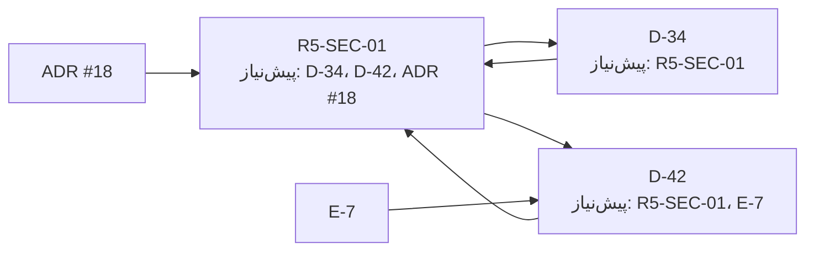
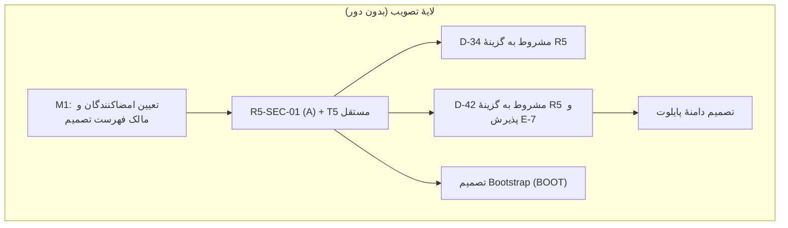

# RM-P10A — بستهٔ بستن تصمیم‌های هویت و دسترسی

**DRAFT — NOT APPROVED.** این بسته یافته‌های ممیزی RM-P09 را به قرارداد فنی و تصمیم‌های آمادهٔ تصویب تبدیل می‌کند. هیچ گزینه‌ای انتخاب نمی‌شود. هیچ تصمیمی تصویب یا تغییر وضعیت داده نمی‌شود. هیچ کد اجرایی، مهاجرت، API، حساب، اعتبارنامه، Grant، Revoke، Feature Flag یا اتصال Production ایجاد یا تغییر داده نمی‌شود.

**GROUP B CLOSED — PRODUCTION NO-GO.**

| مورد | مقدار |
|---|---|
| مبنای بررسی‌شده | `main` @ `2638bdae9982ff9fec4d1d5ddc65615d0b10c78c` (ادغام PR #97، ممیزی RM-P09) |
| شاخه | `claude/funny-bell-bk9xyk` |
| تاریخ | 2026-11-23 |
| مراجع بازاستفاده‌شده (تکرار نشده‌اند) | `docs/audits/rm-p09-identity-access-pilot-readiness.md` (یافته‌های F01 تا F12، PC-01 تا PC-15)؛ `docs/audits/rm-p08-functional-integration-audit.md` (BN-09، BN-10، BN-16)؛ `docs/security/rm-e04h-person-identity-decision-package.md` (گزینه‌های A تا D، OF-4، HQ-1 تا HQ-12)؛ `docs/security/rm-e04i-option-a-implementation-contract.md` (E1 تا E7، resolver، W1 تا W11، H-1 تا H-8، PR-A تا PR-F)؛ `docs/remediation/m2-authorization-decision-intake-fa.md` (پیشنهاد ثبت ۱ و ۲، Q3)؛ `docs/remediation/m2-engineering-readiness.md` (S1 تا S5)؛ `docs/remediation/m2-d42-seller-authorization-fa.md` (N1 تا N8)؛ `docs/governance/r6-decision-tracker.json`؛ `docs/remediation/r5-decision-inventory.md`؛ `AGENTS.md` |
| آزمون حاکمیتی این بسته | `docs/governance/rm_p10a_test.go` |

## فایل‌های بسته

| # | فایل | محتوا |
|---|---|---|
| ۰ | همین فایل | خلاصه، حل دور OF-4، بستهٔ امضای R5-SEC-01، فهرست تصویب، پاسخ نهایی |
| ۱ | `docs/decisions/rm-p10a/identity-person-account-contract.md` | قرارداد شخص و حساب برای Option A؛ ماشین‌های وضعیت؛ جدول انتقال مجاز و ممنوع؛ کنترل همکاری فعال در ورود و نشست |
| ۲ | `docs/decisions/rm-p10a/row-scope-contract.md` | مدل NONE / SELF / TEAM / ALL؛ پاسخ به ده پرسش؛ مدل هر ماژول |
| ۳ | `docs/decisions/rm-p10a/d34-account-provisioning-contract.md` | قرارداد تأمین حساب، اعتبارنامه، غیرفعال‌سازی و ابطال نشست (D-34) |
| ۴ | `docs/decisions/rm-p10a/d42-grant-revoke-contract.md` | قرارداد درخواست، تأیید، اجرا و لغو Grant (D-42 و E-7) |
| ۵ | `docs/decisions/rm-p10a/decision-dependency-matrix.md` | ماتریس همهٔ تصمیم‌ها، وابستگی‌ها و قفل‌های امنیتی |
| ۶ | `docs/decisions/rm-p10a/pilot-security-controls.md` | جدول اصلاح F01 تا F12 و کنترل‌های پیش از پایلوت |
| ۷ | `docs/decisions/rm-p10a/rm-p10b-delivery-plan.md` | برنامهٔ مرحله‌بندی‌شدهٔ توسعهٔ RM-P10B |

## واژگان وضعیت

هر مورد در این بسته دقیقاً یکی از این وضعیت‌ها را دارد. هر ستونی که عنوانش دقیقاً «وضعیت» است، فقط همین مقادیر را می‌پذیرد (`TestRMP10AStatusVocabulary`).

| وضعیت | معنی |
|---|---|
| `EXISTING_VERIFIED` | در کد، مهاجرت یا آزمون روی SHA مبنا وجود دارد و بازبینی شد |
| `PROPOSED` | پیشنهاد مهندسی این بسته؛ نه تصمیم، نه مجوز اجرا |
| `REQUIRES_APPROVAL` | بدون تصویب انسانی ثبت‌شده (رکورد R6 با `APPROVED_VERIFIED`) قابل اجرا نیست |
| `BLOCKED` | تا رفع یک وابستگی نام‌برده، ممکن نیست |
| `UNKNOWN` | شاهد کافی در مخزن وجود ندارد |

هیچ وضعیت تصویب‌شدهٔ جدیدی در این بسته ثبت نشده است. پوشهٔ `docs/governance/approvals/` وجود ندارد و هیچ رکورد تصویبی در مخزن نیست.

---

## ۱. خلاصهٔ مدیریتی

1. **دور OF-4 فقط در لایهٔ «پیاده‌سازی» واقعی است، نه در لایهٔ «تصمیم».** هیچ‌یک از D-34 و D-42 برای *تصمیم‌گیری* دربارهٔ R5-SEC-01 لازم نیست. آن‌ها فقط برای *اجرای* گردش کار ثبت شخص لازم‌اند (کاربر HR باید بتواند وارد شود و Capability داشته باشد). این دور با یک «راه‌اندازی اولیهٔ کنترل‌شده» (Bootstrap) شکسته می‌شود. ترتیب پیشنهادی تصویب: R5-SEC-01 ← D-34 و D-42 (هر دو مشروط به گزینهٔ R5). ترتیب توسعه از آن جداست (§۲). تغییر ستون وابستگی ردیاب، تصمیم مالک فهرست تصمیم‌ها است (HQ-10). وضعیت: `REQUIRES_APPROVAL`.
2. **برای R5-SEC-01 یک متن تصمیم آمادهٔ امضا برای Option A تهیه شد** (§۳). شامل ۱۰ بند الزام‌آور، ۸ شرط، امضاکنندگان، شواهد لازم و گزینه‌های جایگزین B، C و D با اثر فنی و ریسک.
3. **قرارداد شخص و حساب** هفت ساختار RM-E04I را بازاستفاده می‌کند. سه افزوده دارد: وضعیت `SUSPENDED` برای پیوند، یک «پذیرش ورود» (Account Admission) که شخص، پیوند و همکاری فعال را در ورود و هر درخواست بررسی می‌کند، و ابطال اداری نشست هنگام خاتمهٔ همکاری (فایل ۱).
4. **مدل دامنه:** `SELF` و `TEAM` فقط از Grant صریح می‌آیند. سلسله‌مراتب هرگز دامنه نمی‌دهد. مالکیت نامعلوم همیشه پنهان است. دامنه پیش از جستجو، cursor و شمارش در کوئری اعمال می‌شود. گزارش‌ها تا نسخهٔ محدود فقط برای `ALL` مجازند (فایل ۲).
5. **D-34 و D-42** هر کدام فرمان‌های دقیق با ورودی، خروجی، خطا، پیش‌شرط و اثر امنیتی دارند. هیچ فرمانی بدون پیوند `VERIFIED`، پذیرش ورود و تصویب R5-SEC-01 قابل اجرا نیست (فایل ۳ و ۴).
6. **از ۱۲ یافتهٔ RM-P09،** هیچ‌کدام بدون تصمیم کامل بسته نمی‌شود. اما F09 و بخش‌های آزمونی F06، F07 و F12 بدون تصمیم کسب‌وکار قابل شروع‌اند (فقط بازبینی امنیتی لازم دارند). F01، F02، F03، F04، F06 (دامنهٔ فروش)، F07 (گزارش محدود)، F08، F10، F11 و F12 (ثبت پایدار) تصمیم لازم دارند (فایل ۶).
7. **RM-P10B** به ۱۴ PR کوچک تقسیم شد. فقط مرحلهٔ صفر بدون تصویب کسب‌وکار ممکن است. اولین PR اجرایی پس از تصویب R5-SEC-01، مدل سایهٔ رجیستری شخص با دادهٔ مصنوعی و پرچم خاموش است (فایل ۷).

---

## ۲. حل وابستگی دوری R5-SEC-01 ↔ D-34 / D-42 (OF-4)

### ۲.۱ نمودار وابستگی فعلی (طبق ردیاب؛ بدون تغییر)



منبع: `docs/governance/r6-decision-tracker.json` (فیلد `prerequisites`)؛ `docs/governance/proposals/rm-e04i-dependency-graph.json` (`unresolved_conflicts`: OF-4a و OF-4b، هر دو `UNRESOLVED`). این بسته هیچ‌یک از این دو فایل را تغییر نمی‌دهد.

### ۲.۲ طبقه‌بندی هر یال: تصمیم‌گیری یا پیاده‌سازی

| یال | ماهیت واقعی | توضیح | شاهد | وضعیت |
|---|---|---|---|---|
| R5-SEC-01 → D-34 | **تصمیم (سازگاری گزینه)** + پیاده‌سازی | گزینهٔ ۳ D-34 («External IdP») همان گزینهٔ B در R5-SEC-01 است. پس گزینهٔ D-34 باید با گزینهٔ R5 سازگار باشد. در پیاده‌سازی، فرمان تأمین حساب به resolver شخص نیاز دارد | `r5-decision-inventory.md` ردیف D-34؛ `m2-engineering-readiness.md` S1 | `EXISTING_VERIFIED` |
| D-34 → R5-SEC-01 | **فقط پیاده‌سازی (Bootstrap)** | برای *تصمیم* دربارهٔ مرجع هویت، سیاست رمز لازم نیست. اما گردش کار W1 تا W11 به کاربر HR نیاز دارد که بتواند وارد شود، و ورود به اعتبارنامه نیاز دارد | `rm-e04i…` §6؛ `00012_identity_authentication.sql:87` (اعتبارنامه فقط SELECT) | `PROPOSED` |
| R5-SEC-01 → D-42 | **تصمیم (سازگاری گزینه)** + پیاده‌سازی | گزینهٔ ۲ D-42 («HR درخواست، Security تأیید») به تفکیک وظایف در سطح شخص تکیه دارد. Grant باید به گیرندهٔ `VERIFIED` داده شود | `m2-engineering-readiness.md` S2؛ `rm-e04h…` §7.2 (G3) | `EXISTING_VERIFIED` |
| D-42 → R5-SEC-01 | **فقط پیاده‌سازی (Bootstrap)** | تصمیم دربارهٔ مرجع هویت به مرجع Grant نیاز ندارد. اما سازندهٔ پیوند (HR) و بازبین (Security/HR) باید Capability ثبت پیوند داشته باشند، و Capability فقط با Grant داده می‌شود | `internal/identity/api/api.go:211-221` (بستهٔ نقش‌ها)؛ `00001_identity.sql:195` | `PROPOSED` |
| ADR #18 → R5-SEC-01 | **شرطی** | فقط اگر Option A دادهٔ واقعی HR را در Staging لازم داشته باشد. با دادهٔ مصنوعی، پیش‌نیاز نیست | `rm-e04h…` §2.3 OF-4؛ `rm-e04i-dependency-graph.json` (یال CONDITIONAL) | `PROPOSED` |
| E-7 → D-42 | **پیاده‌سازی** | تصمیم D-42 می‌تواند با شرط «E-7 پیش از هر Grant پذیرفته شود» تصویب شود. E-7 پیش‌نیاز مهندسی است، نه تصمیم کسب‌وکار | `r5-decision-inventory.md:144` | `EXISTING_VERIFIED` |

**نتیجه:** در لایهٔ تصمیم، گراف بدون دور است: `R5-SEC-01 → {D-34, D-42}`. دو یال معکوس فقط در لایهٔ پیاده‌سازی وجود دارند و هر دو یک مسئلهٔ واحدند: «اولین کاربران رجیستری چگونه بدون رجیستری تأیید شوند؟» (Bootstrap). وضعیت این خوانش: `REQUIRES_APPROVAL` (HQ-10، مالک فهرست تصمیم + بازبین مستقل).

### ۲.۳ ترتیب تصویب (مستقل از ترتیب توسعه)



| گام | تصمیم | قابل هم‌زمانی با | شرط ثبت | وضعیت |
|---|---|---|---|---|
| T-0 | پاسخ M1: امضاکنندگان Security، HR، Legal، Product؛ بازبین T5؛ مالک فهرست تصمیم | — | مدرک اختیار مکتوب (`r6-approval-evidence-standard.md`) | `REQUIRES_APPROVAL` |
| T-1 | R5-SEC-01 (متن §۳) | T-2 و T-3 در همان جلسهٔ M2 | رکورد R6 با چهار امضای مستقل + T5 | `REQUIRES_APPROVAL` |
| T-2 | D-34 | T-1 (رکورد جدا، با ارجاع به T-1 در `conditions`) | «گزینهٔ انتخابی باید با گزینهٔ R5-SEC-01 سازگار باشد» | `REQUIRES_APPROVAL` |
| T-3 | D-42 | T-1 | «اجرا فقط پس از پذیرش E-7 و سخت‌سازی H-1 تا H-8» | `REQUIRES_APPROVAL` |
| T-4 | تصمیم Bootstrap (§۲.۵) | T-1 | امضای Security + HR + T5 | `REQUIRES_APPROVAL` |
| T-5 | HQ-10: خوانش جهت وابستگی | T-1 | رکورد مالک فهرست تصمیم؛ ستون `prerequisites` فقط با رکورد جدید اصلاح شود | `REQUIRES_APPROVAL` |

این همان راه دوم جدول «مسئلهٔ وابستگی چرخشی» در `m2-authorization-decision-intake-fa.md` §۲ است («R5-SEC-01 اول تصمیم شود و D-34 / D-42 با شرط سازگاری ثبت شوند»)، به‌علاوهٔ امکان بررسی هم‌زمان در یک جلسه (راه اول). این بسته هیچ‌یک از سه راه را انتخاب نمی‌کند. فقط نشان می‌دهد که راه اول و دوم با هم سازگارند.

### ۲.۴ ترتیب توسعه (جدا از ترتیب تصویب)

ترتیب توسعه در فایل ۷ آمده است. خلاصه: آزمون‌های قفل (بدون تصمیم) ← رجیستری سایه ← resolver ← پذیرش ورود ← ابطال اداری نشست ← تأمین حساب ← سخت‌سازی قفل Grant ← فرمان Grant ← دامنهٔ سطری ← گزارش ← لاگ ← Staging ← پذیرش پایلوت. هیچ مرحله‌ای پیش از تصویب پیش‌نیاز خودش ادغام نمی‌شود.

### ۲.۵ شکستن دور پیاده‌سازی: Bootstrap کنترل‌شده

| گزینه | شرح | اثر فنی | ریسک | وضعیت |
|---|---|---|---|---|
| **BOOT-1 (پیشنهاد مهندسی)** | پیوندهای اولیهٔ اپراتورهای رجیستری (حداقل دو سازنده و دو بازبین) با یک فرمان خط فرمان یک‌بارمصرف ساخته می‌شوند، نه با SQL دستی و نه با ورود وب. هر پیوند مدرک انتصاب امضاشده دارد، تأیید هویت از کانال مستقل دارد و توسط بازبین T5 ثبت می‌شود. هیچ‌کس پیوند خودش را تأیید نمی‌کند. فرمان پس از سقف مشخص (مثلاً ۴ پیوند) و پس از یک بار اجرا قفل می‌شود. پایهٔ هر پیوند `BOOTSTRAP` ثبت می‌شود و پس از راه‌اندازی، بازبینی مجدد با گردش عادی الزامی است | یک فرمان CLI در ماژول organization؛ رویداد ممیزی؛ قفل سقف در DB | تمرکز اعتماد روی T5 و مدارک انتصاب (همان ریسک bootstrap در `rm-e04h…` §6.4) | `REQUIRES_APPROVAL` |
| BOOT-2 | اپراتورهای اولیه از IdP (گزینهٔ B) می‌آیند | نیاز به زیرساخت IdP | گزینهٔ R5 را عملاً به B تغییر می‌دهد | `REQUIRES_APPROVAL` |
| BOOT-3 | بدون Bootstrap؛ رجیستری خالی می‌ماند | هیچ | کل مسیر پایلوت `BLOCKED` می‌ماند | `PROPOSED` (پیش‌فرض امن تا تصمیم) |

فرمان Bootstrap **هیچ اعتبارنامه یا Grant نمی‌سازد.** فقط پیوند شخص به حساب را می‌سازد. اعتبارنامهٔ این اپراتورها همچنان از فرمان D-34 و Capability آن‌ها از فرمان D-42 می‌آید.

### ۲.۶ شرایطی که بدون تصویب R5-SEC-01 اجازهٔ صدور اعتبارنامه یا Grant نمی‌دهند

این شرایط **تجمعی** هستند. یعنی هر کدام به‌تنهایی کافی است تا صدور رد شود. هیچ‌کدام قفل‌های موجود را حذف نمی‌کند.

| # | شرط | محل اعمال پیشنهادی | رفتار در صورت نقض | وضعیت |
|---|---|---|---|---|
| NG-1 | قفل `credential` فقط SELECT و قید `role_grant_shadow_only` باقی می‌مانند، تا مهاجرتی که خودش تصویب جداگانه دارد | `00012_identity_authentication.sql:87`؛ `00001_identity.sql:195` | DB خطا می‌دهد | `EXISTING_VERIFIED` |
| NG-2 | resolver شخص در هر فراخوانی، اگر R5-SEC-01 با `APPROVED_VERIFIED` و گزینهٔ A یا B نباشد، `BLOCKED(RESOLVER_NOT_AUTHORISED)` برمی‌گرداند | `rm-e04i…` §5.3 گام ۱ | فرمان رد می‌شود | `PROPOSED` |
| NG-3 | فرمان تأمین حساب (D-34) فقط وقتی اجرا می‌شود که `resolvePerson(account, now, ACCOUNT_PROVISIONING) = VERIFIED` باشد | فایل ۳ | `BLOCKED(PERSON_LINK_UNVERIFIED)` | `PROPOSED` |
| NG-4 | فرمان Grant (D-42) فقط برای گیرنده‌ای با پیوند `VERIFIED` و پذیرش ورود `ADMITTED` اجرا می‌شود | فایل ۴ | `BLOCKED(GRANTEE_NOT_VERIFIED)` | `PROPOSED` |
| NG-5 | قفل حاکمیتی Grant (`grantConstraintProblems`) پیش از هر مهاجرت `role_grant` با H-1 تا H-8 سخت می‌شود، از جمله H-1 (R5-SEC-01 تصویب‌شده) | `docs/governance/rm_e04d_test.go`؛ `rm-e04i…` §8 | CI قرمز | `REQUIRES_APPROVAL` (H-RV-08 / I-RV-07) |
| NG-6 | پیش‌نیاز S1 در `m2-engineering-readiness.md` («R5-SEC-01 فقط اگر گزینهٔ ۳ D-34») به «R5-SEC-01 با گزینهٔ A یا B، برای همهٔ گزینه‌های D-34» سخت‌تر شود | بازنگری سند S1 پس از تصویب | — | `REQUIRES_APPROVAL` |
| NG-7 | ورود (Login) و هر احراز نشست بدون رکورد پذیرش `ADMITTED` رد می‌شود. نبود رکورد یعنی رد | فایل ۱ §۶ | `401` / `BLOCKED(ACCOUNT_NOT_ADMITTED)` | `PROPOSED` |
| NG-8 | پیشنهاد ترجیحی Option A فقط در رکورد غیرمرجع ثبت است و هیچ gate آن را نمی‌خواند | `TestRME04IPreferenceIsNotConsumed` | CI قرمز | `EXISTING_VERIFIED` |

### ۲.۷ اثبات اینکه هیچ پیشنهادی قفل‌های فعلی را دور نمی‌زند

روش: برای هر قفل موجود بررسی شد که آیا پیشنهادی از این بسته آن را حذف، تضعیف یا دور می‌زند. معیار: هر پیشنهاد باید **یکنوا** باشد، یعنی فقط شرط رد اضافه کند. هر برداشتن قفل فقط در PR جدا و پس از تصویب نام‌برده انجام می‌شود.

| قفل موجود | شاهد | پیشنهادهای مرتبط | آیا تضعیف می‌شود؟ | وضعیت |
|---|---|---|---|---|
| L1 نقش برنامه روی `identity.credential` فقط SELECT دارد | `00012_identity_authentication.sql:87`؛ lint `r1-credential-write` (`internal/architecture/lint.go:325`) | فرمان تأمین (فایل ۳) | فقط با مهاجرت جدا که INSERT/UPDATE را **فقط** به فرمان تأمین بدهد، پس از D-34 و R5-SEC-01 | `EXISTING_VERIFIED` |
| L2 `role_grant_shadow_only` و L3 `role_grant_basis = LEGACY_PROFILE_ROLE` | `00001_identity.sql:194-195` | فرمان Grant (فایل ۴) | فقط با مهاجرت جدا پس از D-42، E-7، H-1 تا H-8. Grantهای SHADOW قدیمی دست نمی‌خورند | `EXISTING_VERIFIED` |
| L4 پرچم `identity.session_auth` پیش‌فرض خاموش | `session.go:71`؛ `session.go:279-281` | هیچ | خیر. این بسته هیچ پرچمی را تغییر نمی‌دهد | `EXISTING_VERIFIED` |
| L5 Staging بدون DSN احراز هویت | `deploy/staging/compose.yaml:100-107`؛ `apiserver/auth.go:42-47` | F11 (فایل ۶) | فقط در مرحلهٔ P10B-11 با دادهٔ مصنوعی و ADR #18 بسته | `EXISTING_VERIFIED` |
| L6 dev stub در تولید ساخته نمی‌شود | `authstub.go:89-95`؛ `TestHTTPNoDevBypassInProduction` | هیچ | خیر | `EXISTING_VERIFIED` |
| L7 ارزیاب فقط NONE/ORGANIZATION؛ `CheckRead` دامنهٔ اعلام‌نشده را رد می‌کند | `authorization.go:75-78`؛ `internal/authorization/guard.go:182`؛ `TestNT07UnsupportedScopeRefused` | مدل دامنه (فایل ۲) | خیر. `SELF` و `TEAM` محدودترند و دامنهٔ اعلام‌نشده همچنان رد می‌شود | `EXISTING_VERIFIED` |
| L8 بستهٔ ۸ نقش از ۹ نقش تهی است | `internal/identity/api/api.go:211-221` | هیچ | خیر. افزودن Capability به نقش تصمیم جدا دارد (پیشنهاد ثبت ۱ M2) | `EXISTING_VERIFIED` |
| L9 سلسله‌مراتب هرگز مجوز نمی‌دهد | `authorization.go:39-49`؛ `TestHierarchyAndPositionNeverGrant` | TEAM (فایل ۲) | خیر. TEAM فقط *محدودکنندهٔ* Grant صریح است، نه منبع آن | `EXISTING_VERIFIED` |
| L10 گارد موقت RM-E04G-I1، gate گروه B خالی، کف امضای `m2Approvers` | `docs/governance/rm_e04g_test.go`؛ `rm-e04c-group-b-gate.json`؛ `m2_test.go` | هیچ | خیر | `EXISTING_VERIFIED` |
| L11 lint `s11-hr-identity-write`، `foreign-schema-write`، `phoneIdent` | `internal/architecture/lint.go:280,302,488` | پذیرش ورود (فایل ۱) | خیر. پروجکشن پذیرش در schema هویت توسط identity نوشته می‌شود، نه organization | `EXISTING_VERIFIED` |
| L12 قفل حاکمیتی Grant فقط با وضعیت D-42 | `rm_e04d_test.go` (`grantConstraintProblems`) | NG-5 | **سخت‌تر می‌شود** (H-1 تا H-8) | `EXISTING_VERIFIED` (قفل)؛ سخت‌سازی `REQUIRES_APPROVAL` |

هیچ پیشنهادی (۱) قفل DB را بدون مهاجرت تصویب‌شده حذف نمی‌کند، (۲) Grant یا اعتبارنامه را از داده، سمت یا سلسله‌مراتب استخراج می‌کند، (۳) تلفن، نام یا ایمیل را هویت می‌داند، (۴) دادهٔ ناشناخته را مجاز می‌کند، یا (۵) پرچمی را روشن می‌کند. ماتریس کامل: فایل ۵.

---

## ۳. بستهٔ تصمیم آمادهٔ امضا: R5-SEC-01

**این متن تصمیم نیست.** پیش‌نویس متنی است که اگر امضاکنندگان مجاز گزینهٔ A را برگزینند، می‌توانند امضا کنند. انتخاب A ترجیح اعلام‌شدهٔ مالک پروژه است (`rm-e04i…` §2) و توصیهٔ مشروط مهندسی است (`rm-e04h…` §4.3)، اما تصمیم تصویب‌شده نیست. وضعیت کل بخش: `REQUIRES_APPROVAL`.

### ۳.۱ متن پیشنهادی تصمیم (گزینهٔ A)

| بند | متن پیشنهادی | وضعیت |
|---|---|---|
| A-1 | مرجع هویت انسانی CRM یک «رجیستری شخص تأییدشده» است که مالک رکوردهای آن واحد منابع انسانی است و مالک سیاست پیوند آن واحد امنیت است | `REQUIRES_APPROVAL` |
| A-2 | هر شخص تأییدشده یک شناسهٔ پایدار `verified_person_id` دارد که هرگز تغییر نمی‌کند، دوباره استفاده نمی‌شود و حذف نمی‌شود. `organization.person.person_id` و `identity.user_account.user_id` شناسهٔ شخص نیستند | `REQUIRES_APPROVAL` |
| A-3 | اتصال حساب به شخص فقط با رکورد پیوند مستند، دارای مدرک، با بازبین مستقل (سازنده ≠ بازبین ≠ موضوع، در سطح شخص)، مؤثر-تاریخ، قابل تعلیق و قابل لغو انجام می‌شود. هیچ اتصال خودکار، وارداتی یا بر پایهٔ تطبیق نام، تلفن، ایمیل یا نام کاربری وجود ندارد | `REQUIRES_APPROVAL` |
| A-4 | تاریخچهٔ رجیستری append-only است. اصلاح، رکورد جدید است. هیچ رکورد تاریخی بازنویسی نمی‌شود | `REQUIRES_APPROVAL` |
| A-5 | حساب مشترک، حساب خدمت و حساب بدون پیوند هرگز به‌عنوان شخص شمرده نمی‌شوند و حالت `UNKNOWN` یا `CONFLICT` یا `BLOCKED` می‌گیرند. این حالت‌ها هرگز مجوز نمی‌دهند | `REQUIRES_APPROVAL` |
| A-6 | ورود و ادامهٔ نشست فقط برای حسابی مجاز است که پیوند مؤثر `VERIFIED` و همکاری فعال دارد. خاتمهٔ همکاری یا لغو پیوند، نشست‌ها را باطل می‌کند | `REQUIRES_APPROVAL` |
| A-7 | روش اثبات هویت (HQ-2)، فهرست انواع مدرک و مدت اعتبار هر مدرک با تصمیم HR + Security تعیین می‌شود. تا آن زمان هیچ پیوندی `VERIFIED` نمی‌شود | `REQUIRES_APPROVAL` |
| A-8 | رجیستری فقط ارجاع و hash مدرک را نگه می‌دارد، نه کپی سند، مگر Legal صریحاً اجازه دهد (HQ-5). هر خواندن مدرک هدف‌محدود و ممیزی‌شده است | `REQUIRES_APPROVAL` |
| A-9 | این تصمیم هیچ Capability، Grant، اعتبارنامه یا دسترسی‌ای ایجاد نمی‌کند. تأمین حساب تابع D-34 و Grant تابع D-42 است | `REQUIRES_APPROVAL` |
| A-10 | اجرای این تصمیم در Production مجوز استقرار جداگانه لازم دارد | `REQUIRES_APPROVAL` |

### ۳.۲ شرایط تصویب (برای فیلد `conditions` رکورد R6)

| شرط | محتوا | منبع | وضعیت |
|---|---|---|---|
| C-A1 | مالک پاسخ‌گوی HR برای رکوردهای شخص تعیین شود (HQ-1) | `rm-e04h…` §8.1 | `REQUIRES_APPROVAL` |
| C-A2 | روش اثبات هویت تصویب شود (HQ-2) | همان | `REQUIRES_APPROVAL` |
| C-A3 | بازبینی حریم خصوصی Legal ثبت شود (HQ-5) | رکورد R5؛ intake blank | `REQUIRES_APPROVAL` |
| C-A4 | جایگاه‌های سازنده، بازبین و لغوکنندهٔ پیوند تعیین شوند (HQ-6) | همان | `REQUIRES_APPROVAL` |
| C-A5 | قاعدهٔ بستن پیوند هنگام انتقال، خاتمه و جابه‌جایی حساب (HQ-7، OPD-05) | همان | `REQUIRES_APPROVAL` |
| C-A6 | روش Bootstrap (§۲.۵) پذیرفته شود (HQ-8) | `rm-e04h…` §6.4 | `REQUIRES_APPROVAL` |
| C-A7 | D-34 و D-42 فقط گزینه‌های سازگار با A را بپذیرند | §۲.۳ | `REQUIRES_APPROVAL` |
| C-A8 | تا تصویب ADR #18، فقط دادهٔ مصنوعی در محیط غیرتولید | `r5-decision-inventory.md:108`؛ `staging.go:119` | `REQUIRES_APPROVAL` |

### ۳.۳ امضاکنندگان و شواهد

| نقش | الزام | منبع | وضعیت |
|---|---|---|---|
| Security owner | امضای مستقل | intake `R5-SEC-01_proposed_ADR-v1.0-DECISION.BLANK.json`؛ `m2Approvers` | `REQUIRES_APPROVAL` (دارنده UNASSIGNED) |
| HR owner | امضای مستقل؛ **هیچ نامزدی ثبت نشده** | همان؛ رجیستر نامزدی | `BLOCKED` (تا تعیین مالک HR، HQ-1) |
| Legal owner (حریم خصوصی) | امضای مستقل + بازبینی حریم خصوصی | همان | `REQUIRES_APPROVAL` |
| Product owner | امضای مستقل | همان | `REQUIRES_APPROVAL` |
| بازبین T5 | هیچ‌یک از امضاکنندگان و ثبت‌کننده نباشد؛ اتوماسیون نباشد | `r6-approval-evidence-standard.md` §3 | `BLOCKED` (UNASSIGNED، HQ-12) |
| حداقل افراد متمایز | پنج نفر | `rm-e04h…` §8؛ `TestRME04HSignerSlotsMatchSources` | `EXISTING_VERIFIED` |

این بسته، دستور جلسهٔ مالک پروژه، حساب GitHub، ادغام PR یا نتیجهٔ CI مدرک اختیار نیستند (`rm-e04h…` §8).

### ۳.۴ گزینه‌های جایگزین (حفظ‌شده، بدون انتخاب)

| گزینه | متن اصلی (خلاصه از رکورد R5) | اثر فنی بر این بسته | ریسک اصلی | وضعیت |
|---|---|---|---|---|
| A | رجیستری شخص تأییدشده توسط HR، پیوند بازبینی‌شده و برگشت‌پذیر | همهٔ قراردادهای فایل ۱ تا ۴ بدون تغییر | ادغام یا تفکیک اشتباه؛ جعل پیوند توسط خودی (کنترل: دو نفر، append-only) | `REQUIRES_APPROVAL` |
| B | IdP تحت مدیریت امنیت؛ حساب‌ها federate می‌شوند | E1 تا E5 با نگاشت federation جایگزین می‌شوند؛ D-34 عملاً گزینهٔ ۳؛ زیرساخت و قرارداد جدید | وابستگی به فروشنده؛ قطعی IdP یعنی `BLOCKED` | `REQUIRES_APPROVAL` |
| C | تفکیک وظایف اعلامی؛ بدون موجودیت شخص | پذیرش ورود نمی‌تواند پیوند `VERIFIED` را بررسی کند؛ NG-2 همیشه `BLOCKED` می‌ماند؛ **هیچ ورودی ممکن نیست** طبق این بسته | استقلال افراد اثبات نمی‌شود (F1 حل‌نشده) | `REQUIRES_APPROVAL` |
| D | مسدود ماندن | هیچ؛ همهٔ مسیرها `BLOCKED` | P0-6 و P0-7 بسته می‌مانند | `REQUIRES_APPROVAL` |

متن کامل و بدون تغییر گزینه‌ها: `rm-e04h…` §2.2.

---

## ۴. قرارداد شخص و حساب — خلاصه

جزئیات کامل در فایل ۱.

| جزء | خلاصه | وضعیت |
|---|---|---|
| رجیستری شخص | هفت ساختار E1 تا E7 از `rm-e04i…` §4 بدون تغییر بازاستفاده می‌شوند | `PROPOSED` |
| ماشین وضعیت پیوند | `PROPOSED → UNDER_REVIEW → VERIFIED → EFFECTIVE ⇄ SUSPENDED → REVOKED / EXPIRED`؛ همراه `REJECTED`، `SUPERSEDED` و نگه‌داشت تعارض. `SUSPENDED` افزودهٔ این بسته است (IQ-2) | `REQUIRES_APPROVAL` |
| پذیرش ورود | رکورد پذیرش در identity، تغذیه از رویدادهای organization؛ بدون رکورد یعنی رد | `PROPOSED` |
| خاتمهٔ همکاری | ابطال پذیرش ← ابطال همهٔ نشست‌ها با دلیل ثبت‌شده | `REQUIRES_APPROVAL` (OPD-05 / SD-04؛ یا فرمان دستی برای پایلوت) |

## ۵. مدل دامنهٔ سطری — خلاصه

جزئیات کامل در فایل ۲. هیچ‌یک تا تصویب اجرایی نیست.

| قاعده | وضعیت |
|---|---|
| دامنه فقط از Grant صریح (جفت Capability و دامنه) می‌آید. سمت و سلسله‌مراتب هرگز دامنه نمی‌دهند | `PROPOSED` |
| `ALL` همان `ORGANIZATION` فعلی است. نام موجود حفظ می‌شود (KEEP + ADAPT) | `PROPOSED` |
| مالکیت نامعلوم، متعارض یا چندگانه‌ای که قاعدهٔ تصویب‌شده ندارد، برای SELF و TEAM پنهان است | `PROPOSED` |
| خارج از دامنه با شناسهٔ مستقیم: ۴۰۴ با بدنهٔ یکسان. بدون Capability: ۴۰۳ پیش از کوئری (موجود) | `PROPOSED` |
| جستجو، فیلتر، cursor، شمارش و total پس از اعمال دامنه | `PROPOSED` |
| گزارش و شمارنده تا نسخهٔ محدود فقط برای Grant با دامنهٔ ALL | `PROPOSED` |
| دسترسی به پرونده یا مشتری هرگز مجوز مالی نمی‌دهد. دامنهٔ فاکتور با مالکیت خود فاکتور سنجیده می‌شود | `EXISTING_VERIFIED` (Capability)؛ قاعدهٔ دامنه `PROPOSED` |
| قاعدهٔ TEAM (مستقیم یا تودرتو، جاری یا تاریخی) | `REQUIRES_APPROVAL` (D-32 + پیشنهاد ثبت ۲) |

## ۶. D-34 و D-42 — خلاصه

| تصمیم | آنچه باید تصمیم شود | قرارداد | وضعیت |
|---|---|---|---|
| D-34 | گزینه (رمز یک‌بارمصرف با تغییر اجباری / دعوت‌نامهٔ دارای انقضا / IdP)؛ مرجع ایجاد؛ کانال تحویل راز؛ مدت انقضا؛ سیاست حساب چندگانهٔ یک شخص؛ مرجع غیرفعال‌سازی و فعال‌سازی مجدد؛ حل تعارض C-04 | فایل ۳ (شش فرمان) | `REQUIRES_APPROVAL` |
| D-42 | گزینه (فقط Identity/Security / HR درخواست و Security تأیید / HR در مجموعهٔ محدود)؛ مرجع درخواست، تأیید و اجرا؛ سقف مدت Grant؛ مجموعهٔ نقش‌های قابل اعطا؛ حداکثر دامنهٔ هر نقش؛ مرجع لغو فوری | فایل ۴ (هشت فرمان) | `REQUIRES_APPROVAL` |
| E-7 | شکل تاریخچهٔ append-only Grant و Flag، فیلدهای ممیزی، رویهٔ تغییر | فایل ۴ §۵ | `PROPOSED` (طراحی سند مجاز است؛ پذیرش `REQUIRES_APPROVAL`) |

---

## ۷. فهرست دقیق تصویب‌های لازم برای آغاز RM-P10B

| # | مورد | مرحلهٔ RM-P10B که باز می‌شود | وضعیت |
|---|---|---|---|
| AP-0 | **هیچ تصویب کسب‌وکاری**؛ فقط بازبینی مستقل PR | P10B-0 (آزمون‌های قفل و فهرست endpointها) و P10B-0b (F09) | `PROPOSED` |
| AP-1 | R5-SEC-01 = A با `APPROVED_VERIFIED`، شرایط C-A1 تا C-A5 و C-A8 | P10B-1، P10B-2 | `REQUIRES_APPROVAL` |
| AP-2 | پاسخ IQ-1 (مالکیت organization)، IQ-2 (حالات گردش کار شامل `SUSPENDED`)، IQ-3 (فهرست بستهٔ purpose با چهار purpose جدید این بسته)، IQ-4 (PR-B پیش از PR-C) | P10B-1، P10B-2 | `REQUIRES_APPROVAL` |
| AP-3 | Bootstrap (BOOT-1 یا جایگزین) | P10B-1 (فرمان Bootstrap) | `REQUIRES_APPROVAL` |
| AP-4 | قاعدهٔ پذیرش ورود: نگاشت ۸ وضعیت همکاری (به‌ویژه `PROBATION`) و TTL پروجکشن | P10B-3 | `REQUIRES_APPROVAL` |
| AP-5 | D-34 با گزینهٔ سازگار + مرجع غیرفعال‌سازی و ابطال اداری نشست | P10B-4، P10B-5 | `REQUIRES_APPROVAL` |
| AP-6 | سخت‌سازی قفل Grant (H-1 تا H-8؛ H-RV-08 / I-RV-07) | P10B-6 | `REQUIRES_APPROVAL` |
| AP-7 | D-42 + پذیرش E-7 + پیشنهاد ثبت ۱ M2 (بستهٔ Capability) برای نقش پایلوت | P10B-7 | `REQUIRES_APPROVAL` |
| AP-8 | دامنهٔ پایلوت: برای HR پذیرش صریح ALL؛ برای فروش پیشنهاد ثبت ۲ و D-32 | P10B-8، P10B-9 | `REQUIRES_APPROVAL` |
| AP-9 | D-45 و D-23 (لاگ و ممیزی خواندن حساس) + طرح‌وارهٔ ثبت ۴۰۳ | P10B-10 | `REQUIRES_APPROVAL` |
| AP-10 | امضای BN-16 برای پیکربندی Staging با دادهٔ مصنوعی؛ ADR #18 فقط اگر دادهٔ واقعی | P10B-11 | `REQUIRES_APPROVAL` |
| AP-11 | مجوز فعال‌سازی جداگانهٔ پایلوت (Group C) | P10B-12 | `REQUIRES_APPROVAL` |

**حداقل برای آغاز کار اجرایی RM-P10B پس از مرحلهٔ صفر: AP-1، AP-2 و AP-3.** مراحل بعدی هر کدام تصویب خودشان را لازم دارند.

---

## ۸. پاسخ نهایی

1. **وابستگی دوری OF-4 چگونه قابل حل است؟** با جدا کردن لایهٔ تصمیم از لایهٔ پیاده‌سازی. در لایهٔ تصمیم، R5-SEC-01 بالادست است و D-34 و D-42 مشروط به گزینهٔ آن تصویب می‌شوند (در یک جلسه یا پشت سر هم). دو یال معکوس فقط مسئلهٔ «اولین اپراتورهای رجیستری» در پیاده‌سازی‌اند و با Bootstrap کنترل‌شده (BOOT-1) شکسته می‌شوند. ثبت رسمی این خوانش در ردیاب تصمیم مالک فهرست تصمیم‌ها است (HQ-10). این بسته ردیاب و گراف را تغییر نمی‌دهد.
2. **برای R5-SEC-01 چه تصمیمی آماده شده؟** متن ده‌بندی گزینهٔ A (A-1 تا A-10) با هشت شرط (C-A1 تا C-A8)، پنج نقش امضا و T5، و سه گزینهٔ جایگزین با اثر فنی. وضعیت: `REQUIRES_APPROVAL`. مالک HR و بازبین T5 هنوز نامزد ندارند (`BLOCKED`).
3. **D-34 و D-42 به چه تصمیم‌هایی نیاز دارند؟** D-34: گزینهٔ تأمین، مرجع ایجاد، کانال و انقضای راز، سیاست حساب چندگانه، مرجع غیرفعال‌سازی و ابطال اداری نشست، حل C-04. D-42: گزینهٔ مرجع، تفکیک درخواست‌کننده و تأییدکننده و اجراکننده، فهرست نقش‌های قابل اعطا و حداکثر دامنه، سقف مدت، مرجع لغو فوری، و پذیرش E-7.
4. **مدل SELF/TEAM/ALL چه قواعدی پیشنهاد می‌کند؟** دامنه فقط از Grant صریح می‌آید. SELF با گزارهٔ مالکیت تصویب‌شدهٔ هر ماژول سنجیده می‌شود. TEAM فقط زیرمجموعهٔ جاری طبق انتساب معتبر است و هر یافتهٔ سلسله‌مراتب آن را می‌بندد. ALL همان ORGANIZATION فعلی است. نامعلوم همیشه پنهان است. دامنه پیش از جستجو و شمارش در کوئری اعمال می‌شود. گزارش‌ها فقط برای ALL مجازند تا نسخهٔ محدود ساخته شود. پرونده هرگز مجوز مالی نمی‌دهد. لغو هرگز چیزی را به دیگری منتقل نمی‌کند.
5. **کدام مشکلات با توسعه حل می‌شوند و کدام تصمیم می‌خواهند؟** فقط با توسعه و بازبینی امنیتی: F09، آزمون‌های قفل و فهرست endpointها (بخش آزمونی F06 و F07)، و طراحی سند F12 و E-7. نیازمند تصمیم: F01، F02 (R5-SEC-01)؛ F03 (D-34 و OPD-05/SD-04)؛ F04 (D-34)؛ F05 (قرارداد principal خدمت)؛ F06 (پیشنهاد ثبت ۲، D-32)؛ F07 (دامنهٔ گزارش)؛ F08 (R5-SEC-01)؛ F10 (تصمیم HR دربارهٔ ماندگاری دید)؛ F11 (BN-16، ADR #18)؛ F12 (D-45، D-23).
6. **برای آغاز RM-P10B دقیقاً چه چیزهایی باید تصویب شوند؟** برای مرحلهٔ صفر هیچ تصمیم کسب‌وکاری لازم نیست. برای اولین مرحلهٔ اجرایی: AP-1 (R5-SEC-01 = A با `APPROVED_VERIFIED` و T5)، AP-2 (IQ-1 تا IQ-4) و AP-3 (Bootstrap). فهرست کامل در §۷.
7. **اولین PR اجرایی امن پس از تصویب چیست؟** P10B-1: مدل سایهٔ رجیستری شخص (E1 تا E7) در ماژول organization، با مهاجرت جدول‌های خالی، تریگرهای append-only، قید exclusion برای پیوند هم‌پوشان، فرمان‌ها پشت پرچم خاموش، نقش برنامه فقط SELECT، فقط دادهٔ مصنوعی، بدون هیچ نوشتن در `identity.*`، بدون اعتبارنامه و بدون Grant. پیش از آن و بدون تصویب، P10B-0 (آزمون‌های قفل) و P10B-0b (F09) امن‌اند.

---

## ۹. شواهد اجرای این بسته

| بررسی | نتیجه | وضعیت |
|---|---|---|
| تفاوت کد با مبنا | فقط فایل‌های `docs/decisions/**` و آزمون حاکمیتی `docs/governance/rm_p10a_test.go` | `EXISTING_VERIFIED` |
| ردیاب تصمیم‌ها | R5-SEC-01، D-34، D-42، D-45، D-23، ADR #18، OPD-05، SD-04 در `READY_FOR_REVIEW` و D-32 در `EVIDENCE_MISSING`؛ همه با `approval_record` خالی؛ بدون تغییر | `EXISTING_VERIFIED` |
| گراف وابستگی RM-E04I | OF-4a و OF-4b همچنان `UNRESOLVED`؛ بدون تغییر | `EXISTING_VERIFIED` |
| `go test -count=1 ./docs/governance/...` | PASS (پیش و پس از تغییر) | `EXISTING_VERIFIED` |
| `go vet ./docs/governance/...`، `gofmt -l docs/governance/`، `go build ./...` | تمیز | `EXISTING_VERIFIED` |
| `R5_REQUIRE_PROVENANCE=1 go test -count=1 ./docs/governance/...` (پس از `git fetch --unshallow`) | PASS | `EXISTING_VERIFIED` |
| آزمون‌های جدید | `TestRMP10APackageMarkers`، `TestRMP10AStatusVocabulary`، `TestRMP10ADecisionsStayUnapproved`، `TestRMP10ACycleRecordedNotResolved`، `TestRMP10ANoImplementationArtifacts` — همه PASS | `EXISTING_VERIFIED` |
| آزمون جهش (نسخهٔ پشتیبان در scratchpad؛ هیچ‌چیز Commit نشد) | ۷ از ۷ کشته شد: وضعیت خارج از واژگان؛ وضعیت `PROPOSED` برای R5-SEC-01 در ماتریس؛ حذف نشانگر DRAFT؛ واژهٔ «تصویب‌شده» به انگلیسی بدون پیشوند NOT؛ `RESOLVED` شدن OF-4a در گراف؛ فایل JSON در `docs/decisions`؛ ادعای حل حاکمیتی OF-4 | `EXISTING_VERIFIED` |
| نام حالت «تأییدشده» در ماشین وضعیت درخواست Grant | آزمون نشانگر نام اولیه را گرفت؛ به `REQUEST_APPROVED` تغییر نام یافت تا با تصویب تصمیم اشتباه نشود | `EXISTING_VERIFIED` |

**وضعیت نهایی:**

```
R5-SEC-01   = PREFERRED_A / NOT_APPROVED
D-34        = NOT_APPROVED
D-42        = NOT_APPROVED
OF-4        = DESIGN_RESOLUTION_PROPOSED / GOVERNANCE_UNRESOLVED
Real grants = BLOCKED
Credentials = BLOCKED
```

**GROUP B CLOSED — PRODUCTION NO-GO.** CRM قدیمی (2.0.160) تنها منبع حقیقت باقی می‌ماند.
