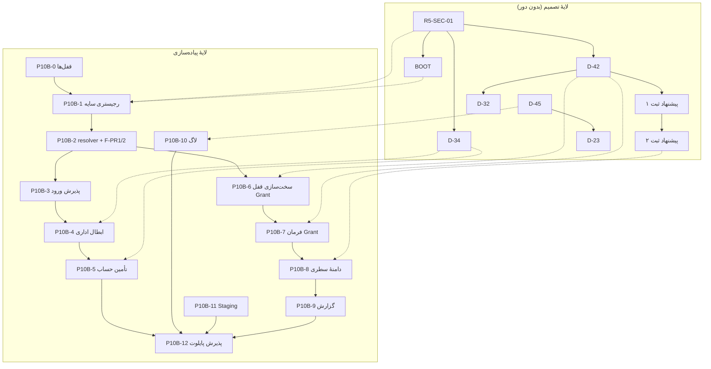

# RM-P10A / ۵ — ماتریس تصمیم‌ها و وابستگی‌ها

**DRAFT — NOT APPROVED.** این ماتریس هیچ وضعیت، پیش‌نیاز یا گزینه‌ای را در ردیاب تغییر نمی‌دهد. منبع وضعیت‌ها `docs/governance/r6-decision-tracker.json` و `docs/remediation/r5-decision-inventory.md` است. هیچ gate یا آزمونی این فایل را به‌عنوان مرجع حاکمیتی نمی‌خواند. **GROUP B CLOSED — PRODUCTION NO-GO.**

`TestRMP10ADecisionsStayUnapproved` بررسی می‌کند که هر تصمیم این جدول، تا زمانی که `approval_record` آن در ردیاب خالی است، اینجا `REQUIRES_APPROVAL` یا `BLOCKED` باشد.

---

## ۱. ماتریس تصمیم‌ها

| شناسه | موضوع | وضعیت ردیاب (بدون تغییر) | پیش‌نیاز ثبت‌شده | ماهیت پیش‌نیاز (این بسته) | مرحلهٔ RM-P10B وابسته | وضعیت |
|---|---|---|---|---|---|---|
| R5-SEC-01 | مرجع هویت شخص و پیوند حساب | `READY_FOR_REVIEW` | D-34، D-42، ADR #18 | D-34 و D-42: فقط پیاده‌سازی (Bootstrap)؛ ADR #18: شرطی | P10B-1 به بعد | `REQUIRES_APPROVAL` |
| D-34 | تأمین حساب و رمز اولیه | `READY_FOR_REVIEW` | R5-SEC-01 | تصمیم (سازگاری گزینه) + پیاده‌سازی | P10B-4، P10B-5 | `REQUIRES_APPROVAL` |
| D-42 | مرجع اعطا و لغو Capability | `READY_FOR_REVIEW` | R5-SEC-01، E-7 | تصمیم (سازگاری گزینه) + پیاده‌سازی | P10B-7 | `REQUIRES_APPROVAL` |
| D-32 | اختیار مرحلهٔ بعد بر پایهٔ سلسله‌مراتب | `EVIDENCE_MISSING` | قرارداد چرخهٔ فاکتور، D-42، P-SEC | برای TEAM حیاتی | P10B-8 (TEAM) | `BLOCKED` |
| D-45 | رفتار هنگام شکست ممیزی خواندن حساس | `READY_FOR_REVIEW` | — | — | P10B-10 | `REQUIRES_APPROVAL` |
| D-23 | دید، PII و خروجی Invoice Review | `READY_FOR_REVIEW` | ADR #18، D-45 | — | P10B-10 | `REQUIRES_APPROVAL` |
| ADR #18 | Staging و ناشناس‌سازی | `READY_FOR_REVIEW` | — | فقط اگر دادهٔ واقعی | P10B-11 (فقط دادهٔ واقعی) | `REQUIRES_APPROVAL` |
| OPD-05 | زمان‌بندی دسترسی هنگام خاتمه و انتقال | `READY_FOR_REVIEW` | SD-04، R5-SEC-01، OPD-08 | دور OPD-05 ↔ SD-04 (خارج از دامنهٔ این بسته) | خاتمهٔ خودکار (پس از پایلوت) | `REQUIRES_APPROVAL` |
| SD-04 | مقصدهای انتقال HR | `READY_FOR_REVIEW` | OPD-05 | — | همان | `REQUIRES_APPROVAL` |
| D-30 | مرجع ادغام مشتری | ردیف inventory: `OPEN` | ADR #18، E-4 | تعریف مالک مشتری را هم مسدود می‌کند | SELF/TEAM مشتری | `BLOCKED` |
| E-7 | رویهٔ تغییر Grant و Flag با ممیزی | پیش‌نیاز مهندسی `OPEN` | — | پیاده‌سازی | P10B-6، P10B-7 | `REQUIRES_APPROVAL` |
| M2 پیشنهاد ثبت ۱ | صلاحیت Capability فروشنده | بدون شناسه | ثبت شناسه، D-42 | تصمیم | P10B-7 (برای فروشنده) | `BLOCKED` (بدون شناسه) |
| M2 پیشنهاد ثبت ۲ | دامنهٔ خواندن پرونده | بدون شناسه | ثبت شناسه، پیشنهاد ۱ | تصمیم | P10B-8 | `BLOCKED` (بدون شناسه) |
| F-PR1 | رجیستری اختیار و فیلدهای هویتی R6 | پیشنهاد مهندسی | بازبینی معماری | پیاده‌سازی | P10B-2 | `REQUIRES_APPROVAL` |
| F-PR2 | اتصال اعتبارسنج R6 به شخص | پیشنهاد | R5-SEC-01، F-PR1 | پیاده‌سازی | P10B-2 | `REQUIRES_APPROVAL` |
| HQ-10 | جهت وابستگی OF-4 | پرسش باز | — | تصمیم مالک فهرست | ثبت رسمی خوانش §۲ بستهٔ اصلی | `REQUIRES_APPROVAL` |
| BOOT | روش Bootstrap رجیستری | جدید (این بسته) | R5-SEC-01 | تصمیم | P10B-1 | `REQUIRES_APPROVAL` |
| IQ-1..IQ-5 | پرسش‌های RM-E04I | پرسش باز | — | تصمیم | P10B-1، P10B-2، P10B-6 | `REQUIRES_APPROVAL` |
| BN-16 | امضای پیکربندی Staging | باز (RM-P08) | — | عملیاتی | P10B-11 | `REQUIRES_APPROVAL` |
| Group C | فعال‌سازی پایلوت | — | Group B، D-42، D-34 | استقرار | P10B-12 | `BLOCKED` |

## ۲. گراف پیشنهادی دو لایه

یال‌های نقطه‌چین: «تصمیم ← مرحلهٔ پیاده‌سازی که باز می‌شود». هیچ یالی از لایهٔ پیاده‌سازی به لایهٔ تصمیم برنمی‌گردد. Bootstrap همان نقطه‌ای است که دو یال معکوس OF-4 را جایگزین می‌کند.

## ۳. تصمیم‌هایی که باید هم‌زمان یا مشروط تصویب شوند

| گروه | تصمیم‌ها | نوع | قاعدهٔ ثبت | وضعیت |
|---|---|---|---|---|
| G-ID | R5-SEC-01 + BOOT + IQ-1 + IQ-2 + IQ-3 | هم‌زمان | یک جلسه؛ BOOT و IQها در `conditions` رکورد R5-SEC-01 ارجاع داده شوند | `REQUIRES_APPROVAL` |
| G-ACC | D-34 | مشروط به G-ID | `conditions`: «گزینه سازگار با گزینهٔ R5-SEC-01» | `REQUIRES_APPROVAL` |
| G-GRANT | D-42 + پذیرش E-7 + H-1 تا H-8 | مشروط به G-ID | `conditions`: «اجرا فقط پس از E-7 و سخت‌سازی قفل» | `REQUIRES_APPROVAL` |
| G-SCOPE-HR | پذیرش ALL برای HR | مشروط به G-GRANT | رکورد جدا یا شرط D-42 | `REQUIRES_APPROVAL` |
| G-SCOPE-SALES | پیشنهاد ثبت ۱ + ۲ + D-32 | مشروط به G-GRANT | پس از ثبت شناسه | `BLOCKED` (بدون شناسه) |
| G-LOG | D-45 + D-23 | هم‌زمان | — | `REQUIRES_APPROVAL` |
| G-TERM | OPD-05 + SD-04 | هم‌زمان (دور خودشان) | خارج از دامنهٔ این بسته؛ برای پایلوت فرمان دستی P-6 | `REQUIRES_APPROVAL` |

## ۴. یافته‌های OF-4 و وضعیت حاکمیتی

| مورد | وضعیت | توضیح |
|---|---|---|
| OF-4a (R5-SEC-01 ↔ D-34) | `REQUIRES_APPROVAL` | حل طراحی پیشنهاد شد؛ در `rm-e04i-dependency-graph.json` همچنان `UNRESOLVED` است و باید بماند تا HQ-10 تصمیم شود |
| OF-4b (R5-SEC-01 ↔ D-42) | `REQUIRES_APPROVAL` | همان |
| دور OPD-05 ↔ SD-04 | `UNKNOWN` | ثبت‌شده در ردیاب؛ در این بسته تحلیل نشد |

**GROUP B CLOSED — PRODUCTION NO-GO.**
