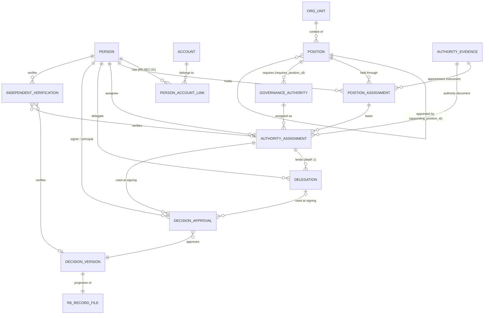

# RM-E04F — Dynamic governance authority and role-assignment architecture

**DRAFT — NOT APPROVED.** Architecture and documentation only. This package appoints nobody, activates no
authority, records no approval, creates no grant, table, migration or runtime code. Every actor assignment in it
is a **proposal** for Codex / Security / human review (AGENTS.md: Claude does not invent permissions or role
authority). **Production: NO-GO.**

| | |
|---|---|
| Baseline | `main` @ `b3dc3ed5fe8a7286bb2baf999da0d2ec62bba8c3` (PR #78 merged) |
| Approval records on main | **0** (`docs/governance/approvals/` does not exist) |
| R6 tracker | 61 records: 30 `EVIDENCE_MISSING`, 26 `READY_FOR_REVIEW`, 5 `DRAFT`. Unchanged |
| Group B gate / S4 manifest | Closed / empty. Unchanged |
| Nominations | `docs/governance/rm-e04f-authority-nominations.json` — all `NOMINATED` or `UNASSIGNED`; none verified |
| Persian summary | `rm-e04f-executive-summary.fa.md` (same directory) |
| Review handoff | `docs/implementation/rm-e04f-codex-security-review-handoff.md` — **REVIEW PENDING** |
| Tests | `docs/governance/rm_e04f_test.go` (documentation / governance contract only; no runtime enforcement) |

Contents: §1 principles · §2 current architecture audit · §3 domain model · §4 ER diagram and data dictionary ·
§5 authority workflow · §6 independence and separation of duties · §7 replacement and revocation scenarios ·
§8 database and security design · §9 threat model · §10 administrative interface · §11 R5 / R6 / M2 / Group B
compatibility · §12 roadmap · §13 architecture decisions required · §14 governance test evidence.

---

## 1. Principles (carried over, not new)

| # | Principle | Source |
|---|---|---|
| P1 | Position ≠ role ≠ capability ≠ credential. Hierarchy ≠ permission. View ≠ write | AGENTS.md; R5 P-SEC §1 |
| P2 | One account with several roles never simulates two approvers; two accounts of one human never count as two people | AGENTS.md; R5 P-SEC §1; RM-E04D validator rule |
| P3 | Authority comes only from evidence: appointment letter, delegation-of-authority document or board / director resolution, with a reference. A typed name, a signature image or the repository-owner account is not enough | R6 evidence standard §1; RM-E04E §1.3 |
| P4 | T5 verifier is a human who is not an approver, not the recorder and not automation | R6 workflow T5; evidence standard §3 |
| P5 | Approval records are append-only; corrections are new versions; history is never rewritten | R6 evidence standard §2; `appendOnlyChange` |
| P6 | Unknown or conflicting lineage stays UNKNOWN / CONFLICT and fails closed | AGENTS.md; authorization evaluator invariants |
| P7 | Authority to approve governance decisions is not a CRM capability and never becomes one implicitly | Authorization evaluator: only ACTIVE role grants allow; D-42 open |

---

## 2. Current architecture audit

### 2.1 What exists

| # | Area | What exists on `main` | Where | Reusable? |
|---|---|---|---|---|
| A1 | User account (authentication subject) | `identity.user_account` (uuid `user_id`, shadow import, `login_enabled = false`); login only through `identity.credential` → `identity.session` → `user_id`. `authorization.Subject` carries `PrincipalID` / `UserID` | `internal/identity/migrations/sql/00001_identity.sql`, `00012_identity_authentication.sql`; `internal/authorization/authorization.go` | **Yes** — the account used to act is `user_id` |
| A2 | Person (HR identity) | `organization.person` (uuid `person_id`, legacy-imported, display name only; sensitive columns not imported) | `internal/organization/migrations/sql/00001_organization.sql` | **Candidate anchor**, but not a *verified* human (R5-SEC-01 open) |
| A3 | Account ↔ person link | `organization.employment.user_id` with `user_link_state` ∈ `LINKED`, `USER_NOT_IMPORTED`, `USER_NOT_RECORDED`, `SHARED_USER`; one employment per person | same file | **Partly** — evidence only; `SHARED_USER` must resolve to CONFLICT |
| A4 | Organizational units | `organization.org_unit` typed tree (`DEPARTMENT` / `UNIT` / `TEAM`), shadow | same file | **Yes** (reference only) |
| A5 | Positions / levels | `organization.position`, `organization.level` (legacy HR job catalogue); `employment.position_id` | same file | **Yes, for HR positions only.** Governance offices (Product owner, Sales owner, …) are not in it |
| A6 | Reporting hierarchy | `organization.org_assignment` + append-only `org_assignment_history`; `hierarchy_finding` (CONFLICT / UNKNOWN, never auto-fixed) | same file | **Pattern reused** (append-only history, findings instead of fixes) |
| A7 | Roles and bundles | `identity.role` (9 keys), `identity.role_capability`; code-defined in `internal/identity/api`. `seller` bundle has no capability | identity migrations; `identity/api/api.go` | **Untouched** — governance authorities are *not* added here |
| A8 | Role grants | `identity.role_grant` with `role_grant_shadow_only CHECK (status = 'SHADOW')`; basis `LEGACY_PROFILE_ROLE`; no grant-change procedure (E-7); D-42 open | `00001_identity.sql` | **Untouched** |
| A9 | Position → role default | `organization.position_role_default` — legacy suggestion, "never a grant" | organization migration | **Pattern reused**: position never grants |
| A10 | Effective access | `authorization.Evaluate`: only ACTIVE grants whose bundle holds the capability allow; `OrgContext` (position, level, hierarchy) never grants; UNKNOWN / conflict deny | `internal/authorization/authorization.go` | **Untouched**; governance authority is evaluated elsewhere |
| A11 | Governance decision inventory | R5 inventory (markdown), `r5-evidence-index.json`, `r6-decision-tracker.json`, R5 package records | `docs/remediation/`, `docs/governance/` | **Yes** — remains the decision source of truth |
| A12 | R6 approval records | JSON schema (`DECISION`, `REVIEW_NOTICE`, `DEFERRAL`) + `human_verification`; validator `validateApprovalRecord`; append-only check | `docs/governance/r6_test.go`; evidence standard | **Yes** — extended additively later (§11.2), never replaced |
| A13 | Approver independence check | `personKey(name)` = lower-cased, whitespace-normalised **name**; duplicate name across approvers rejected; verifier ≠ approver / recorder; verifier not in a bot list | `r6_test.go` | **Reused as the floor**; insufficient alone (§2.3 F1) |
| A14 | Authority worksheet | RM-E04E §1.4: every governance role **UNASSIGNED**, worksheet blank by design | `rm-e04e-authority-and-registration-packet.md` | **Yes** — this package proposes how it becomes data |
| A15 | Audit | `audit.audit_event` (append-only by trigger; `actor_domain/actor_id` separate from `subject_domain/subject_id`; bounded metadata, secret keys refused); `identity.auth_event` append-only | `internal/platform/audit`; platform migration | **Yes** — governance events go here via outbox |
| A16 | Module infrastructure | Per-module schema, NOLOGIN owner role, outbox / inbox / idempotency tables | rendered module infra | **Yes** for a future `governance` module |
| A17 | Outcome vocabulary | `SUCCESS`, `PARTIAL`, `FAILED`, `UNKNOWN`, `CONFLICT`, `BLOCKED` (+ `UNAUTHORIZED`) | `identity.import_run`; AGENTS.md | **Yes** |
| A18 | HR requests | `organization.hr_request` (transfer / termination request; no personnel change) | organization migration 00002 | Not reused (different domain) |

### 2.2 What is missing

| # | Missing | Consequence today |
|---|---|---|
| M1 | Verified-person model (R5-SEC-01 open) | Independence can be proven only by name (F1) |
| M2 | Governance offices (Product / Sales / Security / Legal / Finance owner, inventory owner, recorder, T5 verifier) as stable identifiers with holders | RM-E04E worksheet has no data model; names would be hard-coded in documents |
| M3 | Appointment authority (the CEO position) as data | "Who appoints" exists only as the project owner's statement |
| M4 | Temporal assignment (`valid_from` / `valid_to`), supersession, revocation | No way to replace a holder without editing documents |
| M5 | Delegation (OPD-10 "not modelled") | Any delegation would be informal |
| M6 | Authority evidence register (hash + archive locator) | Evidence references are free text in each approval record |
| M7 | Temporal / exclusion-constraint convention in PostgreSQL | No module uses `tstzrange` or `EXCLUDE`; legacy intervals are raw text |
| M8 | Grant-change procedure (E-7), provisioning (D-34) | Out of scope here; stay blocking for real grants |

### 2.3 Findings

| # | Finding | Severity | Handling |
|---|---|---|---|
| F1 | Name-keyed independence: `personKey` cannot tell two people with the same name apart (false rejection) and cannot tell that `مهرداد حافظی` and a Latin transliteration are one person (false acceptance). Verified by a scratch mutation (§14.2) | High for any future multi-signer decision | Design: independence keyed by verified `person_id` (§6). Until then, an approval record whose signers cannot be resolved to distinct verified persons is **UNKNOWN** for independence; the T5 checklist item "no person counted twice" remains the human control. Validator change is a separate reviewed PR (§12, F-PR2) |
| F2 | The verifier bot list is name-based (`bot`, `ci`, `claude`, `codex`, …) | Medium | Design: verifier must resolve to a verified person; automation subjects have no person (§6.3) |
| F3 | `employment` allows one person → one account; `SHARED_USER` marks one account → several persons | Medium | Account-to-person resolution returns CONFLICT for `SHARED_USER`, UNKNOWN for `USER_NOT_*`, and never matches by phone, name or e-mail |
| F4 | No root of trust for appointment authority | High | §5.4 CEO / root appointment model; new architecture decision RM-E04F-AD2 |

### 2.4 What this design deliberately does not build

- No competing identity system: accounts stay in `identity`, people in `organization` (or the R5-SEC-01 outcome).
- No competing authorization system: CRM capability evaluation stays in `internal/authorization`; governance
  authority is evaluated only for governance acts (§5.1) and never feeds `authorization.Evaluate`.
- No new role in `identity.role`; no change to any bundle, including `seller`.

---

## 3. Proposed domain model

### 3.1 Five acts that must never be conflated

| Act | What it is | Who performs it (proposal) | Produces | Never implies |
|---|---|---|---|---|
| **Organizational appointment** | A person is placed in a position (e.g. Sales owner office) | The holder of the appointing position (the CEO position for governance offices), with a signed appointment instrument | `PositionAssignment` = `APPOINTED` | Any signing authority, any CRM grant |
| **Governance authority activation** | A person's authority to perform a governance act (sign for a domain, register IDs, record, verify) becomes effective | Registrar records it; an independent verifier confirms the evidence | `AuthorityAssignment` = `ACTIVE` | A decision, a CRM grant, production access |
| **Decision signing** | An approver entry in an R6 `DECISION` record | A person whose matching authority is `ACTIVE` at signing time | `DecisionApproval` | Verification of that decision |
| **R6 independent T5 verification** | `human_verification` entry on an R6 record | A human who is not an approver, recorder or automation for that decision | `IndependentVerification` | Any implementation, gate opening or grant by itself |
| **Production access activation** | A real `role_grant` becomes ACTIVE and a credential is provisioned | Separate authorization: D-42, D-34, Group C, production NO-GO lifted | `identity.role_grant` ACTIVE (future) | Anything in this model |

### 3.2 Entities

| Entity | Purpose | Identity | Owner module (proposal) | Reuses |
|---|---|---|---|---|
| **Person** | A verified human | immutable `person_id` (uuid) | `organization` (or R5-SEC-01 outcome) | A2; **not redefined here** |
| **Account** (reference only) | Login used to act | `user_id` | `identity` | A1 |
| **PersonAccountLink** (reference only) | Which accounts belong to which person, as-of time | defined by R5-SEC-01 | `identity` / `organization` per R5-SEC-01 | A3 evidence; not designed here |
| **OrganizationalUnit** | Unit context of a position | `org_unit_id` | `organization` | A4 |
| **Position** | A stable seat: HR job (reference to `organization.position`) or governance office (`SALES_OWNER`, …) or root (`CEO`) | `position_id` + immutable `position_key` | new `governance` module | A5 by reference |
| **PositionAssignment** | Person holds position during an interval | `position_assignment_id` | `governance` | — |
| **GovernanceAuthority** | A governance act type, scoped to a domain (`decision.sign.sales`, `decision.register`, `decision.record`, `decision.verify_t5`, `position.appoint`) | immutable `authority_key` | `governance` | — |
| **AuthorityAssignment** | Person may perform an authority during an interval, based on a position assignment, with evidence | `authority_assignment_id` | `governance` | — |
| **Delegation** | Holder lends one authority, for a scope and a bounded period, to another person | `delegation_id` | `governance` | — |
| **AuthorityEvidence** | Immutable reference to an appointment or authority document (hash + archive locator) | `evidence_id` | `governance` | R6 `authority_evidence` |
| **DecisionApproval** | One signer's approval of one decision version, with the authority used at signing time | `approval_id` | `governance` (projection of R6 records) | A12 |
| **IndependentVerification** | T5 verification of a decision version, or verification of an authority assignment | `verification_id` | `governance` | A12 `human_verification` |
| **AuditEvent** | Every transition | `audit.audit_event.event_id` | `audit` | A15 |

### 3.3 Requirement traceability (task §5 items 1–18)

| # | Requirement | Where satisfied |
|---|---|---|
| 1 | Immutable person ids | §3.2 Person; §8.2 no update of `person_id` columns |
| 2 | Stable position / role keys, never names | `position_key`, `authority_key` immutable; names are labels only (§4.2) |
| 3 | Assignments reference ids | §4.2 `person_id`, `position_id` columns |
| 4 | Governance ≠ CRM capability | §3.1; P7; §11.6 |
| 5 | Position does not grant signing authority | §5.2: `AuthorityAssignment` needs its own evidence and verification |
| 6 | Independent evidence | §5.2 T-A3, T-A4 |
| 7 | `valid_from` / `valid_to` | §4.2 `valid_during tstzrange` (rendered as `valid_from` / `valid_to` in API and UI) |
| 8 | Immediate, audited revocation | §5.2 T-A7; §8.5 |
| 9 | Historical signer + evidence at signing | §4.2 `DecisionApproval.authority_snapshot` |
| 10 | Independence by person | §6 |
| 11 | One person ≠ several signatures | §6.2 rule I1; §8.3 uniqueness |
| 12 | T5 ≠ approver, recorder, automation | §6.2 rule I3 |
| 13 | Delegation scope, expiry, revocation | §5.3 |
| 14 | Delegation cannot bypass SoD | §6.2 rule I4 |
| 15 | CEO modelled without name | §5.4 |
| 16 | Authority changes do not rewrite history | §7 Scenario A; §8.2 append-only |
| 17 | No circular delegation, no self-appointment | §5.3 depth-1 rule; §5.4 rule SA |
| 18 | Emergency revocation and recovery | §5.5 |

---

## 4. ER diagram and data dictionary

### 4.1 ER diagram



`DECISION_VERSION` is a projection of the R6 tracker and `docs/governance/approvals/` files; the repository files
stay authoritative (§11.2). `PERSON`, `ACCOUNT`, `ORG_UNIT` belong to existing modules and are referenced by id,
not by cross-module foreign key (existing convention: `employment.user_id` "is an identity reference, not a
foreign key").

### 4.2 Data dictionary (logical; physical proposal in §8)

**Position**

| Field | Type | Rule |
|---|---|---|
| `position_id` | uuid | immutable PK |
| `position_key` | text | immutable, unique, `^[A-Z][A-Z0-9_]{1,63}$` (e.g. `CEO`, `SALES_OWNER`, `DECISION_INVENTORY_OWNER`) |
| `position_kind` | enum | `ROOT` (CEO), `GOVERNANCE_OFFICE`, `ORGANIZATIONAL` |
| `org_position_ref` | uuid null | `organization.position.position_id` for `ORGANIZATIONAL` only |
| `org_unit_ref` | uuid null | `organization.org_unit.org_unit_id` |
| `appointing_position_id` | uuid null | NULL only for `ROOT`; for offices → `CEO` (proposal; AD3) |
| `exclusive` | bool | true = at most one holder at a time |
| `label_fa`, `label_en` | text | display only; renaming never changes identity |
| `retired_at` | timestamptz null | positions are retired, never deleted |

**PositionAssignment**

| Field | Type | Rule |
|---|---|---|
| `position_assignment_id` | uuid | PK |
| `position_id`, `person_id` | uuid | immutable |
| `state` | enum | `PROPOSED`, `APPOINTED`, `REJECTED`, `WITHDRAWN`, `ENDED`, `SUPERSEDED` |
| `valid_during` | tstzrange | `[valid_from, valid_to)`; upper may be open only for `APPOINTED` |
| `appointed_by_person_id` | uuid null | ≠ `person_id` (no self-appointment) |
| `appointed_by_position_assignment_id` | uuid null | the appointer's own `APPOINTED` assignment to the appointing position, valid at appointment time |
| `appointment_evidence_id` | uuid null | required for `APPOINTED` |
| `supersedes_id` | uuid null | previous holder's assignment |
| `version` | bigint | optimistic concurrency |

**GovernanceAuthority**

| Field | Type | Rule |
|---|---|---|
| `authority_key` | text | immutable PK, e.g. `decision.sign.product`, `decision.sign.sales`, `decision.sign.security`, `decision.sign.legal`, `decision.sign.finance`, `decision.register`, `decision.record`, `decision.verify_t5`, `position.appoint` |
| `r6_role_label` | text null | exact R6 role string it satisfies (`Product owner`, `Sales owner`, `Security owner`, …) |
| `requires_position_id` | uuid null | position whose `APPOINTED` assignment is the basis |
| `delegable` | bool | `decision.verify_t5`, `decision.register`, `position.appoint` are **not** delegable (proposal) |
| `max_delegation_days` | int null | upper bound for delegations (AD5) |

**AuthorityAssignment**

| Field | Type | Rule |
|---|---|---|
| `authority_assignment_id` | uuid | PK |
| `authority_key`, `person_id` | | immutable |
| `basis_position_assignment_id` | uuid null | must be `APPOINTED` and cover `valid_during` when `requires_position_id` is set |
| `state` | enum | `NOMINATED`, `PENDING_AUTHORITY_EVIDENCE`, `PENDING_VERIFICATION`, `ACTIVE`, `EXPIRED`, `REVOKED`, `REJECTED`, `WITHDRAWN`, `SUPERSEDED` |
| `valid_during` | tstzrange | set at activation; never retroactive (`lower ≥ activated_at`) |
| `nominated_by_person_id`, `registered_by_person_id`, `verified_by_person_id` | uuid | verifier ≠ assignee, ≠ nominator, ≠ registrar, ≠ appointer |
| `authority_evidence_id` | uuid null | required from `PENDING_VERIFICATION` |
| `revoked_at`, `revocation_reason` | | `REVOCATION`, `EMERGENCY`, `POSITION_ENDED`, `PERSON_LINK_CONFLICT` |
| `compromise_suspected_from` | timestamptz null | emergency only (§5.5) |

**Delegation**

| Field | Type | Rule |
|---|---|---|
| `delegation_id` | uuid | PK |
| `source_authority_assignment_id` | uuid | must be `ACTIVE`; FK to an assignment, **never to a delegation** (depth 1) |
| `delegate_person_id` | uuid | ≠ delegator person |
| `scope` | jsonb | explicit list: `decision_ids` and/or `domains`; empty scope invalid |
| `valid_during` | tstzrange | bounded upper; within source validity; ≤ `max_delegation_days` |
| `state` | enum | `PENDING_VERIFICATION`, `ACTIVE`, `EXPIRED`, `REVOKED` |
| `evidence_id` | uuid | signed delegation document |

**AuthorityEvidence** (immutable)

| Field | Type | Rule |
|---|---|---|
| `evidence_id` | uuid | PK |
| `kind` | enum | `APPOINTMENT_LETTER`, `DELEGATION_OF_AUTHORITY`, `BOARD_RESOLUTION`, `EXTERNAL_LEGAL_INSTRUMENT`, `REVOCATION_NOTICE` |
| `reference` | text | document number / archive id |
| `content_sha256` | bytea(32) | hash of the archived document |
| `archive_locator` | text | restricted archive location; the document itself is never stored in the CRM database |
| `issuer_person_id` | uuid null | NULL only for `EXTERNAL_LEGAL_INSTRUMENT` |
| `scope_statement` | text | domain(s) the document covers (matched in T-A4) |
| `registered_by_person_id`, `registered_at` | | |

**DecisionApproval** (immutable)

| Field | Type | Rule |
|---|---|---|
| `approval_id` | uuid | PK |
| `decision_id`, `decision_version` | text | tracker id; R6 version |
| `r6_role` | text | role the signature satisfies |
| `signer_person_id` | uuid | resolved verified person at signing time |
| `signer_user_id` | uuid null | account used (evidence only) |
| `principal_person_id` | uuid | = signer, or the delegator when a delegation is used |
| `authority_assignment_id`, `delegation_id` | uuid | authority used |
| `authority_snapshot` | jsonb | evidence id, `content_sha256`, assignment state and validity as read at signing time |
| `signed_at` | timestamptz | |
| `record_path`, `record_immutable_ref` | text | the R6 file and its `immutable_ref` |

**IndependentVerification** (immutable)

| Field | Type | Rule |
|---|---|---|
| `verification_id` | uuid | PK |
| `target_kind` | enum | `DECISION_VERSION`, `AUTHORITY_ASSIGNMENT`, `POSITION_ASSIGNMENT`, `DELEGATION` |
| `target_ref` | text | |
| `verifier_person_id`, `verifier_user_id` | uuid | verified person; automation has no `person_id` and cannot verify |
| `method` | text | independent channel used |
| `result` | enum | `VERIFIED`, `REJECTED`, `INCONCLUSIVE` (R6 vocabulary) |
| `verified_at` | timestamptz | |

**AuditEvent** — reuses `audit.audit_event` (§8.6).

---

## 5. Authority workflow specification

### 5.1 Position assignment (organizational appointment)

`PROPOSED → APPOINTED → ENDED | SUPERSEDED`; `PROPOSED → REJECTED | WITHDRAWN`.

| Transition | Required actor (proposal) | Evidence | Validation | Audit event | Failure cases |
|---|---|---|---|---|---|
| → `PROPOSED` | Any person with `position.appoint` for the appointing position, or the registrar on their instruction | none | position exists, not retired; person resolves to a verified `person_id` | `governance.position_assignment.proposed` | person UNKNOWN / CONFLICT → `BLOCKED` |
| `PROPOSED → APPOINTED` | Holder of the appointing position (CEO position for offices), acting personally | `APPOINTMENT_LETTER` / `BOARD_RESOLUTION` registered in `AuthorityEvidence` | appointer's own position assignment `APPOINTED` and valid now; appointer ≠ appointee (rule SA); exclusive position: no overlapping `APPOINTED` row (exclusion constraint) unless the previous one is superseded in the same transaction | `governance.position_assignment.appointed` | self-appointment → `UNAUTHORIZED`; overlap → `CONFLICT`; appointer not current → `UNAUTHORIZED` |
| `APPOINTED → SUPERSEDED` | Appointer, as part of appointing the successor | successor's instrument | same transaction as the successor's `APPOINTED`; sets `valid_to` = successor `valid_from` | `…superseded` | concurrent successor → serialization failure, retry after reconcile |
| `APPOINTED → ENDED` | Appointer, or HR termination evidence (proposal; AD3) | `REVOCATION_NOTICE` or termination evidence | | `…ended` | |
| `PROPOSED → REJECTED / WITHDRAWN` | Appointer / proposer | reason | | `…rejected` / `…withdrawn` | |

Ending or superseding a position assignment **immediately** ends every authority assignment based on it
(`POSITION_ENDED`), in the same transaction (§8.5).

### 5.2 Authority assignment (governance authority activation)

```
NOMINATED ──▶ PENDING_AUTHORITY_EVIDENCE ──▶ PENDING_VERIFICATION ──▶ ACTIVE ──▶ EXPIRED
    │                    │                           │                   │
    ├─▶ WITHDRAWN        ├─▶ REJECTED                ├─▶ REJECTED        ├─▶ REVOKED (incl. EMERGENCY)
    └─▶ REJECTED         └─▶ WITHDRAWN               └─▶ (INCONCLUSIVE stays PENDING_VERIFICATION)
                                                                         └─▶ SUPERSEDED (successor ACTIVE)
```

There is **no** transition from `NOMINATED`, `PENDING_AUTHORITY_EVIDENCE` or any other state directly to
`ACTIVE` except `PENDING_VERIFICATION → ACTIVE`, and that one requires a human verifier.

| ID | Transition | Required actor (proposal) | Evidence | Validation | Audit event | Authorization requirement | Failure cases |
|---|---|---|---|---|---|---|---|
| T-A1 | → `NOMINATED` | Anyone with `position.appoint` for the basis position, or the project owner's documented nomination | none (a nomination is not evidence) | authority key exists; nominee resolves to a person or is recorded as `UNRESOLVED` | `governance.authority.nominated` | none beyond an authenticated account; a nomination grants nothing | unknown authority key → `FAILED` |
| T-A2 | `NOMINATED → PENDING_AUTHORITY_EVIDENCE` | Registrar (holder of `decision.register` or a governance-admin registrar, AD4) | basis `PositionAssignment` = `APPOINTED` when `requires_position_id` is set | nominee resolves to a verified `person_id` (R5-SEC-01); basis assignment valid | `…evidence_requested` | registrar authority `ACTIVE` | nominee UNKNOWN / CONFLICT → `BLOCKED`; no appointment → `BLOCKED` |
| T-A3 | `PENDING_AUTHORITY_EVIDENCE → PENDING_VERIFICATION` | Registrar | `AuthorityEvidence` registered: kind, reference, `content_sha256`, scope statement, issuer | issuer ≠ assignee; issuer held `position.appoint` (or the instrument is external for the root) at issue time; scope covers the authority domain | `…evidence_registered` | registrar `ACTIVE` | hash missing, scope mismatch, issuer = assignee → `REJECTED` |
| T-A4 | `PENDING_VERIFICATION → ACTIVE` | Independent verifier (human) | `IndependentVerification` = `VERIFIED`, method = independent channel | verifier person ∉ {assignee, nominator, registrar, issuer/appointer}; verifier is a person, not automation; evidence hash re-checked against archive; position still `APPOINTED`; `valid_from ≥ now` (never retroactive) | `…activated` | verifier holds `decision.verify_t5` **or** the verification rule of AD6 | any identity collision → `UNAUTHORIZED`; `INCONCLUSIVE` → stays pending; `REJECTED` → `REJECTED` |
| T-A5 | `ACTIVE → EXPIRED` | System clock (no actor) | `valid_to` reached | evaluation is as-of time; the stored state is advanced by a job but the **validity interval is authoritative** | `…expired` | — | job late: evaluation still treats it as inactive |
| T-A6 | `ACTIVE → SUPERSEDED` | Registrar, when a successor's assignment becomes `ACTIVE` | successor activation | same transaction; `valid_to` = successor `valid_from` | `…superseded` | registrar `ACTIVE` | |
| T-A7 | `ACTIVE → REVOKED` | Issuer / appointer, or Security owner, or CEO-position holder (proposal) | `REVOCATION_NOTICE` (may follow within N hours for emergency, AD7) | effective at commit time; never backdated | `…revoked` | revoker authority `ACTIVE` | revoker = assignee is allowed only as **resignation** (`WITHDRAWN`-like self-revocation, always permitted) |
| T-A8 | any pre-active → `REJECTED` / `WITHDRAWN` | Verifier, registrar, appointer / nominee or nominator | reason | | `…rejected` / `…withdrawn` | | |

A nomination recorded from a chat instruction, a commit, a merged PR, a GitHub approval or CI is **only** T-A1.
None of these is evidence for T-A3 or T-A4.

### 5.3 Delegation

| Rule | Statement |
|---|---|
| DL1 | Only an `ACTIVE` assignment of a `delegable` authority can be delegated |
| DL2 | Source is always an `AuthorityAssignment`, never a `Delegation` → maximum depth 1 → cycles are structurally impossible |
| DL3 | Delegate ≠ delegator (person); delegate must resolve to a verified person |
| DL4 | Scope is an explicit, non-empty list of decision ids and / or domains; no wildcard |
| DL5 | `valid_to` is mandatory, within the source validity and ≤ `max_delegation_days` |
| DL6 | Activation requires `IndependentVerification` of the delegation document (same as T-A4) |
| DL7 | Revoking or ending the source immediately ends the delegation |
| DL8 | Delegator may revoke at any time; revocation is immediate |
| DL9 | A delegated signature occupies **both** the delegate's and the delegator's person slot on that decision (§6.2 I4) |

### 5.4 CEO / root appointment model (no hard-coded name)

| Rule | Statement |
|---|---|
| R1 | `CEO` is a `Position` with `position_kind = ROOT` and `position_key = CEO`. No name appears in code, configuration or role definitions |
| R2 | The CEO position holder is established only by an `EXTERNAL_LEGAL_INSTRUMENT` (e.g. registered company resolution / board resolution) registered by a registrar and verified by an independent human verifier |
| R3 | The CEO position holder holds `position.appoint` for governance offices **only** while their CEO `PositionAssignment` is `APPOINTED` and valid |
| SA | **No self-appointment:** an appointer can never appoint themself (person level, any account). If the CEO is to hold a governance office, the appointment needs an appointing body above the CEO (board instrument) — RM-E04F-AD2 |
| R4 | Changing CEO = new `PositionAssignment` (supersession). Appointments made by the previous CEO remain valid until ended; they are not re-signed or rewritten |
| R5 | The project owner's statement "the CEO appoints position holders" is recorded as a **design input**, not as evidence. The CEO position's holder is **UNVERIFIED / UNASSIGNED** (RM-E04Q: a provisional CEO nominee is recorded as `NOMINATED` only — not appointed, not verified) |

### 5.5 Emergency revocation and recovery

| Step | Control (proposal; AD7) |
|---|---|
| E1 | Any one of: Security owner, CEO-position holder, the issuer, may revoke with reason `EMERGENCY`, single actor, effective at commit |
| E2 | Optional `compromise_suspected_from`: decisions signed with that authority after this time and **not yet T5-verified** are flagged `REVIEW_REQUIRED` (an appended event). Verified historical records are not rewritten; if they must be undone, a new `SUPERSEDED` / `VOID` decision version is recorded under R6 |
| E3 | Emergency revocation of an account compromise also revokes sessions (`identity.session` revoke reasons are an identity decision; not designed here) |
| E4 | Reinstatement is never an "undo": a new assignment goes through T-A1…T-A4 |
| E5 | If no `ACTIVE` holder remains for a required role, every decision needing it is `BLOCKED`; there is no break-glass signer |
| E6 | If the CEO position holder is compromised, recovery is by a new external legal instrument (R2) |
| E7 | Revocation itself is audited and T5-verified after the fact (two-person review within N days; AD7) |

---

## 6. Independence and separation of duties

### 6.1 Person resolution

`resolve(user_id, at) → (person_id, VERIFIED) | UNKNOWN | CONFLICT`, defined by R5-SEC-01.

| Situation | Result |
|---|---|
| Account linked to exactly one verified person at `at` | `person_id` |
| `SHARED_USER`, two active links, contradictory evidence | `CONFLICT` → deny |
| `USER_NOT_IMPORTED`, `USER_NOT_RECORDED`, unverified link | `UNKNOWN` → deny |
| Automation, service account, bot | no person → cannot sign, record-as-person or verify |
| Match by phone, name, e-mail similarity | **never** |

### 6.2 Rules (evaluated per decision version)

| Rule | Statement |
|---|---|
| I1 | Each required role is satisfied by a distinct person. `count(distinct principal_person_id) = count(required roles)` |
| I2 | A person contributes at most one approval per decision version, regardless of how many positions, authorities or accounts they hold |
| I3 | T5 verifier person ∉ {signers, principals, recorder}; verifier is not automation |
| I4 | A delegated approval reserves both the delegate's and the delegator's person; neither may sign again or verify |
| I5 | Authority used must be `ACTIVE` (or an `ACTIVE` in-scope delegation) at `signed_at` |
| I6 | If any participant resolves to `UNKNOWN` / `CONFLICT`, independence is `UNKNOWN` and the decision cannot reach `APPROVED_VERIFIED` |
| I7 | Recorder may be an approver (existing R6 rule, unchanged) |
| I8 | Verifier of an authority assignment ∉ {assignee, nominator, registrar, issuer} |

### 6.3 Concentration of offices

One person may be nominated to, appointed to and even hold several offices. The model allows it (it is an
organizational choice) but every rule above counts **people**, so concentration never multiplies approvals. The
administrative interface (§10, screen 10) shows a "concentration" warning when one person holds two or more
offices that appear together in any decision's required roles.

---

## 7. Replacement, independence and revocation scenarios

Nominee label used in the scenarios: **N1 = مهرداد حافظی** (provisional nominee; no `person_id` resolved).

### Scenario A — Sales owner replaced

1. N1 is `NOMINATED` for `decision.sign.sales` (today's state). Nothing else exists.
2. Suppose N1 is later appointed and activated (T-A1…T-A4 with real evidence) and signs decision X as Sales owner.
   `DecisionApproval` stores `signer_person_id = N1`, the assignment id and `authority_snapshot` (evidence hash,
   validity).
3. The CEO-position holder appoints person P2 to `SALES_OWNER` (new `PositionAssignment`, supersedes N1's).
   N1's `authority_assignment` becomes `SUPERSEDED` / `POSITION_ENDED` at that instant.
4. P2's `decision.sign.sales` is `NOMINATED → … → PENDING_VERIFICATION`; P2 **cannot sign** until T-A4
   (`ACTIVE`). Between steps 3 and 4 there is **no** active Sales owner: Sales-signed decisions are `BLOCKED`.
5. Decision X's record is unchanged: `appendOnlyChange` rejects any rewrite of its approver (tested, §14).
   Its approver is still N1, with N1's evidence as it was at signing.

No source code, role definition, hard-coded name, rebuild or historical record changes.

### Scenario B — one person in three offices

N1 holds Product, Sales and Security offices. A decision requires Product + Sales + Security. N1 signs under all
three roles. Rule I1/I2: distinct principals = 1, required = 3 → **not independent**. Today's R6 validator already
rejects the same normalised name under two roles (tested, §14). The future model rejects by `person_id`, which
also catches different spellings of the same person (F1).

### Scenario C — recorder verifies under a second account

N1 records decision Y with account U1 and submits the T5 verification with account U2. `resolve(U1) = resolve(U2)
= N1` → rule I3 → `UNAUTHORIZED`. If U2 cannot be resolved (`UNKNOWN`) → rule I6 → `BLOCKED`, never accepted.
Today's R6 validator rejects verifier = recorder by normalised name (tested, §14); a cross-script alias is not
caught by name (F1) and must be caught by the T5 human checklist until person ids exist.

### Scenario D — expired delegation

Security owner S delegates `decision.sign.security` for decision Z to P3 until `2027-01-31`. P3 signs on
`2027-02-02`. Rule I5: delegation not active at `signed_at` → signature invalid → decision stays
`DECISION_RECORDED_PENDING_VERIFICATION` and T5 must reject. The delegation row is not extended retroactively; a
new delegation must be issued and verified.

### Scenario E — emergency revocation

Finance owner F's account is reported compromised at 10:00; Security owner revokes F's authority with `EMERGENCY`
and `compromise_suspected_from = 08:00`. Effects: from commit, F cannot sign; decision V signed by F at 09:00 and
not yet verified is flagged `REVIEW_REQUIRED` (event appended); decision W signed and T5-verified last month stays
as recorded. If W must be undone, a new R6 version (`VOID` / `SUPERSEDED`) is recorded and verified.

### Scenario F — CEO change

A new external instrument establishes P4 as CEO-position holder; the previous CEO assignment is `SUPERSEDED`.
Offices appointed by the previous CEO remain valid until P4 ends them. P4 cannot appoint themself to any office
(rule SA).

---

## 8. Database and security design (proposal; no migration created)

### 8.1 Placement

New module schema `governance` with NOLOGIN owner `crm_owner_governance`, rendered module infrastructure
(outbox, inbox, idempotency) like every other module. Requires extension `btree_gist` for exclusion
constraints — **new convention** (RM-E04F-AD8).

### 8.2 Table proposal (illustrative DDL, not a migration)

```sql
-- PROPOSAL ONLY. Not a migration. Production NO-GO.
CREATE TABLE governance.position (
    position_id            uuid PRIMARY KEY,
    position_key           text NOT NULL UNIQUE CHECK (position_key ~ '^[A-Z][A-Z0-9_]{1,63}$'),
    position_kind          text NOT NULL CHECK (position_kind IN ('ROOT','GOVERNANCE_OFFICE','ORGANIZATIONAL')),
    org_position_ref       uuid NULL,
    org_unit_ref           uuid NULL,
    appointing_position_id uuid NULL REFERENCES governance.position (position_id),
    exclusive              boolean NOT NULL,
    label_fa               text NOT NULL,
    label_en               text NOT NULL,
    retired_at             timestamptz NULL,
    CONSTRAINT position_root_has_no_appointer CHECK ((position_kind = 'ROOT') = (appointing_position_id IS NULL)),
    CONSTRAINT position_org_ref CHECK ((position_kind = 'ORGANIZATIONAL') = (org_position_ref IS NOT NULL)),
    CONSTRAINT position_not_self_appointing CHECK (appointing_position_id IS NULL OR appointing_position_id <> position_id)
);

CREATE TABLE governance.authority_evidence (
    evidence_id             uuid PRIMARY KEY,
    kind                    text NOT NULL CHECK (kind IN ('APPOINTMENT_LETTER','DELEGATION_OF_AUTHORITY',
                              'BOARD_RESOLUTION','EXTERNAL_LEGAL_INSTRUMENT','REVOCATION_NOTICE')),
    reference               text NOT NULL CHECK (length(reference) BETWEEN 1 AND 200),
    content_sha256          bytea NOT NULL CHECK (octet_length(content_sha256) = 32),
    archive_locator         text NOT NULL CHECK (length(archive_locator) BETWEEN 1 AND 500),
    issuer_person_id        uuid NULL,
    scope_statement         text NOT NULL CHECK (length(scope_statement) BETWEEN 1 AND 500),
    registered_by_person_id uuid NOT NULL,
    registered_at           timestamptz NOT NULL,
    CONSTRAINT evidence_issuer CHECK ((kind = 'EXTERNAL_LEGAL_INSTRUMENT') = (issuer_person_id IS NULL)),
    CONSTRAINT evidence_unique UNIQUE (kind, reference, content_sha256)
);

CREATE TABLE governance.position_assignment (
    position_assignment_id              uuid PRIMARY KEY,
    position_id                         uuid NOT NULL REFERENCES governance.position (position_id),
    person_id                           uuid NOT NULL,
    exclusive                           boolean NOT NULL,      -- copied from position for the exclusion constraint
    state                               text NOT NULL CHECK (state IN ('PROPOSED','APPOINTED','REJECTED','WITHDRAWN','ENDED','SUPERSEDED')),
    valid_during                        tstzrange NULL,
    appointed_by_person_id              uuid NULL,
    appointed_by_position_assignment_id uuid NULL REFERENCES governance.position_assignment (position_assignment_id),
    appointment_evidence_id             uuid NULL REFERENCES governance.authority_evidence (evidence_id),
    supersedes_id                       uuid NULL REFERENCES governance.position_assignment (position_assignment_id),
    version                             bigint NOT NULL CHECK (version > 0),
    CONSTRAINT pa_no_self_appointment CHECK (appointed_by_person_id IS NULL OR appointed_by_person_id <> person_id),
    CONSTRAINT pa_appointed_complete CHECK (state NOT IN ('APPOINTED','ENDED','SUPERSEDED') OR
        (valid_during IS NOT NULL AND appointment_evidence_id IS NOT NULL AND
         (appointed_by_person_id IS NOT NULL OR appointed_by_position_assignment_id IS NULL))),
    CONSTRAINT pa_bounded_when_closed CHECK (state NOT IN ('ENDED','SUPERSEDED') OR NOT upper_inf(valid_during)),
    CONSTRAINT pa_exclusive_holder EXCLUDE USING gist (position_id WITH =, valid_during WITH &&)
        WHERE (exclusive AND state IN ('APPOINTED','ENDED','SUPERSEDED'))
);

CREATE TABLE governance.authority (
    authority_key        text PRIMARY KEY CHECK (authority_key ~ '^[a-z][a-z0-9_]*(\.[a-z][a-z0-9_]*)+$'),
    r6_role_label        text NULL UNIQUE,
    requires_position_id uuid NULL REFERENCES governance.position (position_id),
    delegable            boolean NOT NULL,
    max_delegation_days  integer NULL CHECK (max_delegation_days IS NULL OR max_delegation_days BETWEEN 1 AND 90),
    CONSTRAINT authority_delegation_bound CHECK (NOT delegable OR max_delegation_days IS NOT NULL)
);

CREATE TABLE governance.authority_assignment (
    authority_assignment_id      uuid PRIMARY KEY,
    authority_key                text NOT NULL REFERENCES governance.authority (authority_key),
    person_id                    uuid NOT NULL,
    basis_position_assignment_id uuid NULL REFERENCES governance.position_assignment (position_assignment_id),
    state                        text NOT NULL CHECK (state IN ('NOMINATED','PENDING_AUTHORITY_EVIDENCE',
                                   'PENDING_VERIFICATION','ACTIVE','EXPIRED','REVOKED','REJECTED','WITHDRAWN','SUPERSEDED')),
    valid_during                 tstzrange NULL,
    nominated_by_person_id       uuid NULL,
    registered_by_person_id      uuid NULL,
    verified_by_person_id        uuid NULL,
    authority_evidence_id        uuid NULL REFERENCES governance.authority_evidence (evidence_id),
    activated_at                 timestamptz NULL,
    revoked_at                   timestamptz NULL,
    revocation_reason            text NULL CHECK (revocation_reason IS NULL OR revocation_reason IN
                                   ('REVOCATION','EMERGENCY','POSITION_ENDED','PERSON_LINK_CONFLICT','RESIGNATION')),
    compromise_suspected_from    timestamptz NULL,
    version                      bigint NOT NULL CHECK (version > 0),
    CONSTRAINT aa_active_complete CHECK (state NOT IN ('ACTIVE','EXPIRED','REVOKED','SUPERSEDED') OR
        (valid_during IS NOT NULL AND authority_evidence_id IS NOT NULL AND verified_by_person_id IS NOT NULL
         AND activated_at IS NOT NULL AND lower(valid_during) >= activated_at)),
    CONSTRAINT aa_verifier_independent CHECK (verified_by_person_id IS NULL OR (verified_by_person_id <> person_id
        AND verified_by_person_id IS DISTINCT FROM nominated_by_person_id
        AND verified_by_person_id IS DISTINCT FROM registered_by_person_id)),
    CONSTRAINT aa_revoked CHECK ((state = 'REVOKED') = (revoked_at IS NOT NULL)),
    CONSTRAINT aa_compromise_only_emergency CHECK (compromise_suspected_from IS NULL OR revocation_reason = 'EMERGENCY'),
    CONSTRAINT aa_one_effective_per_person EXCLUDE USING gist (authority_key WITH =, person_id WITH =, valid_during WITH &&)
        WHERE (state IN ('ACTIVE','EXPIRED','REVOKED','SUPERSEDED'))
);

CREATE TABLE governance.delegation (
    delegation_id                  uuid PRIMARY KEY,
    source_authority_assignment_id uuid NOT NULL REFERENCES governance.authority_assignment (authority_assignment_id),
    delegator_person_id            uuid NOT NULL,   -- copied from the source for constraints
    delegate_person_id             uuid NOT NULL,
    scope                          jsonb NOT NULL,
    valid_during                   tstzrange NOT NULL,
    state                          text NOT NULL CHECK (state IN ('PENDING_VERIFICATION','ACTIVE','EXPIRED','REVOKED')),
    evidence_id                    uuid NOT NULL REFERENCES governance.authority_evidence (evidence_id),
    verified_by_person_id          uuid NULL,
    revoked_at                     timestamptz NULL,
    CONSTRAINT dl_not_self CHECK (delegate_person_id <> delegator_person_id),
    CONSTRAINT dl_bounded CHECK (NOT upper_inf(valid_during) AND NOT lower_inf(valid_during)),
    CONSTRAINT dl_scope_explicit CHECK (jsonb_typeof(scope) = 'object' AND scope <> '{}'::jsonb),
    CONSTRAINT dl_verifier CHECK (verified_by_person_id IS NULL OR verified_by_person_id NOT IN (delegate_person_id, delegator_person_id))
);

CREATE TABLE governance.decision_approval (
    approval_id             uuid PRIMARY KEY,
    decision_id             text NOT NULL,
    decision_version        text NOT NULL,
    r6_role                 text NOT NULL,
    signer_person_id        uuid NOT NULL,
    principal_person_id     uuid NOT NULL,
    signer_user_id          uuid NULL,
    authority_assignment_id uuid NOT NULL REFERENCES governance.authority_assignment (authority_assignment_id),
    delegation_id           uuid NULL REFERENCES governance.delegation (delegation_id),
    authority_snapshot      jsonb NOT NULL,
    signed_at               timestamptz NOT NULL,
    record_path             text NOT NULL,
    record_immutable_ref    text NOT NULL,
    CONSTRAINT da_one_signature_per_role   UNIQUE (decision_id, decision_version, r6_role),
    CONSTRAINT da_one_signature_per_signer UNIQUE (decision_id, decision_version, signer_person_id),
    CONSTRAINT da_one_signature_per_principal UNIQUE (decision_id, decision_version, principal_person_id),
    CONSTRAINT da_delegation_principal CHECK ((delegation_id IS NULL) = (principal_person_id = signer_person_id))
);

CREATE TABLE governance.independent_verification (
    verification_id    uuid PRIMARY KEY,
    target_kind        text NOT NULL CHECK (target_kind IN ('DECISION_VERSION','AUTHORITY_ASSIGNMENT','POSITION_ASSIGNMENT','DELEGATION')),
    target_ref         text NOT NULL,
    verifier_person_id uuid NOT NULL,
    verifier_user_id   uuid NULL,
    method             text NOT NULL CHECK (length(method) BETWEEN 1 AND 300),
    result             text NOT NULL CHECK (result IN ('VERIFIED','REJECTED','INCONCLUSIVE')),
    verified_at        timestamptz NOT NULL
);
-- Cross-row rules that a CHECK cannot express (verifier ∉ signers/principals/recorder of the same decision version,
-- signer cannot also be a principal elsewhere on that version, cross-table person collisions) are enforced by a
-- BEFORE INSERT trigger under the advisory lock of §8.4 and re-checked by the command.
-- decision_approval, independent_verification and authority_evidence are append-only (trigger pattern of
-- identity.reject_auth_history_change / audit.reject_mutation). Assignment tables allow only forward state changes
-- (trigger compares OLD.state → NEW.state with the allowed transition table) and never change person_id,
-- authority_key, position_id or a lower bound of valid_during.
```

### 8.3 Constraints and uniqueness summary

| Rule | Mechanism |
|---|---|
| One exclusive holder per position at a time | `pa_exclusive_holder` exclusion |
| No overlapping effective assignment of the same authority to the same person | `aa_one_effective_per_person` |
| No self-appointment | `pa_no_self_appointment` + command check on the appointer's person |
| Verifier ≠ assignee / nominator / registrar | `aa_verifier_independent`; issuer / appointer checked by trigger |
| One signature per role, per signer, per principal | three `UNIQUE` constraints on `decision_approval` |
| No delegation chains | `delegation.source_authority_assignment_id` references assignments only |
| Delegation bounded and explicit | `dl_bounded`, `dl_scope_explicit` |
| Activation never retroactive | `aa_active_complete` (`lower(valid_during) ≥ activated_at`) |
| History immutable | append-only triggers; forward-only state trigger |

### 8.4 Concurrency and race conditions

| Race | Handling |
|---|---|
| Two successors appointed concurrently | exclusion constraint; loser gets `CONFLICT`, no partial write |
| Signing while a revocation commits | signing takes `SELECT … FOR SHARE` on the authority assignment (and delegation); revocation takes `FOR UPDATE`; whichever commits first wins; signature checks `state = 'ACTIVE' AND valid_during @> signed_at` inside the same transaction |
| Two signatures by one person under two roles | `da_one_signature_per_signer` unique |
| Verification racing a new signature on the same decision version | `pg_advisory_xact_lock(hashtext(decision_id || '/' || version))` for every insert into `decision_approval` / `independent_verification` of that version |
| Person link changes during signing | resolution as of `signed_at` is re-read inside the transaction; a CONFLICT found later appends `PERSON_LINK_CONFLICT` review events, never rewrites |
| Duplicate submission | module `idempotency_record` (scope `governance.*`) |
| Outcome unknown (timeout) | reconcile by idempotency key before retry (AGENTS.md) |

Isolation: `SERIALIZABLE` for commands that both read and write assignment state (appoint, activate, revoke,
sign, verify).

### 8.5 Authorization checks (governance commands)

Every governance command resolves the acting account to a verified person (§6.1) and checks the acting person's
**governance authority** (not a CRM capability). The CRM route that exposes the admin screens is additionally
guarded by a CRM capability (e.g. a future `governance.admin.read`) — a **new capability needs its own
decision** (RM-E04F-AD4) and is not proposed for any existing bundle.

### 8.6 Audit event schema

Reuse `audit.audit_event` through the governance outbox:

| Column | Value |
|---|---|
| `actor_domain` / `actor_id` | `identity.user` / acting `user_id` (the account) |
| `subject_domain` / `subject_id` | `governance.authority_assignment` / id (or position_assignment, delegation, decision_approval, verification) |
| `action` | `governance.<entity>.<transition>`, e.g. `governance.authority_assignment.activated` |
| `reason` | free text ≤ 1000 (no evidence content) |
| `metadata` | `actor_person_id`, `subject_person_id`, `authority_key`, `position_key`, `from_state`, `to_state`, `evidence_id`, `evidence_sha256_prefix`, `valid_from`, `valid_to`, `outcome` (`SUCCESS` / `FAILED` / `UNAUTHORIZED` / `CONFLICT` / `BLOCKED` / `UNKNOWN`) |

Denied attempts (`UNAUTHORIZED`, independence failure) are audited too; they feed screen 10.

### 8.7 Privacy requirements

| # | Requirement |
|---|---|
| PR1 | The CRM database stores evidence **hash + reference + archive locator** only; documents stay in a restricted archive |
| PR2 | No national id, phone, address, signature image or document scan in governance tables or audit metadata |
| PR3 | Sales users (any seller / supervisor / manager bundle) see no governance identity evidence; they may see, at most, that a decision is approved and verified |
| PR4 | Display name of a signer is visible on approved decisions (already public inside the repository today); evidence references are visible only to Security owner, the registrar and the assigned verifier |
| PR5 | Retention and legal basis need Legal (privacy) review — linked to ADR #18 |

### 8.8 Migration and rollback strategy

| Phase | Strategy | Rollback |
|---|---|---|
| Repository registry (F-PR1) | JSON registry + Go validator; no database | revert the PR |
| Shadow schema (F-PR3) | new schema only; no change to existing tables; flag `governance.authority.shadow` default off; non-production only | `DROP SCHEMA governance CASCADE` (goose Down) — safe because nothing else depends on it |
| Shadow import (F-PR4) | DB is a projection of the repository registry and R6 files; parity report; DB never authoritative | truncate projection (shadow only) and re-import |
| Write commands (F-PR7, staging) | behind flag; repository remains source of truth until a recorded decision changes it (AD1) | disable flag; projection rebuilt from repository |
| Production | **separate authorization; not part of this roadmap** | — |

No existing historical row (identity, organization, R6 files) is migrated or rewritten at any phase.

---

## 9. Security threat model

| # | Threat (STRIDE) | Vector | Control | Residual |
|---|---|---|---|---|
| TH1 | Spoofing | Second account of the same person signs or verifies | Person resolution (§6.1); UNKNOWN / CONFLICT deny; unique per person | Depends on R5-SEC-01 quality |
| TH2 | Spoofing | Name variant / transliteration defeats name-keyed independence (F1) | person ids; until then, T5 checklist | **Open until F-PR2 / R5-SEC-01** |
| TH3 | Elevation | Self-appointment or appointer collusion | rule SA; independent verifier ≠ appointer; two-person activation | Collusion of appointer + verifier remains (organizational control) |
| TH4 | Elevation | Delegation chain or wildcard scope | depth 1; explicit scope; bounded validity | — |
| TH5 | Elevation | Governance authority treated as CRM grant | no shared table; evaluator untouched; tests (§14) | — |
| TH6 | Elevation | Nomination text treated as authority | states; tests reject nominees as approvers | — |
| TH7 | Tampering | Rewriting a past approval after holder change | append-only; `appendOnlyChange`; snapshot at signing | — |
| TH8 | Tampering | Backdated activation or revocation | `lower ≥ activated_at`; revocation at commit time | Clock integrity (DB time) |
| TH9 | Repudiation | Signer denies signing | evidence hash, independent channel in T5, audit | — |
| TH10 | Information disclosure | Evidence documents leak to sales users | PR1–PR4 | — |
| TH11 | Denial of service | Mass emergency revocation blocks all decisions | revocation audited and T5-reviewed (E7); BLOCKED is the safe failure | Business impact accepted (fail closed) |
| TH12 | Race | Sign / revoke race | §8.4 locking | — |
| TH13 | Automation | Agent or CI acts as verifier | automation has no person; bot list kept as extra floor | — |
| TH14 | Root compromise | CEO-position holder compromised | external instrument recovery (E6) | Legal process outside the CRM |

---

## 10. Administrative interface specification (future; design only)

Uses the frozen shared CRM Design System (`docs/implementation/rm-e01-shared-design-system.md`), RTL Persian,
outcome badges for `SUCCESS` / `PARTIAL` / `FAILED` / `UNKNOWN` / `CONFLICT` / `BLOCKED` / `UNAUTHORIZED`, and the
existing "unknown is never zero" presentation. Actor columns are **proposals**; nothing here is a permission.

| # | Screen | Who may view (proposal) | Who may propose | Who may approve | Who may activate | Audited |
|---|---|---|---|---|---|---|
| 1 | Organizational units (read-only mirror of `organization.org_unit`) | Governance admins, Security owner, HR | — (HR source) | — | — | views of the screen (sensitive-read policy D-45 decides) |
| 2 | Position catalogue (positions, kinds, appointing position) | Governance admins, Security owner | Registrar | CEO-position holder (offices); Security owner co-approval for new governance offices (AD3) | Registrar after approval | create / retire / relabel |
| 3 | Nominations (holder nominations per position / authority) | Governance admins, nominee (own row only) | Appointer, registrar | — (a nomination is not approved) | — | nominate / withdraw / reject |
| 4 | Appointment documents register (evidence metadata) | Security owner, registrar, assigned verifier | Registrar | — | — | every view of an evidence reference; register; hash re-check |
| 5 | Authority assignments (state machine T-A1…T-A8) | Governance admins, Security owner, assignee (own) | Registrar | Independent verifier (T-A4) | System on verified T-A4 only | every transition |
| 6 | Effective authority viewer (as-of date; person, position, authority, delegation) | Governance admins, Security owner, T5 verifiers, assignee (own) | — | — | — | queries with as-of time |
| 7 | Revocation (normal / emergency) | Security owner, CEO-position holder, issuer | same | post-hoc review by an independent verifier (E7) | effective at commit | revocation, reason, compromise window, review |
| 8 | Delegation history | Security owner, delegator, delegate (own) | Delegator | Independent verifier (DL6) | on verification | create / revoke / expire |
| 9 | Audit log (governance actions) | Security owner, auditor role (AD4) | — | — | — | access to the log itself |
| 10 | Independence failures inspector (denied signatures, I1–I8 hits, concentration warnings, UNKNOWN / CONFLICT person resolutions) | Security owner, T5 verifiers | — | — | — | views; every finding is append-only |

Sales users (seller, supervisor, senior supervisor, sales manager, sales deputy bundles) have **no** access to any
of these screens; this design adds nothing to their bundles.

Key interaction rules: activation buttons are absent (not disabled) for anyone who is the assignee, nominator,
registrar or issuer of the item; independence failures render as `UNAUTHORIZED` / `BLOCKED` with the rule id
(I1…I8), never as a generic error; evidence documents are never rendered inline — only reference and hash prefix.

---

## 11. Integration with M2, R5, R6, D-42, D-34, R5-SEC-01, Group B, Group C and S4

### 11.1 Summary

| Item | Integration | Gate loosened? |
|---|---|---|
| M2 Record 1 / Record 2 candidate forms (RM-E04E) | Their "Required approver roles" (Product, Sales, Security; Legal if PQ-4 = yes) map to `authority_key`s `decision.sign.{product,sales,security,legal}`. The candidate drafts stay placeholders; nothing here fills them | No |
| Authorized R5 inventory registration | Registering an ID requires an `ACTIVE` `decision.register` assignment (the "authorized inventory owner" of RM-E04E Q-A). Until then registration cannot legally proceed (RM-E04E §1.2 result unchanged) | No |
| R6 approval evidence | Each approver entry's `authority_evidence` will reference an `AuthorityEvidence` id / hash; additive optional fields `person_ref` and `authority_assignment_ref` (§11.2). Existing validator rules all stay | No |
| T5 independence | Rules I3 / I6 / I8 on top of the current name-keyed rule | No (adds checks) |
| D-42 (role grant governance) | Governance authority assignments are **not** role grants; nothing here answers D-42 or creates a grant-change procedure (E-7). A future grant-change procedure may *use* this model to identify the approving Security owner | No |
| D-34 (person provisioning) | Provisioning a credential is unrelated to authority activation; a governance office holder gets no credential from this model | No |
| R5-SEC-01 (person identity) | **Hard dependency.** `person_id` resolution is defined by the R5-SEC-01 outcome. Option C (declarative SoD) or D (keep blocked) leaves independence `UNKNOWN` → no `ACTIVE` assignment can be verified by person | No |
| Seller capability / own-row scope | `seller` bundle, scopes (`NONE` / `ORGANIZATION`), `/me` operations: **untouched** | No |
| Group B readiness gate | Still requires both M2 records `APPROVED_VERIFIED` through valid R6 records with independent Product + Sales + Security approvals (`rmE04CGateFloorRoles`). This model only makes "independent" stronger | No |
| Group C real grants | Still require D-42 + D-34 + their own authorization | No |
| S4 execution evidence | Proofs 1, 2, 3a, 3b unchanged; Finance owner + Security owner for the conversion-payment contract map to `decision.sign.finance` / `decision.sign.security` | No |

### 11.2 R6 record extension (additive, future F-PR1 — not done here)

Optional per approver: `"person_ref": "<person_id>"`, `"authority_assignment_ref": "<id>"`,
`"authority_evidence": {"type", "reference", "sha256"}`. Optional on `human_verification`: `"verifier_person_ref"`.
Rules: when present they must be consistent with the authority registry; when absent the existing name-keyed
rules apply unchanged. Existing v1 records remain valid without rewrite.

### 11.3 Source of truth during transition (RM-E04F-AD1)

Repository R6 records and the tracker remain the authoritative governance record. A database projection never
overrides them until a recorded, verified decision says otherwise.

---

## 12. Phased implementation roadmap (future PRs; none authorized by this package)

| PR | Content | Dependencies | Affected modules | Proposed tests | Acceptance | Migration risk | Feature flag | Rollback | Approvals required |
|---|---|---|---|---|---|---|---|---|---|
| F-PR0 | This package | PR #78 | docs | `rm_e04f_test.go` | review questions answered | none | — | revert | Codex + Security review (PENDING) |
| F-PR1 | Repository authority registry: `docs/governance/authority/` JSON (positions, assignments, evidence refs — no documents) + validator; R6 additive fields (§11.2) | F-PR0 reviewed; AD1 | docs/governance | state-machine and SoD validator tests, mutation controls | registry rejects every invalid transition; no existing record changes | none (docs) | — | revert | Codex architecture; Security |
| F-PR2 | Validator wiring: R6 validator consults registry when `person_ref` present; fail-closed on unresolved refs | F-PR1; R5-SEC-01 decided (A or B) | docs/governance | cross-alias tests (F1), verifier collision, delegated principal | Scenario B/C variants rejected by person ref | none | — | revert | Security |
| F-PR3 | `governance` module skeleton + shadow migrations + pure domain functions (state machine, independence evaluator) | F-PR2; AD8 (`btree_gist`); AD2–AD7 | new `internal/governance`, platform migrations | unit + pgtest (exclusion, uniqueness, append-only, forward-only trigger, race tests with concurrent tx) | all §8.3 rules proven in pgtest | new schema only | `governance.authority.shadow` (off) | goose Down | Codex architecture; Security; DBA review |
| F-PR4 | Shadow import of registry + R6 records into projection; parity report | F-PR3 | governance, docs | parity / drift tests | 0 drift on synthetic + repository data | projection only | same flag | rebuild | Codex |
| F-PR5 | Admin UI prototype (synthetic data only) | F-PR0 design accepted | prototype / web | visual QA, a11y, RTL, role-hidden screens | screens 1–10, no evidence leakage | none | dev-only | revert | Design review |
| F-PR6 | Read-only admin API (non-production) | F-PR4; AD4 (new capability decision) | governance http, authorization registry | route → capability → row tests; sales bundles denied | read-only, audited | none | flag | disable | Security; D-45 for sensitive reads |
| F-PR7 | Write commands (staging only) | F-PR6; AD7 | governance | T-A1…T-A8, DL1…DL9, I1…I8, race tests | negative tests for every rule | staging data only | flag | disable + rebuild | Security; independent T5 of staging evidence |
| — | Production activation | all above + separate authorization | — | real-account tests | — | — | — | — | **Separate authorization; NO-GO** |

---

## 13. Architecture decisions required (not taken here)

| ID | Question | Why it is needed |
|---|---|---|
| RM-E04F-AD1 | Source of truth: repository registry vs database, and when (if ever) it changes | Avoid two authorities |
| RM-E04F-AD2 | Root of trust: which external instrument establishes the CEO position holder; who may appoint the CEO to a governance office (self-appointment rule SA) | Bootstrap |
| RM-E04F-AD3 | Appointing position per office (is it always the CEO?), and whether HR termination ends assignments automatically | Organizational policy |
| RM-E04F-AD4 | Registrar / governance-admin / auditor actors; any new CRM capability for admin screens (not in any existing bundle) | Permissions are not Claude's to invent |
| RM-E04F-AD5 | Delegable authorities and maximum delegation duration | Bounded delegation |
| RM-E04F-AD6 | Who may act as independent verifier of authority assignments (any independent human vs. holders of `decision.verify_t5`) | Verifier pool |
| RM-E04F-AD7 | Emergency revocation actors, notice deadline, post-hoc review window | Recovery |
| RM-E04F-AD8 | Adopt `tstzrange` + `EXCLUDE USING gist` (`btree_gist`) as a temporal convention | New DB convention |
| (existing) R5-SEC-01 | Authoritative person identity | Hard dependency |
| (existing) D-42, D-34, ADR #18, D-45 | Grants, provisioning, privacy, sensitive-read audit | Unchanged; still required where cited |

---

## 14. Governance test evidence

### 14.1 Committed tests (`docs/governance/rm_e04f_test.go`)

These tests check **documentation and governance data**, plus the existing R6 validator's behaviour. They do not
enforce runtime behaviour; no runtime exists.

| Test | Asserts |
|---|---|
| `TestRME04FDocumentsMarkedNotApproved` | All RM-E04F documents carry `DRAFT — NOT APPROVED` near the top and state NO-GO; the handoff is `REVIEW PENDING` |
| `TestRME04FNominationsStayProvisional` | Every nomination is `NOMINATED` or `UNASSIGNED`; no evidence, verifier, validity or person ref is filled; the CEO position has at most a `NOMINATED` holder with no evidence, who is not nominated for any office it appoints (SA); T5 verifier is `UNASSIGNED`; nominees count as one independent person |
| `TestRME04FWorkflowHasNoShortcutToActive` | The §5.2 state diagram/table in this document allows `ACTIVE` only from `PENDING_VERIFICATION` and only by a human verifier |
| `TestRME04FOnePersonIsOneApprover` | The R6 validator rejects a decision signed by one nominee under the Product, Sales and Security roles (also with case / whitespace variants) |
| `TestRME04FRecorderOrApproverCannotVerify` | The R6 validator rejects T5 verification by the recorder or an approver |
| `TestRME04FHistoricalApprovalNotRewritten` | `appendOnlyChange` rejects replacing the Sales owner in a committed record (Scenario A) |
| `TestRME04FNomineeIsNotAnApprover` | No R6 approval file or tracker outcome names a nominee whose authority is only nominated |
| `TestRME04FAuthorityIsNotAGrant` | The nomination register carries no role, capability or grant field; identity still enforces `role_grant_shadow_only`; the seller bundle is still empty |
| `TestRME04FNoInventedDecisionID` | RM-E04F documents cite only tracker / inventory decision IDs |

### 14.2 Mutation checks (scratch copy; not committed)

Each mutation was applied to a throwaway copy of the repository and the governance suite was run.

| # | Mutation | Result |
|---|---|---|
| MU1 | A nomination's state set to `ACTIVE` | Rejected (`TestRME04FNominationsStayProvisional`) |
| MU2 | `verified_by` filled on a nomination | Rejected (same) |
| MU3 | T5 verifier nominated to N1 | Rejected (same) |
| MU4 | Transition row `NOMINATED → ACTIVE` by `System` added to §5.2 | Rejected (`TestRME04FWorkflowHasNoShortcutToActive`) |
| MU5 | `DRAFT — NOT APPROVED` removed from the Persian summary | Rejected (`TestRME04FDocumentsMarkedNotApproved`) |
| MU6 | Handoff status changed from `REVIEW PENDING` | Rejected (same) |
| MU7 | Approval file naming N1 as Security owner | Rejected (`TestRME04FNomineeIsNotAnApprover`, plus existing `TestR6ZeroRecordedApprovals`, `TestR6NoStatusOrOutcomeWithoutApprovalRecord`) |
| MU8 | Migration giving `seller` a capability | Rejected (`TestRME04FAuthorityIsNotAGrant`) |
| MU9 | CEO position holder filled with N1 | Rejected (`TestRME04FNominationsStayProvisional`) |
| MU10 | `role_key` field added to the register | Rejected (`TestRME04FAuthorityIsNotAGrant`) |
| MU11 | `appendOnlyChange` weakened to accept rewrites | Rejected (`TestRME04FHistoricalApprovalNotRewritten`) |
| MU12 (F1 evidence) | Approvers `مهرداد حافظی` (Product) and `Mehrdad Hafezi` (Sales) on one record | **Accepted** by the current validator (`DECISION_RECORDED_PENDING_VERIFICATION`) — the name-keyed gap F1 |
| MU13 (F1 evidence) | Recorder `مهرداد حافظی`, T5 verifier `Mehrdad Hafezi` | **Accepted** (`HUMAN_VERIFICATION_ENTRY_CONSISTENT`) — the name-keyed gap F1 |

MU12 / MU13 are not committed as tests: they show a limitation of the existing validator, which this package does
not change (validator semantics change only in F-PR2, after review). Until then the T5 human checklist item "no
person counted twice" (RM-E04E §3.5) is the control, and the RQ-14 review question asks whether F-PR2 must come
before any multi-signer approval.
