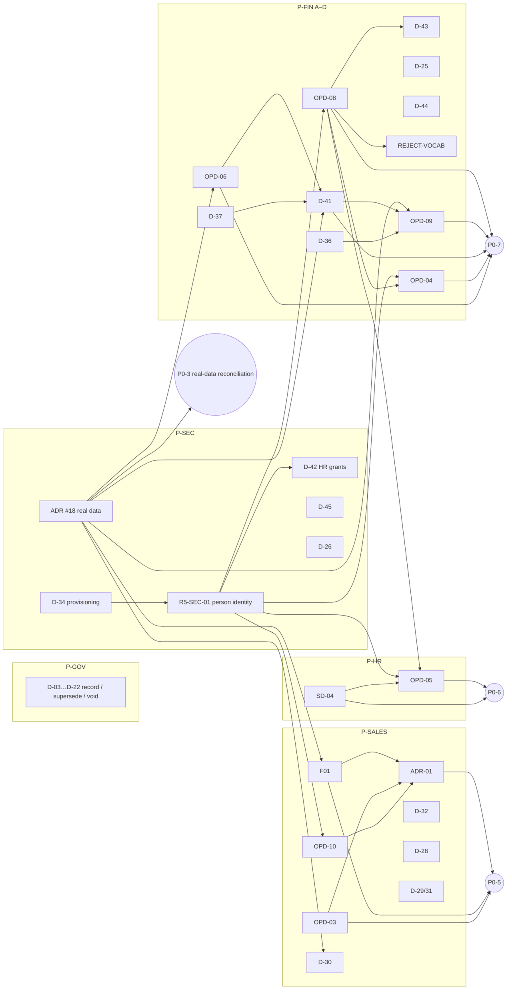

# R5 — Management dependency map

**This map invents no approval deadlines.** It shows:
- which decisions block which P0 / P1 items;
- which can be prepared in parallel;
- which must precede implementation or activation.

## 1. Dependency graph

Edge "X → Y" means: X must be decided (or its evidence produced) before Y can be decided meaningfully, or
before Y can be implemented. Both meanings are listed in the tables below.

## 2. Blockers by P0 item

| P0 | Decisions that block it | Must precede implementation | Must precede activation |
|---|---|---|---|
| P0-5 inventory safety | ADR-01, F01, OPD-03, OPD-10, D-32, D-28 | ADR-01, F01 (+ OPD-03 for reset / release) | All of them + P1-8 (legacy writer disable) + runtime evidence |
| P0-6 HR handover | OPD-05, SD-04, R5-SEC-01 | OPD-05, SD-04 | + HR real-account evidence |
| P0-7 financial execution | OPD-08, D-43, REJECT-VOCAB, D-41, OPD-06, OPD-09, D-36, OPD-04, R5-SEC-01 | Per command: OPD-08 (approve / reject), D-41 + OPD-06 (posting), OPD-09 + D-36 (commission), OPD-04 (refund) | + real-data parity (ADR #18) + Finance activation authority |
| P0-3 real-data reconciliation | ADR #18 | ADR #18 | — |
| P0-1 / P0-2 / P0-4 (residual) | D-34, D-42 (P0-1); E-3 (P0-2); column B sign-off (P0-4) | — | Security / Operations sign-off |

**Blocks real staging or reconciliation:** ADR #18 (privacy). Every real-data parity step (F01 coverage,
D-41 parity, OPD-06 source units, OPD-09 engine reconciliation, D-30 resolution report) waits on it.

## 3. What can be prepared in parallel

These packages have no decision dependency on each other and can be reviewed at the same time:
- **P-GOV** (D-03…D-22);
- **ADR #18**;
- **R5-SEC-01 + D-34**;
- **P-REPORT**;
- **P-BIAWIN** (except D-38, which follows D-41);
- **OPD-08 / D-43 / D-25 / D-44**.

## 4. Sequence of management approval meetings (recommendation; no dates)

Grouping keeps the required independent approvals separate:
- Finance, Security and Legal sign their own records;
- the refund package is never folded into payment approval.

| Meeting | Packages / decisions | Required independent sign-offs | Why this order |
|---|---|---|---|
| M1 — Governance and data access | P-GOV (D-03…D-22), ADR #18 | Human Owner; Security + Legal (privacy) | Unblocks every real-data evidence step; clears P1-6 |
| M2 — Identity and access | R5-SEC-01, D-34, D-42, D-45, D-26 | Security owner (separately), HR, Legal (privacy) | SoD for Finance, refunds, delegation and HR handover depends on it |
| M3 — Inventory authority | ADR-01, F01, OPD-03, OPD-10, D-32, D-28, D-29 / D-31, D-30 | Human Owner + Engineering (ADR-01); Sales, MIS, Finance | P0-5; F01 and D-30 may need M1 evidence first |
| M4a — Payment approval | OPD-08, D-43, D-25, D-44, REJECT-VOCAB | Finance; Legal (D-44) | P0-7 approve / reject |
| M4b — Ledger and money | D-41, OPD-06, D-37 | Finance (accounting authority) alone | Needs M1 real-data parity |
| M4c — Entitlements | OPD-09, D-36 | Finance + Product | After M4b (posting basis) |
| M4d — Refunds | OPD-04 | Finance + Product (independent of M4a); Legal for compensation | Separate by rule |
| M5 — Workforce | OPD-05, SD-04 | HR, Sales, Finance, Product | After M2 (person identity) |
| M6 — Services and reporting | P-BIAWIN, P-REPORT, OPD-02, D-40 | Product, Finance, MIS, Sales | Lowest coupling to P0 items |

## 5. Readiness ladder (all six steps are separate)

| Step | Meaning | Status for every OPEN decision today |
|---|---|---|
| 1. Decision evidence available | Facts needed to decide exist | PARTIAL (see each record's "Missing evidence") |
| 2. Ready for human review | Question, options and evidence are documented | YES for records marked READY FOR HUMAN REVIEW; NO for NEEDS FURTHER EVIDENCE |
| 3. Approved by authorized people | Signed record with verifiable evidence | **NO** (0 approvals) |
| 4. Engineering implementation complete | Commands / adapters exist | NO (R4 evaluators only) |
| 5. Runtime evidence verified | Real-environment / real-role evidence | NO |
| 6. Activation separately authorized | Flag or authority switch approved | NO |
